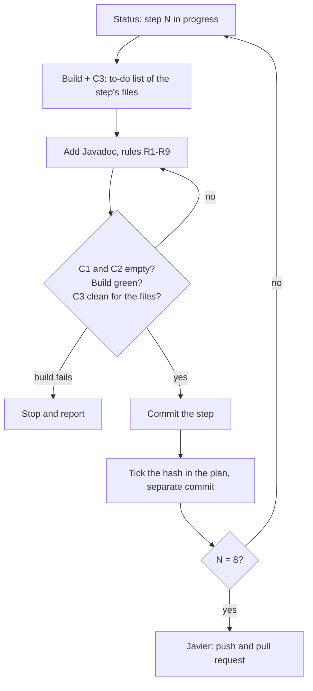

# Plan – Javadoc of C1 (#150)

| | |
|---|---|
| **Sub-issue** | #150 *C1: Javadoc in every class and public method (D-034)* · branch `feature/C1-javadoc` (created by Javier) |
| **Use case** | none: documentation only (kind: docs) of C1 Access and security (UC22, UC18, UC19) |
| **Rule** | D-034 and rule 18 of `AGENTS.md`: every class and public method has its Javadoc in English |
| **Specification** | #150 (checklist "Done when") |
| **Design** | none: no code changes. The style follows the Javadoc of C2 and C3 (examples below) |
| **Plan approved by** | Javier Villanueva Crespo, 21/11/2026 |

## What this plan does, in one paragraph
Add Javadoc comments, in English, to the classes and public members of C1 that do not have them, in
`common` (package `es.uclm.esi.iso2.common.access` and its subpackages), `server/c1-access` and `client/c1-access`.
**Only comments are added.** No code, no import, no blank line, no test, no `pom.xml` and no other comment changes.
Each step is one commit. The work is checked with three commands (section *Commands*), the same in every step.

## Questions and answers
All answered by Javier on 21/11/2026.
- **Q1:** Where is the plan? **A:** `doc/plans/C1-javadoc.md` (this file).
- **Q2:** Methods with `@Override`? **A:** no Javadoc: they inherit it from the interface, as in C2 and C3
  (`PatientService`). Every method of an interface (with or without an explicit `public`) gets a full Javadoc.
- **Q3:** Constructors? **A:** every `public` constructor gets a Javadoc (sentence + `@param`). The implicit default
  constructor (not written in the code) is out of scope: documenting it would need code.
- **Q4:** Public constants and enum values? **A:** one line `/** ... */` each.
- **Q5:** Tags? **A:** full Javadoc: a sentence, then `@param`, `@return` and `@throws` when they apply. An existing
  Javadoc that lacks tags is completed with the missing tags **without rewriting its text**; an existing complete
  Javadoc is not touched.
- **Q6:** Use case in the first sentence of a class or interface? **A:** yes, in parentheses, only in the class
  Javadoc that this plan writes (table *Use case of each class*). Existing class Javadoc is not changed.
- **Q7:** Links? **A:** `{@link Type}` for other classes and interfaces; `{@code ...}` for values, codes and names.
- **Q8:** Other comments? **A:** none is changed (`//` comments included). An existing Javadoc that looks out of date is
  not changed: it is reported (rule R12).
- **Q9:** `package-info.java` in `server/c1-access` and `client/c1-access`? **A:** not created (open question).
- **Q10:** How to check "only comments"? **A:** commands C1 and C2 below; both must print nothing.
- **Q11:** Build? **A:** `mvn -B verify` in every step with the filter of `agents/token-efficiency.md` (never `-q`);
  a full doclint pass in step 8. GitHub Pages is checked after the merge, outside the steps.
- **Q12:** Steps? **A:** eight steps, one commit each (`docs(C1): <what> (#150)`); the hash is ticked in this plan in
  a separate commit.
- **Q13:** `client/.../client/Main.java`? **A:** only reviewed, not changed. `common.shared` is out of scope.
- **Q14:** Tests? **A:** none are written or changed: there is no new code, so there is no hand-over to Adam. The
  existing tests must pass unchanged.

## Files
Only these files may change. Paths are relative to the root of the repository.

| Step | Files (all in `src/main/java`) |
|---|---|
| 1 | `common/src/main/java/es/uclm/esi/iso2/common/access/domain/`: `AuditLog.java`, `Permission.java`, `Role.java`, `UserAccount.java` |
| 2 | `common/src/main/java/es/uclm/esi/iso2/common/access/contracts/`: `AccessDeniedException.java`, `AuthenticationException.java`, `AuthenticationFailureReason.java`, `IAuditService.java`, `IAuthenticationService.java`, `IRoleManagementService.java` (also review `IAuditRecorder.java`, `IAuthenticatorSystem.java`) |
| 3 | `server/c1-access/src/main/java/es/uclm/esi/iso2/server/access/persistence/`: `IAuditLogRepository.java`, `IPermissionRepository.java`, `IRoleRepository.java`, `IUserAccountRepository.java`, `InMemoryPermissionRepository.java` (also review `InMemoryAuditLogRepository.java`, `InMemoryRoleRepository.java`, `InMemoryUserAccountRepository.java`) |
| 4 | `server/c1-access/src/main/java/es/uclm/esi/iso2/server/access/service/`: `AuditService.java`, `AuthenticationService.java`, `RoleManagementService.java`; and `.../server/access/integration/AuthenticatorSystemSimulator.java` (review) |
| 5 | `client/c1-access/src/main/java/es/uclm/esi/iso2/client/access/presentation/`: `IU_Login.java`, `IU_Welcome.java` |
| 6 | same folder: `IU_Audit.java` |
| 7 | same folder: `IU_ManageRoles.java` |
| 8 | any file of steps 1–7 that command C3 still reports; this plan |

"Review" means: run command C3; if it reports nothing for that file, the file is not changed.
Never change: `src/test`, any `pom.xml`, `client/c1-access/src/main/java/es/uclm/esi/iso2/client/Main.java`,
`common/src/main/java/es/uclm/esi/iso2/common/shared/`, any file of C2 or C3.

Number of items command C3 reported on 21/11/2026 (it is the to-do list of each file):
IU_Audit 4, IU_Login 4, IU_ManageRoles 10, IU_Welcome 20, AccessDeniedException 3, AuthenticationException 3,
AuthenticationFailureReason 4, IAuditService 3, IAuthenticationService 2, IRoleManagementService 9, AuditLog 6,
Permission 4, Role 7, UserAccount 7, IAuditLogRepository 4, IPermissionRepository 4, IRoleRepository 5,
IUserAccountRepository 5, InMemoryPermissionRepository 1, AuditService 2, AuthenticationService 2,
RoleManagementService 2. Total 111.

## Use case of each class
Only for the classes and interfaces that have **no** class Javadoc yet. "none" = it serves several use cases, so the
sentence has no parentheses (as `InMemoryPatientRepository` in C3).

| Class or interface | Use case |
|---|---|
| `IU_Login`, `AuthenticationService`, `IAuthenticationService`, `AuthenticationException`, `AuthenticationFailureReason` | UC22 |
| `IU_ManageRoles`, `RoleManagementService`, `Role`, `Permission`, `IRoleRepository`, `IPermissionRepository` | UC18 |
| `IU_Audit`, `AuditService`, `IAuditService`, `IAuditLogRepository` | UC19 |
| `IU_Welcome`, `AccessDeniedException`, `UserAccount`, `IUserAccountRepository` | none |

## Javadoc rules
- R1. English, present tense, third person: "Returns…", "Checks…", "Creates…". The first sentence says **what** it
  does and ends with a full stop. Describe only what the code does; never invent behaviour or requirements.
- R2. Class or interface: one sentence about what it is or does; when the table above gives a use case, put it in
  parentheses before the full stop, for example `Manages the demographic data of the patients (UC12).`
- R3. Method, constructor or interface method: the sentence, an empty ` *` line, then the tags in this order:
  `@param` (one per parameter, in the order of the signature), `@return` (if not `void` and not a constructor),
  `@throws` (one per exception in the `throws` clause). Tag text starts in lower case and has no final full stop,
  for example `@param username the username to check; it may be {@code null}`.
- R4. One-line form `/** Text. */` only for constants, enum values, and methods with no parameter, no return value
  and no `throws`.
- R5. No Javadoc on methods with `@Override`, on private members, or on the implicit default constructor.
- R6. Existing Javadoc: if it is complete, do not touch it. If it lacks tags, add only the missing tags (and, if it
  has no sentence, add one before the tags). Never rewrite its existing text.
- R7. `{@link Type}` for other classes and interfaces (only types that the file imports or that are in the same
  package); `{@code ...}` for literal values, codes, usernames and parameter names.
- R8. Place the Javadoc right above the declaration (above its annotations, if any), with the same indentation as the
  declaration; continuation lines start with ` * ` aligned under the first `*`. Lines at most 120 characters.
- R9. Never add or remove blank lines, code, imports or `//` comments. Never change a line that is not a Javadoc line.
- R10. Commits: Conventional Commits, author Javier's Git identity, no `Co-Authored-By` lines, no tool signatures.
- R11. Do not push and do not open a pull request (rule 8 of `AGENTS.md`).
- R12. If an existing Javadoc or comment looks out of date, do not change it: write one line in the report of the
  step, `OUTDATED: <path>:<line> – <why>`. It is moved to *Open questions* of this plan.

Examples already in the repository (copy the style, not the text):
`server/c3-patients/src/main/java/es/uclm/esi/iso2/server/patients/persistence/IPatientRepository.java` (interface
with full tags), `server/c3-patients/.../patients/service/PatientService.java` lines 19–23 and 38–44 (class with use
case; constructor with `@param`), `common/.../common/access/contracts/IAuthenticatorSystem.java` (methods with
`@param` and `@return`).

## Commands
Run them from the root of the repository in **Git Bash** (Windows). Each one prints its result at the end.

**C1 – only Javadoc lines changed** (must print nothing; compares the working tree with the last commit):
```bash
git diff -U0 HEAD -- '*.java' | grep -E '^[+-]' | grep -vE '^(\+\+\+|---) ' | grep -vE '^[+-][[:space:]]*(/\*\*|\*/|\*)'
```
**C2 – only allowed files changed** (must print nothing):
```bash
git status --porcelain | grep -vE ' (common/src/main/java/es/uclm/esi/iso2/common/access/|server/c1-access/src/main/java/|client/c1-access/src/main/java/es/uclm/esi/iso2/client/access/|doc/plans/C1-javadoc.md)'
```
**C3 – missing Javadoc of C1** (JDK `javadoc`, no Maven plugin; run after the build so that `target/classes` exist).
It prints one line per missing item; private members and the implicit constructors are filtered out. Use it at the
start of a step as the to-do list (look only at the lines of the step's files) and at the end to check that those
lines are gone:
```bash
javadoc -quiet -Xdoclint:missing,reference,syntax,html -Xmaxwarns 10000 -Xmaxerrs 10000 -d target/c1-doclint \
  -sourcepath "common/src/main/java;server/c1-access/src/main/java;client/c1-access/src/main/java" \
  -cp "common/target/classes;server/c1-access/target/classes" \
  es.uclm.esi.iso2.common.access es.uclm.esi.iso2.common.access.contracts es.uclm.esi.iso2.common.access.domain \
  es.uclm.esi.iso2.server.access.integration es.uclm.esi.iso2.server.access.persistence \
  es.uclm.esi.iso2.server.access.service es.uclm.esi.iso2.client.access.presentation \
  > /dev/null 2> target/c1-doclint.txt; echo "javadoc exit $?"
awk '/warning: |error: /{w=$0; getline n; if (n !~ /^[[:space:]]*private / && w !~ /default constructor/) print w}' target/c1-doclint.txt
```
(`mvn javadoc:javadoc -Ddoclint=missing` is not used: it stops at 100 warnings per module and skips modules whose
pages are already generated. `Main.java` is not in C3 because it imports C2 and C3.)

**Build** (must end with `BUILD SUCCESS` and `mvn exit 0`; never use `-q`):
```bash
mvn -B -ntp verify 2>&1 | grep -E "Tests run:|FAIL|ERROR|WARN|BUILD|coverage checks" | grep -v " -- in "; echo "mvn exit ${PIPESTATUS[0]}"
```

## Steps
For each step: (1) write it as *In progress* in *Status*; (2) run the build, then C3, and note the lines of the
step's files; (3) add the Javadoc following R1–R9; (4) C1 and C2 print nothing, the build is green and C3 prints no
line of the step's files; (5) `git add` the step's files and commit; (6) tick the step here with the hash and commit
this plan alone (`docs(C1): tick step N of the Javadoc plan (#150)`). If C1 or C2 print something, undo that change
(`git checkout -- <file>` only for the file you are editing) and redo it; if the build fails, stop and report.
Before step 1, this plan is committed alone: `docs(C1): plan of the Javadoc of C1 (#150)`.

- [x] 1. `common.access.domain` – `docs(C1): Javadoc of common.access.domain (#150)` (a8efa25)
- [x] 2. `common.access.contracts` – `docs(C1): Javadoc of common.access.contracts (#150)` (08cbaa8)
- [x] 3. server persistence – `docs(C1): Javadoc of the server persistence (#150)` (80345f3)
- [x] 4. server service and integration – `docs(C1): Javadoc of the server services (#150)` (1ff5964)
- [x] 5. `IU_Login` and `IU_Welcome` – `docs(C1): Javadoc of IU_Login and IU_Welcome (#150)` (90bbe47)
- [ ] 6. `IU_Audit` – `docs(C1): Javadoc of IU_Audit (#150)`
- [ ] 7. `IU_ManageRoles` – `docs(C1): Javadoc of IU_ManageRoles (#150)`
- [ ] 8. Final check – C1 against the whole branch (replace `HEAD` with `origin/develop...HEAD` in C1); C3 prints
  nothing; build green; fix any line C3 still shows (comments only); update *Status*.
  `docs(C1): final Javadoc check and plan status (#150)`
- [ ] Human step: push and open the pull request to `develop` with `Closes #150` (only when Javier asks).



## State for Adam
N/A: comments only; existing tests must pass unchanged.

## Cases to cover
N/A: comments only; existing tests must pass unchanged.

## Verification
- [ ] Every class and public method of `server/c1-access`, `client/c1-access` and `common.access` has its Javadoc in
  English (command C3 prints nothing), except the open question about `Main.main`.
- [ ] Only comments changed: C1 against `origin/develop...HEAD` prints nothing; no file in `src/test` or `pom.xml`.
- [ ] `mvn -B verify` is green with the same tests.
- [ ] After the merge to `develop`: the workflow *Publish the Javadoc* (`.github/workflows/javadoc.yml`) is green and
  the pages of the C1 classes show the new comments.

## Status
- **In progress:** nothing
- **Next step:** step 6 (`client/c1-access/.../presentation/IU_Audit.java`)
- **Open questions:**
  - `// Temporary: with UC18 this check uses the permissions of the role.` in `AuditService.java:17` and
    `IU_Welcome.java:19`: the code still checks the role name `SYSTEM_ADMINISTRATOR` (`AuditService.java:47`,
    `IU_Welcome.java:138`) although UC18 is done. Javier asks Ignacio; not changed here.
  - `package-info.java` for the packages of C1–C3 in `server` and `client`, if the team wants them.
  - `Main.main` (`client/c1-access/.../client/Main.java`) has no Javadoc and Q13 leaves `Main.java` unchanged, while
    #150 asks for every public method of `client-c1-access`.
  - Whether this change raises the PATCH version of C1 (D-036); asked to Ignacio. This plan changes no `pom.xml`.
- **Last update:** 21/11/2026, Javier
