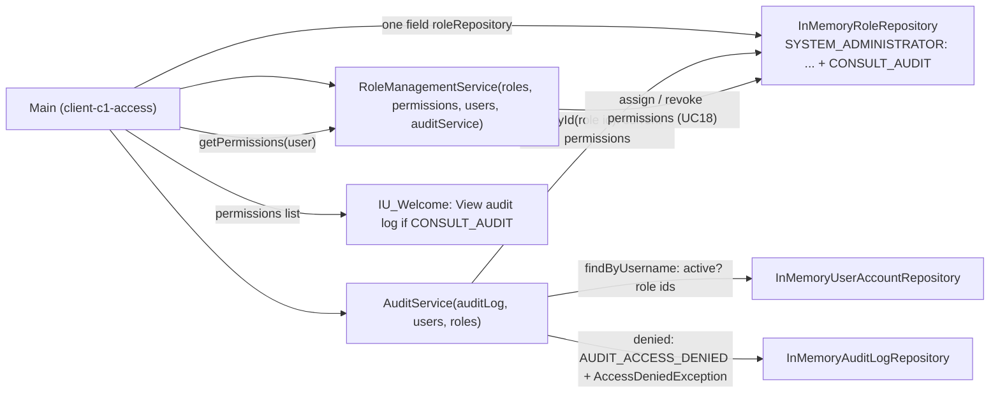

# Plan – Patch of C1 1.2.3 (#172)

| | |
|---|---|
| **Issue** | #172 *Patch of C1: permission CONSULT_AUDIT for the audit, instead of the role name (C1 v1.2.3)* · assigned to Javier · Milestone 3 · branch `feature/C1-patch-1.2.3` (created by Javier from `develop` `13d5a75`) |
| **Use case** | none: it is a PATCH of C1 (D-014, D-032). It touches the audit log of UC19 and the welcome screen; it adds no use case and does not change what any user can do |
| **Rule** | D-036: a finished component is changed in its own branch and pull request, approved by its owner (Ignacio). `server-c1-access` `1.2.3`, `client-c1-access` `1.2.4`; `common` does not change |
| **Specification** | #172; `doc/plans/UC18-server.md` (questions on `VIEW_AUDIT_LOG` and on UC19); `doc/plans/UC19-server.md` (who can consult the log) |
| **Design** | `doc/design/C1-server-design.png` (`AuditService`, `IRoleRepository`) · contracts: section 6 of #8 *C1. Access and security* (no contract changes) |
| **Plan approved by** | Javier Villanueva Crespo, 21/11/2026 (including the yes of rule 9 for the poms of step 4 and `agents/` of step 5) |

## Decisions already taken
- Ignacio, owner of C1, approved the patch to Javier (D-036, as Javier reports).
- UC18 made the permissions of each role editable, but `AuditService` and `IU_Welcome` still check the role name `SYSTEM_ADMINISTRATOR` (comments "Temporary" in `AuditService.java:20` and `IU_Welcome.java:22`). This patch replaces that check with the permission `CONSULT_AUDIT`.
- `VIEW_AUDIT_LOG` was removed on 06/11/2026 because the audit log checked the role, so the permission would have had no effect (`doc/plans/UC18-server.md:18-19`). The new permission is named `CONSULT_AUDIT`, as in #172.
- No contract of `common` changes. The new dependency `AuditService` → `IRoleRepository` is not in the C1 server diagram yet: the plan does not wait for it, and Javier tells Marcos and Denis (open question).
- The tests are Adam's (D-034, rule 17): **nobody in this plan writes, edits or deletes a test**. Adam adapts the broken tests in this same branch after the implementation, as in #116, #125 and #139.

## Questions and answers
All answered by Javier on 21/11/2026.
- **Q1 – Name of the permission and who has it.** **A:** `CONSULT_AUDIT`, description "Consult the audit log of the system activity". It is the last permission of `InMemoryPermissionRepository` and the last permission of the role `SYSTEM_ADMINISTRATOR` in `InMemoryRoleRepository`. No other role has it at start.
- **Q2 – How `AuditService` checks the permission.** `RoleManagementService` receives `AuditService` as its `IAuditRecorder` (`Main.java:38-45`), so `AuditService` cannot receive `RoleManagementService` without a cycle. The copy of the roles inside `UserAccount` carries no permissions (`InMemoryUserAccountRepository.java:11-12`). **A:** option A: `AuditService` also receives `IRoleRepository` (same module) and reads the current permissions of the roles of the user from it, as `currentRoles` of `RoleManagementService` does. `Main` keeps one `new InMemoryRoleRepository()` in a field and passes it to both services. `common` and its contracts are not touched.
- **Q3 – Constructor of `AuditService`.** **A:** the 2-argument constructor is **replaced** by one with 3 arguments `(auditLogRepository, userAccountRepository, roleRepository)`. The 2-argument constructor is not kept.
- **Q4 – What happens when the check fails.** **A:** the same as today: it registers `AUDIT_ACCESS_DENIED` with the target `audit` and throws `new AccessDeniedException(requester)`. A `null`, unknown or inactive user is denied. `CONSULT_AUDIT` is **not** protected like `MANAGE_ROLES` (an administrator may revoke it from every role; only `MANAGE_ROLES` keeps the rule of the last administrator).
- **Q5 – Welcome screen.** **A:** the button *View audit log* is shown with `hasPermission(permissions, CONSULT_AUDIT)`, like the other buttons. `ADMINISTRATOR_ROLE`, `isAdministrator` and the comment "Temporary" are removed. The Javadoc says the button is shown only to a user with `CONSULT_AUDIT`. The constructors with 2 and 3 arguments are **kept**, and their Javadoc says that, as they pass an empty list of permissions, they never show the button.
- **Q6 – Versions (rule 9).** **A:** `server-c1-access` `1.2.2-SNAPSHOT` → `1.2.3-SNAPSHOT` (`server/c1-access/pom.xml` and the managed version in `pom.xml`); `client-c1-access` `1.2.3-SNAPSHOT` → `1.2.4-SNAPSHOT` (1.2.3 was released in `v0.3.0`); `common` and the parent pom do not change. The poms go in their own commit. `doc/plans/C5-design.md` reserves `server-c1-access` 1.2.3 for `MANAGE_APPOINTMENTS`/`ORDER_PROCEDURES`: that patch would become 1.2.4; Ignacio decides it and is told; `C5-design.md` is **not** changed here.
- **Q7 – Documents.** **A:** this plan; `doc/plans/C1-patch-1.2.2.md` is not touched; `agents/architecture.md` (lines 9, 13, 41, 42) and `agents/components.md` (line 56) change **only the versions of C1**, in their own step; the class Javadoc of `InMemoryPermissionRepository` names `CONSULT_AUDIT`.
- **Q8 – Adam's tests and the build.** **A:** code first. After each code step, the filtered build; if exactly the tests listed for that step fail (and nothing else), the step is committed with the body "Tests pending Adam (#172)." Adam adapts the tests in this branch after step 6. A full green `mvn -B verify` is required before the pull request is opened.
- **Q9 – Steps and order.** **A:** 1 permission and role (server); 2 `AuditService` and `Main.java` in the **same** commit (`Main` is in the client module but creates `AuditService`, so the client does not compile without it); 3 `IU_Welcome`; 4 poms; 5 `agents/`; 6 hand over to Adam (no push).
- **Q10 – Design.** **A:** the plan does not wait for the C1 server diagram; Javier tells Marcos and Denis. Open question to Ignacio: the versions (Q6).

## Files
| File | Action | What | Step |
|---|---|---|---|
| `server/c1-access/src/main/java/es/uclm/esi/iso2/server/access/persistence/InMemoryPermissionRepository.java` | change | constant `CONSULT_AUDIT`, last in the list; class Javadoc (Q1, Q7) | 1 |
| `server/c1-access/src/main/java/es/uclm/esi/iso2/server/access/persistence/InMemoryRoleRepository.java` | change | `SYSTEM_ADMINISTRATOR` gets `CONSULT_AUDIT` as its last permission (Q1) | 1 |
| `server/c1-access/src/main/java/es/uclm/esi/iso2/server/access/service/AuditService.java` | change | 3-argument constructor, check by permission, "Temporary" removed (Q2–Q4) | 2 |
| `client/c1-access/src/main/java/es/uclm/esi/iso2/client/Main.java` | change | field `roleRepository` shared by `AuditService` and `RoleManagementService` (Q2) | 2 |
| `client/c1-access/src/main/java/es/uclm/esi/iso2/client/access/presentation/IU_Welcome.java` | change | button by permission, role check and "Temporary" removed, Javadoc (Q5) | 3 |
| `server/c1-access/pom.xml`, `pom.xml`, `client/c1-access/pom.xml` | change | versions (Q6) — **needs Javier's yes (rule 9)** | 4 |
| `agents/architecture.md`, `agents/components.md` | change | versions of C1 only (Q7) — **needs Javier's yes (rule 9)** | 5 |
| `doc/plans/C1-patch-1.2.3.md` | create/update | this plan | 6 |

No other file changes: no test, no file of `common`, C2, C3, C4 or C5, no `DECISIONS.md`, no `doc/plans/C5-design.md`.

## How the pieces fit


## How to work (read before step 1)
- Run every command from the root of the repository in **Git Bash** (Windows). One step = one commit. Before a step, write it as *In progress* in **Status**; after the commit, tick it here with the short hash and set *In progress* back to nothing.
- Line numbers in the steps are those of the file **before** the step (as on `develop` `13d5a75`); after an edit
  above, find the line by its content.
- Code, comments and Javadoc in English. Every class and every public constructor or method you create or change has Javadoc with `@param`, `@return` and `@throws` where they apply; methods with `@Override` get **no** Javadoc; private methods need none. Keep lines under 120 characters and the existing 4-space indentation.
- Never edit, create or delete a file under `src/test`. Never run `git push`, never create a branch, never use `--no-verify`, `reset --hard`, `clean` or `rebase`. Commits use the Git identity already configured, with no co-author line and no tool signature (rule 13).
- **Do not build before writing the code of the step.** The checks, after the code:
  - **Check A (main code of every module compiles, ~5 s):**
    `mvn -B -ntp -Dmaven.test.skip=true -Djacoco.skip=true verify 2>&1 | grep -E "ERROR|BUILD|SKIPPED"; echo "Exit code: ${PIPESTATUS[0]}"`
    It must print `BUILD SUCCESS` and `Exit code: 0`.
  - **Check B (tests, without coverage, ~40 s):**
    `mvn -B -ntp -fae -Djacoco.skip=true -Dmaven.test.failure.ignore=true verify 2>&1 | grep -E "Tests run:|FAIL|ERROR|BUILD|SKIPPED" | grep -v " -- in "; echo "Exit code: ${PIPESTATUS[0]}"`
  - **Full build (~45 s):**
    `mvn -B -ntp verify 2>&1 | grep -E "Tests run:|FAIL|ERROR|WARN|BUILD|coverage checks" | grep -v " -- in "; echo "Exit code: ${PIPESTATUS[0]}"`
  - All three were tested on this branch on 21/11/2026 before any change: green, 7 modules.
- **Allowed files:** before each commit run `git status --short` and `git diff --stat`; they must list only the files of the step (and this plan only in step 6). Anything else: stop and tell Javier.
- If a check gives a result different from the one written in the step (another test fails, a main class does not compile, another module fails), **stop**, do not commit, and write in **Status** what happened. Do not change a test to make it pass.

## Steps
- [x] **1. Permission `CONSULT_AUDIT` for the system administrator** (Q1, Q7). Module `server/c1-access`. `de4f6ce`
  - `InMemoryPermissionRepository.java`:
    - class Javadoc (lines 6-9) becomes:
      `Keeps the permissions in memory: each use case adds its own (MANAGE_ROLES of UC18, CONFIGURE_SYSTEM of UC17,`
      `CONFIGURE_INTEGRATIONS of UC20, MANAGE_PATIENTS of UC12 and CONSULT_AUDIT of UC19).`
    - after `MANAGE_PATIENTS` (line 25) add:
      ```java
      /** Permission of UC19 to consult the audit log of the system activity. */
      public static final Permission CONSULT_AUDIT =
              new Permission("CONSULT_AUDIT", "Consult the audit log of the system activity");
      ```
    - the list (lines 27-28) becomes `List.of(MANAGE_ROLES, CONFIGURE_SYSTEM, CONFIGURE_INTEGRATIONS, MANAGE_PATIENTS, CONSULT_AUDIT)` (split the line before 120 characters).
  - `InMemoryRoleRepository.java`: the permissions of `SYSTEM_ADMINISTRATOR` (lines 11-12) become
    `List.of(InMemoryPermissionRepository.MANAGE_ROLES, InMemoryPermissionRepository.CONFIGURE_SYSTEM, InMemoryPermissionRepository.CONFIGURE_INTEGRATIONS, InMemoryPermissionRepository.CONSULT_AUDIT)` (in that order, split over lines). The other roles do not change.
  - Checks: A (green) and B. **Expected in B:** `BUILD SUCCESS`; failures only in methods of `InMemoryPermissionRepositoryTest` (the list now has 5 permissions) and `InMemoryRoleRepositoryTest` (the row of `SYSTEM_ADMINISTRATOR`); every other module `Failures: 0, Errors: 0`.
  - Commit: `git add` the two files, then
    `git commit -m "fix(C1): permission CONSULT_AUDIT for the system administrator (#172)" -m "Tests pending Adam (#172)."`
- [ ] **2. `AuditService` checks `CONSULT_AUDIT`, and `Main` shares the repository of roles** (Q2, Q3, Q4). Modules `server/c1-access` and `client/c1-access`, one commit.
  - `AuditService.java`:
    - imports: add `es.uclm.esi.iso2.server.access.persistence.IRoleRepository` (between `IAuditLogRepository` and `IUserAccountRepository`) and `java.util.Objects` (after `java.util.List`).
    - class Javadoc becomes: `Records and consults audit log entries (UC19). Only an active user with the permission {@code CONSULT_AUDIT} in one of their roles can consult them; the permissions are read from the repository of roles, so a change made with UC18 applies at once.`
    - delete line 20 (`// Temporary: ...`) and line 21 (`ADMINISTRATOR_ROLE`); add `private static final String CONSULT_AUDIT = "CONSULT_AUDIT";` after `AUDIT_RESOURCE`.
    - add the field `private final IRoleRepository roleRepository;` after `userAccountRepository`.
    - replace the constructor with:
      ```java
      /**
       * Creates the audit service with the given repositories.
       *
       * @param auditLogRepository the repository for audit log entries
       * @param userAccountRepository the repository for user accounts
       * @param roleRepository the repository for roles, which holds the current permissions of each role
       */
      public AuditService(IAuditLogRepository auditLogRepository, IUserAccountRepository userAccountRepository,
              IRoleRepository roleRepository) {
          this.auditLogRepository = auditLogRepository;
          this.userAccountRepository = userAccountRepository;
          this.roleRepository = roleRepository;
      }
      ```
    - in `getActivityLog`, change only the condition: `if (!canConsultAudit(requester)) {` (the two lines inside stay: `register(requester, AUDIT_ACCESS_DENIED, AUDIT_RESOURCE);` and `throw new AccessDeniedException(requester);`).
    - replace the method `isActiveAdministrator` with:
      ```java
      private boolean canConsultAudit(String username) {
          UserAccount user = userAccountRepository.findByUsername(username);
          return user != null && user.isActive() && user.getRoles().stream()
                  .map(role -> roleRepository.findById(role.getId()))
                  .filter(Objects::nonNull)
                  .flatMap(role -> role.getPermissions().stream())
                  .anyMatch(permission -> CONSULT_AUDIT.equals(permission.getCode()));
      }
      ```
    - `register`, `nextId` and the other constants do not change.
  - `Main.java` (`client/c1-access/src/main/java/es/uclm/esi/iso2/client/Main.java`):
    - import `es.uclm.esi.iso2.server.access.persistence.IRoleRepository` (before `IUserAccountRepository`).
    - after the field `userAccountRepository` (line 37) add `private final IRoleRepository roleRepository = new InMemoryRoleRepository();` (it must be declared before `auditService`).
    - `auditService` becomes `new AuditService(new InMemoryAuditLogRepository(), userAccountRepository, roleRepository)`.
    - `roleManagementService` becomes `new RoleManagementService(roleRepository, new InMemoryPermissionRepository(), userAccountRepository, auditService)`.
    - nothing else in `Main` changes.
  - Checks: A (green: it proves that `Main` compiles) and B. **Expected in B:** `BUILD FAILURE`; in `server-c1-access` only test compilation errors, and only in `AuditServiceTest.java`, `AuditServiceIntegrationTest.java` and `RoleManagementServiceIntegrationTest.java` (the old 2-argument constructor); `client-c1-access` `SKIPPED`; every other module `Failures: 0, Errors: 0`.
  - Commit: `git add` the two files, then
    `git commit -m "fix(C1): the audit log checks the permission CONSULT_AUDIT instead of the role (#172)" -m "Tests pending Adam (#172)."`
- [ ] **3. `IU_Welcome` shows *View audit log* with `CONSULT_AUDIT`** (Q5). Module `client/c1-access`.
  - `IU_Welcome.java`:
    - class Javadoc becomes: `Displays the welcome screen with the options available for the logged user. Each button is only shown to a user with its permission; for example, View audit log only to a user with {@code CONSULT_AUDIT}.`
    - delete line 22 (`// Temporary: ...`) and line 23 (`ADMINISTRATOR_ROLE`); add `private static final String CONSULT_AUDIT = "CONSULT_AUDIT";` before `MANAGE_ROLES`.
    - Javadoc of the 2-argument constructor: add the sentence `It passes no action and an empty list of permissions, so it shows no other button.`
    - Javadoc of the 3-argument constructor, `@param onViewAudit`: `is run when the user presses <em>View audit log</em>; the button is only shown to a user with the permission {@code CONSULT_AUDIT}, and not at all if this is {@code null}. This constructor passes an empty list of permissions, so it never shows the button.`
    - line 136 becomes `if (onViewAudit != null && hasPermission(permissions, CONSULT_AUDIT)) {`.
    - delete the method `isAdministrator` (lines 173-175). Keep the import of `Role` (still used at line 128).
    - no signature, text, mnemonic or button order changes.
  - Checks: A (green) and the **full build** (last code step). **Expected in the full build:** `BUILD FAILURE` at the test compilation of `server-c1-access`, with errors only in the three test files of step 2; the modules after it are skipped. This is the expected state until Adam adapts the tests.
  - Commit: `git add` the file, then
    `git commit -m "fix(C1): the welcome screen shows View audit log with the permission CONSULT_AUDIT (#172)" -m "Tests pending Adam (#172)."`
- [ ] **4. Versions** (Q6). **Ask Javier for a yes before changing the poms (rule 9).**
  - `server/c1-access/pom.xml` line 15: `<version>1.2.3-SNAPSHOT</version>`.
  - `pom.xml` line 34 (managed version of `server-c1-access`): `<version>1.2.3-SNAPSHOT</version>`.
  - `client/c1-access/pom.xml` line 15: `<version>1.2.4-SNAPSHOT</version>`.
  - Nothing else: not `common`, not the parent version `0.4.0-SNAPSHOT`.
  - Check: A (green).
  - Commit: `git commit -m "build(C1): server-c1-access 1.2.3-SNAPSHOT and client-c1-access 1.2.4-SNAPSHOT for the patch (#172)"`
- [ ] **5. Versions in `agents/`** (Q7). **Ask Javier for a yes before changing `agents/` (rule 9).** Only the versions of C1:
  - `agents/architecture.md` line 9: `version 1.2.2-SNAPSHOT` → `version 1.2.3-SNAPSHOT`; line 13: `version 1.2.3-SNAPSHOT` → `version 1.2.4-SNAPSHOT`; lines 41-42: `1.2.2-SNAPSHOT after the patches #109 and #112` → `1.2.3-SNAPSHOT after the patches #109, #112 and #172`, and `1.2.3-SNAPSHOT after UC12-client` → `1.2.4-SNAPSHOT after UC12-client and #172`.
  - `agents/components.md` line 56: `C1 is at 1.2.2 (#109, #116)` → `C1 is at 1.2.3 in the server and 1.2.4 in the client (#109, #116, #172)`. The rest of the line is not changed.
  - No build (documents only).
  - Commit: `git commit -m "docs(C1): versions of the patch 1.2.3 in agents (#172)"`
- [ ] **6. Hand over to Adam.** Tick steps 1-5 with their hashes, fill in *State for Adam* (date and hashes) and **Status**, then
  `git commit -m "docs(C1): state of the patch 1.2.3 for Adam (#172)"`. **No push**: Javier pushes and tells Adam.

## State for Adam
To be completed in step 6. The code of the patch is in steps 1-3 (hashes above). Tests that need to be adapted in this branch (nothing else should fail):
- Do not compile (old 2-argument constructor of `AuditService`; the new one is `AuditService(IAuditLogRepository, IUserAccountRepository, IRoleRepository)`): `AuditServiceTest` (lines 42 and 166), `AuditServiceIntegrationTest` (line 29), `RoleManagementServiceIntegrationTest` (line 35).
- Expect the old list of permissions: `InMemoryPermissionRepositoryTest` (lines 35-39: now 5 permissions, `CONSULT_AUDIT` last), `InMemoryRoleRepositoryTest` (line 42: the administrator has `MANAGE_ROLES;CONFIGURE_SYSTEM;CONFIGURE_INTEGRATIONS;CONSULT_AUDIT`).
- Expect *View audit log* for an administrator by role (now it needs `CONSULT_AUDIT` in the list of permissions passed to `IU_Welcome`; the 2- and 3-argument constructors never show it): `IU_WelcomeTest` (about lines 67-100, 124-130, 158-164), `IU_WelcomeConfigureSystemTest` (61, 114), `IU_WelcomeConfigureIntegrationsTest` (68, 131-133), `IU_WelcomeManagePatientsTest` (74, 111, 139-143).
- In `AuditServiceTest`, the test roles have no permissions: with the new check, the administrator needs a role whose current version in the repository of roles has `CONSULT_AUDIT`.

## Cases to cover
Adam designs the table (rule 17); the agent does not invent expected results. Cases that the decisions of this plan define:
- `AuditService.getActivityLog`: active user whose role has `CONSULT_AUDIT` (allowed); active user without it (denied: `AUDIT_ACCESS_DENIED` with target `audit` and `AccessDeniedException`); inactive user with it (denied); unknown and `null` requester (denied); a user whose copy of the role has no permissions but whose role in the repository of roles has `CONSULT_AUDIT` (allowed); a role that is no longer in the repository of roles (ignored); `CONSULT_AUDIT` granted to another role with UC18 (allowed at once) and revoked from the administrator (denied at once).
- `InMemoryPermissionRepository`: five permissions, `CONSULT_AUDIT` last, with its description; `findByCode("CONSULT_AUDIT")`.
- `InMemoryRoleRepository`: only `SYSTEM_ADMINISTRATOR` has `CONSULT_AUDIT`, as its last permission.
- `IU_Welcome`: with and without `CONSULT_AUDIT` in the list; `onViewAudit` `null`; the 2- and 3-argument constructors; the order of the buttons does not change.
- Revoking `CONSULT_AUDIT` from every role is allowed (it is not protected like `MANAGE_ROLES`).

## Verification
- [ ] Every item of the checklist of #172 is done (permission, `AuditService`, `IU_Welcome`, the two "Temporary" comments removed, versions).
- [ ] No test file, no file of `common` and no file of other components changed (`git diff --stat develop...HEAD`).
- [ ] With the application running (`Main`), `admin` sees *View audit log* and can open the log; a user without `CONSULT_AUDIT` does not see it.
- [ ] `mvn -B verify` (full build) is green with Adam's tests, coverage included.
- [ ] The pull request (`Closes #172`) is approved by Ignacio (D-036).

## Status
- **In progress:** nothing
- **Next step:** step 2 (`AuditService.java` and `Main.java`, one commit). Step 1 is done in `de4f6ce`.
- **Open questions:**
  - Ignacio (versions, D-036): `doc/plans/C5-design.md` (lines 57 and 698) reserves `server-c1-access` 1.2.3 for `MANAGE_APPOINTMENTS`/`ORDER_PROCEDURES`; with this patch that one would be 1.2.4. Javier tells Ignacio, and also David if Ignacio is not available. `C5-design.md` is not changed here.
  - Marcos and Denis (design): `doc/design/C1-server-design.png` needs the dependency `AuditService` → `IRoleRepository`. No contract of `common` changes. Javier tells them; the plan does not wait.
  - `agents/components.md:56` says `common` is at 1.4.0-SNAPSHOT, while `common/pom.xml` says 1.5.0-SNAPSHOT; it is not changed in this patch (rule 2).
- **Last update:** 21/11/2026, Javier
