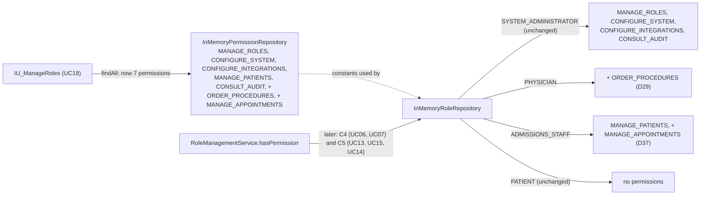

# Plan – Patch of C1 1.2.4 (#173)

| | |
|---|---|
| **Issue** | #173 (patch of C1 *Access and security* needed by C4 and C5, agreed in Meeting 9) · assigned to Javier · branch `feature/C1-patch-1.2.4` (created by Javier from `develop` `25b0b41`, after #172 was merged in pull request #176) |
| **Use case** | none: it is a PATCH of C1 (D-014, D-032). It adds no use case and does not change what any current user can do: no function checks the new permissions yet |
| **Rule** | D-036: a finished component is changed in its own branch and pull request, approved by its owner (Ignacio). `server-c1-access` `1.2.4`; `client-c1-access` stays at `1.2.4-SNAPSHOT`; `common` does not change |
| **Specification** | #173; D29 of `doc/AN-C4-DECISIONS.md` (lines 69-73: `ORDER_PROCEDURES`, Physician, UC06 and UC07); D37 of `doc/AN-C5-DECISIONS.md` (lines 92-96: `MANAGE_APPOINTMENTS`, Admissions staff, UC13, UC15 and UC14); `doc/plans/C5-design.md` lines 57 and 698 |
| **Design** | `doc/design/C1-server-design.png` (no change: `Permission` is an entity `(code, description)`, not an enum, `doc/plans/C5-design.md:57`) · contracts: section 6 of #8 *C1. Access and security* (no contract changes) |
| **Plan approved by** | Javier Villanueva Crespo, 22/11/2026 (including the yes of rule 9 for the poms of step 2 and `agents/` of step 3; step 1 waits for Ignacio) |

## Decisions already taken
- Agreed in Meeting 9 (22/11/2026), as #173 says. Criterion of David in that meeting: touch as little as possible, so that as little as possible breaks.
- The approval of Ignacio, owner of C1 (D-036), is **pending** (#173). The plan is written now, but **step 1 is not committed without Ignacio's yes** (Javier, 22/11/2026). See **Status**.
- `Role(id, name, description)` already gives an empty list of permissions (`common/src/main/java/es/uclm/esi/iso2/common/access/domain/Role.java:21-23`), so `PHYSICIAN` only needs the 4-argument constructor. No file of `common` changes.
- No production code checks `ORDER_PROCEDURES` or `MANAGE_APPOINTMENTS` yet: on `develop` they appear only in `doc/` (grep). C4 and C5 have no modules yet.
- The tests are Adam's (D-034, rule 17): **nobody in this plan writes, edits or deletes a test**. Adam adapts the broken tests in this same branch after the implementation, as in #172.
- `MANAGE_APPOINTMENTS` is for C5 (It5, `agents/components.md:15`), but #173 and Meeting 9 ask for it in this patch, so it is in scope.

## Questions and answers
All answered by Javier on 22/11/2026.
- **Q1 – Ignacio's approval.** #173 says "Pending approval by Ignacio" (D-036). **A:** write the plan now; step 1 is not committed until Ignacio says yes. It stays as an open question in **Status**.
- **Q2 – Order in the list of permissions.** **A:** at the end, after `CONSULT_AUDIT`: first `ORDER_PROCEDURES` (C4), then `MANAGE_APPOINTMENTS` (C5). As in #172, each patch adds at the end (`InMemoryPermissionRepository.java:31-32`), and indexes 0-4 do not move.
- **Q3 – Descriptions.** **A:** `ORDER_PROCEDURES`: "Order diagnostic and periodic follow-up procedures"; `MANAGE_APPOINTMENTS`: "Manage appointments, waitlists and daily schedules" (titles of UC06/UC07 in `doc/AN-C4-DECISIONS.md:28,44` and UC13/UC15/UC14 in `doc/AN-C5-DECISIONS.md:28,53,71`).
- **Q4 – Javadoc.** **A:** constants: "Permission of UC06 and UC07 to order …" and "Permission of UC13, UC15 and UC14 to manage …" (D29, D37). The class Javadoc names both, with the same pattern as today.
- **Q5 – Permissions of each role.** **A:** `PHYSICIAN` gets `List.of(ORDER_PROCEDURES)`; `ADMISSIONS_STAFF` gets `List.of(MANAGE_PATIENTS, MANAGE_APPOINTMENTS)` (the new one last). The names and descriptions of the roles and the class Javadoc of `InMemoryRoleRepository` do not change. `SYSTEM_ADMINISTRATOR` and `PATIENT` do not change.
- **Q6 – Versions (rule 9).** **A:** `server-c1-access` `1.2.3-SNAPSHOT` → `1.2.4-SNAPSHOT` (`server/c1-access/pom.xml:15` and the managed version in `pom.xml:34`). `client-c1-access` stays at `1.2.4-SNAPSHOT` (its code does not change, and 1.2.4 is not released: `v0.3.0` has `1.2.3`). `common` (`1.5.0-SNAPSHOT`) and the parent pom (`0.4.0-SNAPSHOT`) do not change. The poms go in their own commit.
- **Q7 – `agents/` (rule 9).** **A:** only versions, in their own step: `agents/architecture.md` lines 9 and 42, and `agents/components.md` line 56 (server 1.2.4, #173, and `common` 1.5.0-SNAPSHOT, as #173 asks; the pom is right: `common/pom.xml:14`).
- **Q8 – `doc/plans/C5-design.md`.** It says `1.2.3` for this patch (lines 57 and 698), which is out of date. **A:** it is **not** changed here; open question in **Status**.
- **Q9 – Adam's tests and the build.** **A:** code first. After the code step, check B; if exactly the tests listed in the step fail (and nothing else), the step is committed with the body "Tests pending Adam (#173)." Adam adapts the tests in this branch after step 4. A full green `mvn -B verify` is required before the pull request is opened.
- **Q10 – Steps.** **A:** 1 permissions, roles and Javadoc (server); 2 poms; 3 `agents/`; 4 hand over to Adam (no push).
- **Q11 – Visible effect in UC18.** `IU_ManageRoles` lists `findAll()`, so the administrator sees 7 permissions and can assign the new ones, although nothing checks them yet. **A:** accepted; it is written for Adam and for the manual check.

## Files
| File | Action | What | Step |
|---|---|---|---|
| `server/c1-access/src/main/java/es/uclm/esi/iso2/server/access/persistence/InMemoryPermissionRepository.java` | change | constants `ORDER_PROCEDURES` and `MANAGE_APPOINTMENTS`, last in the list; class Javadoc (Q2-Q4) | 1 |
| `server/c1-access/src/main/java/es/uclm/esi/iso2/server/access/persistence/InMemoryRoleRepository.java` | change | `PHYSICIAN` gets `ORDER_PROCEDURES`; `ADMISSIONS_STAFF` gets `MANAGE_APPOINTMENTS` after `MANAGE_PATIENTS` (Q5) | 1 |
| `server/c1-access/pom.xml`, `pom.xml` | change | version of `server-c1-access` (Q6) — **needs Javier's yes (rule 9)** | 2 |
| `agents/architecture.md`, `agents/components.md` | change | versions only (Q7) — **needs Javier's yes (rule 9)** | 3 |
| `doc/plans/C1-patch-1.2.4.md` | create/update | this plan | 4 |

No other file changes: no test, no file of `common`, of `client/c1-access`, of C2 or C3, no `DECISIONS.md`, no `doc/AN-*`, no `doc/plans/C5-design.md`.

## How the pieces fit


## How to work (read before step 1)
- **Before step 1: Ignacio must have approved the patch (Q1).** If **Status** still lists his approval as an open question, stop and ask Javier.
- Run every command from the root of the repository in **Git Bash** (Windows). One step = one commit. Before a step, write it as *In progress* in **Status**; after the commit, tick it here with the short hash and set *In progress* back to nothing.
- Line numbers in the steps are those of the file **before** the step (as on `develop` `25b0b41`); after an edit
  above, find the line by its content.
- Code, comments and Javadoc in English. Every public constant you create has a one-line Javadoc. Keep lines under 120 characters and the existing 4-space indentation.
- Never edit, create or delete a file under `src/test`. Never run `git push`, never create a branch, never use `--no-verify`, `reset --hard`, `clean` or `rebase`. Commits use the Git identity already configured, with no co-author line and no tool signature (rule 13).
- **Do not build before writing the code of the step.** The checks, after the code:
  - **Check A (main code of every module compiles, ~5 s):**
    `mvn -B -ntp -Dmaven.test.skip=true -Djacoco.skip=true verify 2>&1 | grep -E "ERROR|BUILD|SKIPPED"; echo "Exit code: ${PIPESTATUS[0]}"`
    It must print `BUILD SUCCESS` and `Exit code: 0`.
  - **Check B (tests, without coverage, ~40 s):**
    `mvn -B -ntp -fae -Djacoco.skip=true -Dmaven.test.failure.ignore=true verify 2>&1 | grep -E "Tests run:|FAIL|ERROR|BUILD|SKIPPED" | grep -v " -- in "; echo "Exit code: ${PIPESTATUS[0]}"`
  - **Full build (~45 s):**
    `mvn -B -ntp verify 2>&1 | grep -E "Tests run:|FAIL|ERROR|WARN|BUILD|coverage checks" | grep -v " -- in "; echo "Exit code: ${PIPESTATUS[0]}"`
  - Baseline: check B was run on this branch on 22/11/2026 before any change: `BUILD SUCCESS`, 10 reactor modules, all with `Failures: 0, Errors: 0` — `common` 52 tests, `server-c1-access` 168, `server-c2-configuration` 154, `server-c3-patients` 143, `client-c2-configuration` 124, `client-c3-patients` 112, `client-c1-access` 98.
- **Allowed files:** before each commit run `git status --short` and `git diff --stat`; they must list only the files of the step (and this plan only in step 4). Anything else: stop and tell Javier.
- If a check gives a result different from the one written in the step (another test fails, a main class does not compile, another module fails), **stop**, do not commit, and write in **Status** what happened. Do not change a test to make it pass.

## Steps
- [x] **1. Permissions `ORDER_PROCEDURES` for the physician and `MANAGE_APPOINTMENTS` for the admissions staff** (Q2-Q5). Module `server/c1-access`. **Only after Ignacio's yes (Q1).** — `1c5d863`
  - `InMemoryPermissionRepository.java`:
    - class Javadoc (lines 6-9) becomes:
      ```java
      /**
       * Keeps the permissions in memory: each use case adds its own (MANAGE_ROLES of UC18, CONFIGURE_SYSTEM of UC17,
       * CONFIGURE_INTEGRATIONS of UC20, MANAGE_PATIENTS of UC12, CONSULT_AUDIT of UC19, ORDER_PROCEDURES of UC06 and
       * UC07, and MANAGE_APPOINTMENTS of UC13, UC15 and UC14).
       */
      ```
    - after `CONSULT_AUDIT` (lines 27-29) add, with one empty line before each Javadoc:
      ```java
      /** Permission of UC06 and UC07 to order diagnostic and periodic follow-up procedures. */
      public static final Permission ORDER_PROCEDURES =
              new Permission("ORDER_PROCEDURES", "Order diagnostic and periodic follow-up procedures");

      /** Permission of UC13, UC15 and UC14 to manage appointments, waitlists and daily schedules. */
      public static final Permission MANAGE_APPOINTMENTS =
              new Permission("MANAGE_APPOINTMENTS", "Manage appointments, waitlists and daily schedules");
      ```
    - the list (lines 31-32) becomes:
      ```java
      private final List<Permission> permissions = List.of(MANAGE_ROLES, CONFIGURE_SYSTEM, CONFIGURE_INTEGRATIONS,
              MANAGE_PATIENTS, CONSULT_AUDIT, ORDER_PROCEDURES, MANAGE_APPOINTMENTS);
      ```
    - `findByCode` and `findAll` do not change.
  - `InMemoryRoleRepository.java`:
    - line 14 (`PHYSICIAN`) becomes:
      ```java
              new Role("PHYSICIAN", "Physician", "Requests and reviews tests and reports",
                      List.of(InMemoryPermissionRepository.ORDER_PROCEDURES)),
      ```
    - lines 15-16 (`ADMISSIONS_STAFF`) become:
      ```java
              new Role("ADMISSIONS_STAFF", "Admissions staff", "Registers patients and manages appointments",
                      List.of(InMemoryPermissionRepository.MANAGE_PATIENTS,
                              InMemoryPermissionRepository.MANAGE_APPOINTMENTS)),
      ```
    - `SYSTEM_ADMINISTRATOR` (lines 10-13), `PATIENT` (line 17), the class Javadoc (line 7) and the methods do not change.
  - Checks: A (green) and B. **Expected in B:** `BUILD SUCCESS` and `Exit code: 0`; `server-c1-access` `Tests run: 168, Failures: 4, Errors: 0`, and the 4 failures only in:
    - `InMemoryPermissionRepositoryTest`: `findAllReturnsManageRolesConfigureSystemConfigureIntegrationsManagePatientsAndConsultAudit` (expects 5 permissions, line 35) and `tc19s09aConsultAuditIsTheLastPermissionWithItsDescription` (expects 5 and `CONSULT_AUDIT` last, lines 62-64);
    - `InMemoryRoleRepositoryTest.onlyTheAdministratorAndTheAdmissionsStaffHavePermissions`: the rows `PHYSICIAN` (line 43) and `ADMISSIONS_STAFF` (line 44).

    Every other module `Failures: 0, Errors: 0` with the test counts of the baseline. If the number of failures is not 4, or another test fails, stop (see *How to work*).
  - Commit: `git add` the two files, then
    `git commit -m "fix(C1): permissions ORDER_PROCEDURES and MANAGE_APPOINTMENTS for C4 and C5 (#173)" -m "Tests pending Adam (#173)."`
- [x] **2. Version of `server-c1-access`** (Q6). **Ask Javier for a yes before changing the poms (rule 9).** — `9b9105d`
  - `server/c1-access/pom.xml` line 15: `<version>1.2.3-SNAPSHOT</version>` → `<version>1.2.4-SNAPSHOT</version>`.
  - `pom.xml` line 34 (managed version of `server-c1-access`, inside the `<dependency>` of lines 31-35): `<version>1.2.3-SNAPSHOT</version>` → `<version>1.2.4-SNAPSHOT</version>`.
  - Nothing else: not `client/c1-access/pom.xml` (stays `1.2.4-SNAPSHOT`), not `common`, not the parent version `0.4.0-SNAPSHOT`.
  - Check: A (green; the line `Building server-c1-access 1.2.4-SNAPSHOT` can be seen without the filter).
  - Commit: `git add` the two poms, then `git commit -m "build(C1): server-c1-access 1.2.4-SNAPSHOT for the patch (#173)"`
- [x] **3. Versions in `agents/`** (Q7). **Ask Javier for a yes before changing `agents/` (rule 9).** Only versions — `582feb0`:
  - `agents/architecture.md` line 9: `version 1.2.3-SNAPSHOT` → `version 1.2.4-SNAPSHOT`.
  - `agents/architecture.md` line 42: `1.2.3-SNAPSHOT after the patches #109, #112 and #172` → `1.2.4-SNAPSHOT after the patches #109, #112, #172 and #173`. The client part of the line (`1.2.4-SNAPSHOT after UC12-client and #172`) does not change.
  - `agents/components.md` line 56: `C1 is at 1.2.3 in the server and 1.2.4 in the client (#109, #116, #172); \`common\` is at 1.4.0-SNAPSHOT.` → `C1 is at 1.2.4 in the server and 1.2.4 in the client (#109, #116, #172, #173); \`common\` is at 1.5.0-SNAPSHOT.` The rest of the line is not changed.
  - No build (documents only).
  - Commit: `git add` the two files, then `git commit -m "docs(C1): versions of the patch 1.2.4 in agents (#173)"`
- [x] **4. Hand over to Adam.** (this commit) Tick steps 1-3 with their hashes, fill in *State for Adam* (date and hashes) and **Status**, then
  `git add doc/plans/C1-patch-1.2.4.md` and `git commit -m "docs(C1): state of the patch 1.2.4 for Adam (#173)"`. **No push**: Javier pushes and tells Adam.

## State for Adam
State of 22/11/2026, at the end of step 3. The code of the patch is in `1c5d863` (permissions and roles); the versions
are in `9b9105d` (poms) and `582feb0` (`agents/`). The main code compiles. The build with the tests gives
`server-c1-access` `Tests run: 168, Failures: 4, Errors: 0`, only in the four tests below; every other module passes
(52, 154, 143, 124, 112 and 98 tests). Tests to adapt in this branch (nothing else should fail):
- `InMemoryPermissionRepositoryTest` (lines 28-41 and 54-65): now 7 permissions, in this order: `MANAGE_ROLES`, `CONFIGURE_SYSTEM`, `CONFIGURE_INTEGRATIONS`, `MANAGE_PATIENTS`, `CONSULT_AUDIT`, `ORDER_PROCEDURES`, `MANAGE_APPOINTMENTS`. `CONSULT_AUDIT` is no longer last (it is at index 4); the DisplayNames "five permissions" and "CONSULT_AUDIT last" no longer hold.
- `InMemoryRoleRepositoryTest` (lines 40-56): `PHYSICIAN` has `ORDER_PROCEDURES`; `ADMISSIONS_STAFF` has `MANAGE_PATIENTS;MANAGE_APPOINTMENTS`; the DisplayName "Only the System administrator and the Admissions staff have permissions" no longer holds (only `PATIENT` has none).
- Not affected (checked on 22/11/2026): `tc19s10` of `InMemoryRoleRepositoryTest`, `RoleManagementServiceIntegrationTest`, `RoleManagementServiceHasPermissionIntegrationTest` and the tests of `client/c1-access` (they define their own `Permission`).
- Note (Q11): `IU_ManageRoles` (UC18) now lists 7 permissions, so the administrator can assign or revoke the new ones; nothing checks them yet.

## Cases to cover
Adam designs the table (rule 17); the agent does not invent expected results. Cases that the decisions of this plan define:
- `InMemoryPermissionRepository`: seven permissions in the order of Q2; `ORDER_PROCEDURES` and `MANAGE_APPOINTMENTS` with the descriptions of Q3; `findByCode("ORDER_PROCEDURES")` and `findByCode("MANAGE_APPOINTMENTS")` return the constants.
- `InMemoryRoleRepository`: the permissions of each of the four roles (Q5); only `PHYSICIAN` has `ORDER_PROCEDURES`; only `ADMISSIONS_STAFF` has `MANAGE_APPOINTMENTS`, after `MANAGE_PATIENTS`; `SYSTEM_ADMINISTRATOR` keeps `CONSULT_AUDIT` last.
- `hasPermission` of the seed users (TC-P-11) does not change for the permissions it already checks.

## Verification
- [ ] Every item of the checklist of #173 is done (two permissions, their roles, the class Javadoc, versions of `server-c1-access` and `agents/`, `common` 1.5.0 in `agents/components.md`).
- [ ] No test file, no file of `common` or `client/c1-access` and no file of other components changed (`git diff --stat develop...HEAD`).
- [ ] With the application running (`Main`), the administrator opens *Manage roles* and sees the 7 permissions, and the welcome screen of each seed user shows the same buttons as before.
- [ ] `mvn -B verify` (full build) is green with Adam's tests, coverage included.
- [ ] The pull request (`Closes #173`) is approved by Ignacio (D-036).

## Status
- **In progress:** nothing
- **Next step:** the four steps of the plan are done. Javier pushes `feature/C1-patch-1.2.4` and tells Adam, who
  adapts the tests of *State for Adam* in this branch. Then `mvn -B verify` must be green (coverage included) and the
  pull request (`Closes #173`) is opened and approved by Ignacio (D-036). Steps 1-3 are in `1c5d863`, `9b9105d` and
  `582feb0`.
- **Open questions:**
  1. Ignacio (owner of C1, D-036): approved the patch on 22/11/2026 (as Javier reports). His approval of the pull request is still needed.
  2. Ignacio and David (requirements): D29 (`doc/AN-C4-DECISIONS.md:70`) and D37 (`doc/AN-C5-DECISIONS.md:93`) are still *To confirm*; Meeting 9 agreed this patch.
  3. Ignacio (versions): `doc/plans/C5-design.md` (lines 57 and 698) says `server-c1-access` 1.2.3 for this patch; it is 1.2.4 because #172 used 1.2.3. `C5-design.md` is not changed here.
- **Last update:** 22/11/2026, Javier — step 3 committed in `582feb0` (versions of `server-c1-access` and `common` in `agents/architecture.md` and `agents/components.md`; main code compiles, `BUILD SUCCESS` with the tests skipped, as the step changes documents only).
