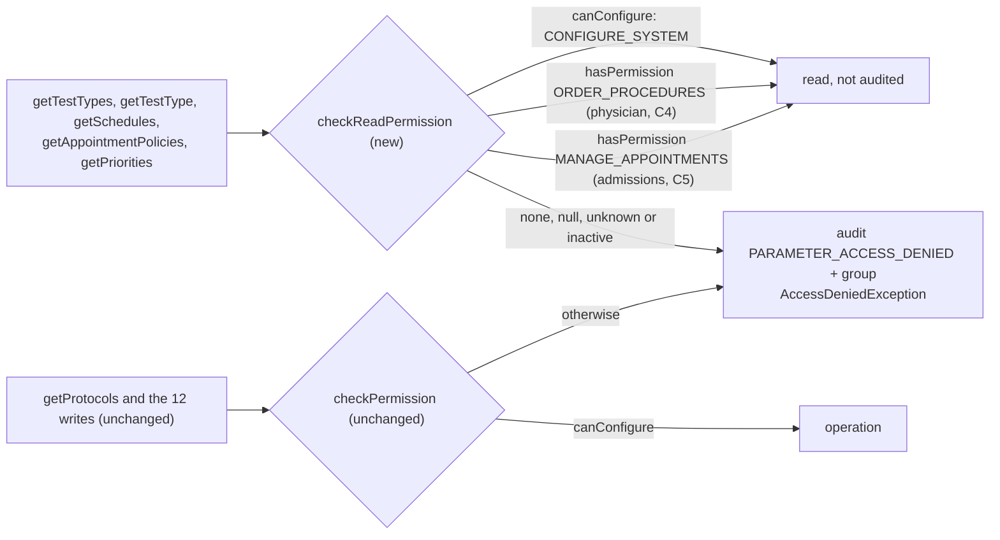

# Plan – Patch of the server of C2 1.1.2 (#174)

| | |
|---|---|
| **Issue** | #174 (patch of C2 *Configuration and integrations* needed by C4 and C5, agreed in Meeting 9) · assigned to Javier · branch `feature/C2-server-patch-1.1.2` (created by Javier from `develop` `ec60eb9`, after #173 was merged in pull request #180) |
| **Use case** | none: it is a PATCH of C2 (D-014, D-032). It adds no use case and does not change the signatures of `ISystemParameterService` |
| **Rule** | D-036: a finished component is changed in its own branch and pull request, approved by its owner. `server-c2-configuration` `1.1.2`; `client-c2-configuration` stays at `1.1.2-SNAPSHOT`; `common` does not change |
| **Specification** | #174; `doc/plans/C5-design.md` line 58 (Q11.2: the read methods of `SystemParameterService` must accept `ORDER_PROCEDURES` and `MANAGE_APPOINTMENTS`); the permissions of the patch of C1 1.2.4 (#173, `server/c1-access/src/main/java/es/uclm/esi/iso2/server/access/persistence/InMemoryPermissionRepository.java:33-38`) |
| **Design** | `doc/design/C2-server-design.puml` (no change: it does not name permissions, and the signatures of lines 52-66 do not change) · contracts: section 6 of the issue of C2 (no contract changes) |
| **Plan approved by** | Javier Villanueva Crespo, 22/11/2026 (including the yes of rule 9 for the poms of step 2 and `agents/` of step 3) |

## Decisions already taken
- Agreed in Meeting 9 (22/11/2026), as #174 says. Criterion of David in that meeting: touch as little as possible, so that as little as possible breaks.
- The permissions `ORDER_PROCEDURES` (role `PHYSICIAN`) and `MANAGE_APPOINTMENTS` (role `ADMISSIONS_STAFF`) already exist in C1 1.2.4 (#173, merged in pull request #180; `InMemoryRoleRepository.java:15-18`).
- `IRoleManagementService.hasPermission(username, permissionCode)` (`common/src/main/java/es/uclm/esi/iso2/common/access/contracts/IRoleManagementService.java:60-67`) returns `false` for a `null`, unknown or inactive user. D-036 asks each component to check permissions with it; C2 already does so in `IntegrationManagementService.java:178`.
- The tests are Adam's (D-034, rule 17): **nobody in this plan writes, edits or deletes a test**. The current tests are expected to stay green: the "physician" of the tests is `mgarcia` (`SystemParameterServiceTest.java:41`), who has no permission in `FakeRoleManagementService.java:31`. Adam adds the new cases in this branch after step 4.
- No module calls these reads outside C2 yet (grep on `develop` `ec60eb9`: only `common` and `server/c2-configuration`). The client of C2 does not change: the welcome screen shows *Configure parameters* only with `CONFIGURE_SYSTEM` (`client/c1-access/.../IU_Welcome.java:150`).

## Questions and answers
All answered by Javier on 22/11/2026.
- **Q1 – Name of the plan.** `doc/plans/C2-patch-1.1.2.md` already exists (patch of the client of C2, #124). **A:** `doc/plans/C2-server-patch-1.1.2.md`, as the branch.
- **Q2 – How the reads check the permission.** **A:** option A: a new private method `checkReadPermission(requester, group)` that lets the requester through if `canConfigure(requester)`, or `roleManagementService.hasPermission(requester, ORDER_PROCEDURES)`, or `roleManagementService.hasPermission(requester, MANAGE_APPOINTMENTS)`. Only the five reads use it. `checkPermission` and `canConfigure` (`SystemParameterService.java:261-277`) are not changed, so the twelve write methods stay exactly as they are.
- **Q3 – Denial and audit.** **A:** a denied read fails as today: it registers `PARAMETER_ACCESS_DENIED` with the group and throws `AccessDeniedException(requester)`. An allowed read is not audited (as today, TC17S-01).
- **Q4 – `getProtocols`.** It is a sixth read (`SystemParameterService.java:144`), not listed in #174 nor in `C5-design.md:58`. **A:** it is **not** relaxed; it keeps `checkPermission`. Open question in **Status**.
- **Q5 – Constants.** **A:** `private static final String ORDER_PROCEDURES` and `MANAGE_APPOINTMENTS`, right after `CONFIGURE_SYSTEM` (line 26), with the codes of C1.
- **Q6 – Javadoc.** **A:** the class Javadoc (lines 20-24) and the Javadoc of the new method. `ISystemParameterService.java:14` (in `common`, it also says `CONFIGURE_SYSTEM`) is **not** changed, so that `common` does not enter the patch. Open question in **Status**.
- **Q7 – Versions (rule 9).** **A:** `server-c2-configuration` `1.1.1-SNAPSHOT` → `1.1.2-SNAPSHOT` (`server/c2-configuration/pom.xml:15` and the managed version in `pom.xml:39`); `v0.3.0` released `1.1.1`. `client-c2-configuration` (`1.1.2-SNAPSHOT`, `pom.xml:54`), `common` (`1.5.0-SNAPSHOT`) and the parent pom (`0.4.0-SNAPSHOT`) do not change. The poms go in their own commit.
- **Q8 – `agents/` (rule 9).** **A:** only `agents/architecture.md` line 10, to `1.1.2-SNAPSHOT`, in its own step. `agents/components.md` is not changed.
- **Q9 – Steps, tests and build.** **A:** four steps: 1 `SystemParameterService`; 2 poms; 3 `agents/`; 4 hand over to Adam (no push). The code step is committed with the body "Tests pending Adam (#174)." If an unexpected test fails, or the coverage of a module goes below 80 % of lines or 70 % of branches (D-033), stop.

## Files
| File | Action | What | Step |
|---|---|---|---|
| `server/c2-configuration/src/main/java/es/uclm/esi/iso2/server/configuration/service/SystemParameterService.java` | change | two constants, class Javadoc, new private method `checkReadPermission`, the five reads call it (Q2-Q6) | 1 |
| `server/c2-configuration/pom.xml`, `pom.xml` | change | version of `server-c2-configuration` (Q7) — **needs Javier's yes (rule 9)** | 2 |
| `agents/architecture.md` | change | version only (Q8) — **needs Javier's yes (rule 9)** | 3 |
| `doc/plans/C2-server-patch-1.1.2.md` | create/update | this plan | 4 |

No other file changes: no test, no file of `common` (not `ISystemParameterService.java`), of `client/c2-configuration`, of C1 or C3, no `ConfigurationSeedData.java`, no `agents/components.md`, no `DECISIONS.md`, no `doc/design/`, no `doc/plans/C5-design.md`.

## How the pieces fit


## How to work (read before step 1)
- **Before step 1: this plan must say `Plan approved by` Javier.** If it still says `pending`, stop and ask Javier.
- Run every command from the root of the repository in **Git Bash** (Windows). One step = one commit. Before a step, write it as *In progress* in **Status**; after the commit, tick it here with the short hash and set *In progress* back to nothing.
- Line numbers in the steps are those of the file **before** the step (as on `develop` `ec60eb9`); after an edit above, find the line by its content.
- Code, comments and Javadoc in English. Keep lines under 120 characters and the existing 4-space indentation.
- Never edit, create or delete a file under `src/test`. Never run `git push`, never create a branch, never use `--no-verify`, `reset --hard`, `clean` or `rebase`. Commits use the Git identity already configured, with no co-author line and no tool signature (rule 13).
- **Do not build before writing the code of the step.** The checks, after the code:
  - **Check A (main code of every module compiles, ~5 s):**
    `mvn -B -ntp -Dmaven.test.skip=true -Djacoco.skip=true verify 2>&1 | grep -E "ERROR|BUILD|SKIPPED"; echo "Exit code: ${PIPESTATUS[0]}"`
    It must print `BUILD SUCCESS` and `Exit code: 0`.
  - **Check B (tests, without coverage, ~40 s):**
    `mvn -B -ntp -fae -Djacoco.skip=true -Dmaven.test.failure.ignore=true verify 2>&1 | grep -E "Tests run:|FAIL|ERROR|BUILD|SKIPPED" | grep -v " -- in "; echo "Exit code: ${PIPESTATUS[0]}"`
  - **Full build (tests and coverage, ~60 s):**
    `mvn -B -ntp verify 2>&1 | grep -E "Tests run:|FAIL|ERROR|WARN|BUILD|coverage checks" | grep -v " -- in "; echo "Exit code: ${PIPESTATUS[0]}"`
  - **Coverage of C2 (after a full build):**
    `awk -F, 'NR>1{bm+=$6;bc+=$7;lm+=$8;lc+=$9} END{printf "lines %.1f%% branches %.1f%%\n",100*lc/(lm+lc),100*bc/(bm+bc)}' server/c2-configuration/target/site/jacoco/jacoco.csv`
  - **Baseline** (measured on this branch on 22/11/2026, `ec60eb9`, before any change): check B and the full build give `BUILD SUCCESS`, `Exit code: 0`, 10 reactor modules, all with `Failures: 0, Errors: 0` and "All coverage checks have been met" — `common` 52 tests, `server-c1-access` 182, `server-c2-configuration` 154, `server-c3-patients` 143, `client-c2-configuration` 124, `client-c3-patients` 112, `client-c1-access` 98. Coverage of `server-c2-configuration`: lines 100.0 %, branches 96.6 %.
- **Allowed files:** before each commit run `git status --short` and `git diff --stat`; they must list only the files of the step (and this plan only in step 4). Anything else: stop and tell Javier.
- If a check gives a result different from the one written in the step (a test fails, a main class does not compile, a coverage check fails, another module fails), **stop**, do not commit, and write in **Status** what happened. Do not change a test to make it pass.

## Steps
- [ ] **1. The five reads accept `ORDER_PROCEDURES` and `MANAGE_APPOINTMENTS`** (Q2-Q6). Module `server/c2-configuration`, file `SystemParameterService.java`.
  - class Javadoc (lines 20-24) becomes:
    ```java
    /**
     * Manages the examination catalogue and the other parameters of the system (UC17). Every operation checks that the
     * requester is an active user with the permission {@code CONFIGURE_SYSTEM}, validates the data, deactivates instead
     * of deleting, and registers every change in the audit log. The reads of the test types, schedules, appointment
     * policies and priorities also accept an active user with {@code ORDER_PROCEDURES} (UC06 and UC07) or
     * {@code MANAGE_APPOINTMENTS} (UC13, UC15 and UC14).
     */
    ```
  - after line 26 (`private static final String CONFIGURE_SYSTEM = "CONFIGURE_SYSTEM";`) add:
    ```java
        private static final String ORDER_PROCEDURES = "ORDER_PROCEDURES";
        private static final String MANAGE_APPOINTMENTS = "MANAGE_APPOINTMENTS";
    ```
  - in each of the five reads, only the call `checkPermission(` becomes `checkReadPermission(`, with the same arguments; the rest of the method does not change:
    - `getTestTypes`, line 102: `checkReadPermission(requester, TEST_TYPE);`
    - `getTestType`, line 108: `checkReadPermission(requester, TEST_TYPE);`
    - `getSchedules`, line 172: `checkReadPermission(requester, SCHEDULE);`
    - `getAppointmentPolicies`, line 207: `checkReadPermission(requester, APPOINTMENT_POLICY);`
    - `getPriorities`, line 235: `checkReadPermission(requester, PRIORITY);`
  - `getProtocols` (line 144-146) and every write method keep `checkPermission` (Q4).
  - after `checkPermission` (it ends at line 267, before `canConfigure` at line 269) add, with one empty line before and after:
    ```java
        /**
         * Checks a read of the test types, schedules, appointment policies or priorities: the requester must be an active
         * user with {@code CONFIGURE_SYSTEM}, {@code ORDER_PROCEDURES} or {@code MANAGE_APPOINTMENTS}; if not, the denial
         * is registered with the group and the access is denied, as in {@link #checkPermission(String, String)}.
         *
         * @param requester the username of the user who reads; it may be {@code null}
         * @param group the group of parameters that is read, registered if the access is denied
         * @throws AccessDeniedException if the requester has none of the three permissions
         */
        private void checkReadPermission(String requester, String group) throws AccessDeniedException {
            if (!canConfigure(requester)
                    && !roleManagementService.hasPermission(requester, ORDER_PROCEDURES)
                    && !roleManagementService.hasPermission(requester, MANAGE_APPOINTMENTS)) {
                auditRecorder.register(requester, ACCESS_DENIED, group);
                throw new AccessDeniedException(requester);
            }
        }
    ```
  - `checkPermission` (lines 261-267), `canConfigure` (lines 269-277), the constructor and every other method do not change. No import changes.
  - Checks: A (green), then the full build and the coverage of C2. **Expected:** `BUILD SUCCESS`, `Exit code: 0`, every module `Failures: 0, Errors: 0` with the test counts of the baseline (`server-c2-configuration` 154), "All coverage checks have been met" in every module, and the coverage of C2 at or above 80 % of lines and 70 % of branches (some branches of the new method stay uncovered until Adam's tests). If anything else happens, stop (see *How to work*).
  - Commit: `git add` the file, then
    `git commit -m "fix(C2): reads of the parameters for ORDER_PROCEDURES and MANAGE_APPOINTMENTS (#174)" -m "Tests pending Adam (#174)."`
- [ ] **2. Version of `server-c2-configuration`** (Q7). **Ask Javier for a yes before changing the poms (rule 9).**
  - `server/c2-configuration/pom.xml` line 15: `<version>1.1.1-SNAPSHOT</version>` → `<version>1.1.2-SNAPSHOT</version>`.
  - `pom.xml` line 39 (managed version of `server-c2-configuration`, inside the `<dependency>` of lines 36-40): `<version>1.1.1-SNAPSHOT</version>` → `<version>1.1.2-SNAPSHOT</version>`.
  - Nothing else: not `client/c2-configuration/pom.xml` nor `pom.xml:54` (stay `1.1.2-SNAPSHOT`), not `common`, not the parent version `0.4.0-SNAPSHOT`.
  - Check: A (green; without the filter the line `Building server-c2-configuration 1.1.2-SNAPSHOT` can be seen).
  - Commit: `git add` the two poms, then `git commit -m "build(C2): server-c2-configuration 1.1.2-SNAPSHOT for the patch (#174)"`
- [ ] **3. Version in `agents/`** (Q8). **Ask Javier for a yes before changing `agents/` (rule 9).** Only the version:
  - `agents/architecture.md` line 10: `version 1.1.1-SNAPSHOT` → `version 1.1.2-SNAPSHOT`. The rest of the line and line 16 (client, `1.1.2-SNAPSHOT`) do not change.
  - No build (documents only).
  - Commit: `git add agents/architecture.md`, then `git commit -m "docs(C2): version of the server patch 1.1.2 in agents (#174)"`
- [ ] **4. Hand over to Adam.** Tick steps 1-3 with their hashes, fill in *State for Adam* (date, hashes and the results of the full build of step 1) and **Status**, then
  `git add doc/plans/C2-server-patch-1.1.2.md` and `git commit -m "docs(C2): state of the server patch 1.1.2 for Adam (#174)"`. **No push**: Javier pushes and tells Adam.

## State for Adam
To be filled in at step 4. What changes for the tests:
- The five reads (`getTestTypes`, `getTestType`, `getSchedules`, `getAppointmentPolicies`, `getPriorities`) now also let through an active user with `ORDER_PROCEDURES` or `MANAGE_APPOINTMENTS`. `getProtocols` and the twelve writes still need `CONFIGURE_SYSTEM`.
- Expected not affected: TC17S-01 to TC17S-07 and the rest of `SystemParameterServiceTest`, because `mgarcia` has no permission in `FakeRoleManagementService` (line 31). `FakeRoleManagementService` has no user with `ORDER_PROCEDURES` or `MANAGE_APPOINTMENTS`, so new cases need new users there (Adam decides).

## Cases to cover
Adam designs the table (rule 17); the agent does not invent expected results. Cases that the decisions of this plan define (#174, Q2-Q4):
- An active user with `ORDER_PROCEDURES` only: each of the five reads returns the data; nothing is audited.
- An active user with `MANAGE_APPOINTMENTS` only: the same.
- Those two users on `getProtocols` and on each write: `AccessDeniedException`, audited with `PARAMETER_ACCESS_DENIED` and the group.
- An inactive user with `ORDER_PROCEDURES` or `MANAGE_APPOINTMENTS`, an unknown user and a `null` requester on a read: `AccessDeniedException`, audited with the group.
- A user with `CONFIGURE_SYSTEM` (admin, `lmartin`): the reads and writes behave as before.
- `getTestType` with an unknown id by a user with `ORDER_PROCEDURES`: the same `ValidationException` as for the administrator.

## Verification
- [ ] The five read methods accept a user with `ORDER_PROCEDURES` or `MANAGE_APPOINTMENTS`, as well as `CONFIGURE_SYSTEM`; the write methods stay as they are (#174, step 1).
- [ ] The tests of the read methods are updated (written by Adam).
- [ ] The version of `server-c2-configuration` goes up by PATCH, and the one in `agents/` (steps 2 and 3).
- [ ] No test file written by the agent, and no file of `common`, `client/c2-configuration` or other components changed (`git diff --stat develop...HEAD`).
- [ ] `mvn -B verify` (full build) is green with Adam's tests, coverage included.
- [ ] Pull request (`Closes #174`) approved by the owner of C2 (D-036).

## Status
- **In progress:** nothing
- **Next step:** step 1 in `SystemParameterService.java` (plan approved by Javier on 22/11/2026).
- **Open questions:**
  1. `getProtocols` (`SystemParameterService.java:144`) still needs `CONFIGURE_SYSTEM`; #174 and `doc/plans/C5-design.md:58` do not ask for it. If C4 or C5 need protocols, it will be another patch.
  2. The Javadoc of `ISystemParameterService` (`common/.../configuration/contracts/ISystemParameterService.java:14`) still says that every operation checks `CONFIGURE_SYSTEM`. It is not changed here so that `common` does not enter the patch (D-036).
- **Last update:** 22/11/2026, Javier — plan written, pending approval. Baseline measured on `ec60eb9`.
