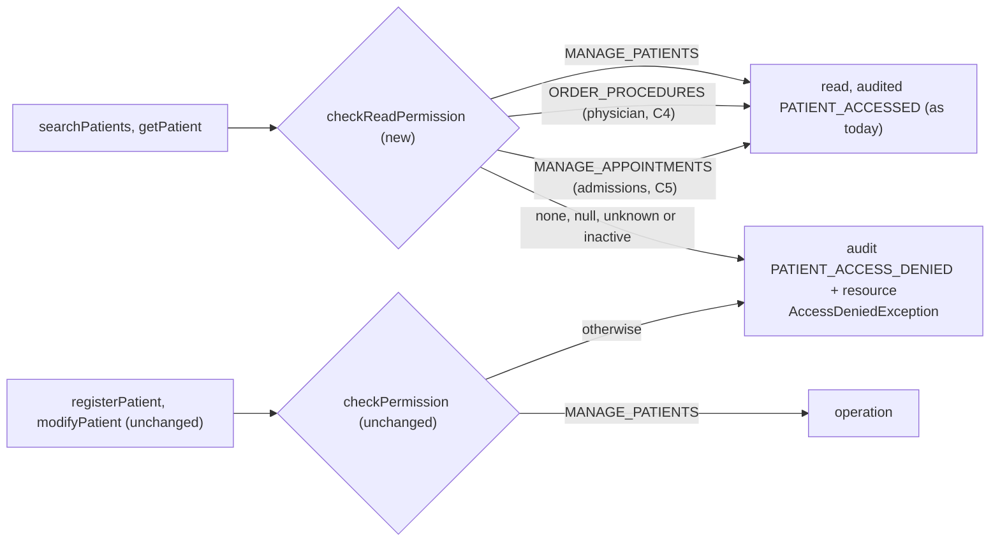

# Plan – Patch of C3 1.0.1 (#175)

| | |
|---|---|
| **Issue** | #175 *Patch of C3: read access to the patients for the physician and the admissions staff (C3 v1.0.1)* (needed by C4 and C5, agreed in Meeting 9) · assigned to Javier · branch `feature/C3-patch-1.0.1` (created by Javier from `develop` `ec60eb9`, after #173 was merged in pull request #180) |
| **Use case** | none: it is a PATCH of C3 (D-014, D-032). It adds no use case and does not change the signatures of `IPatientService` |
| **Rule** | D-036: a finished component is changed in its own branch and pull request, approved by its owner. `server-c3-patients` `1.0.1`; `client-c3-patients` stays at `1.0.0-SNAPSHOT`; `common` does not change |
| **Specification** | #175; the permissions of the patch of C1 1.2.4 (#173, `server/c1-access/src/main/java/es/uclm/esi/iso2/server/access/persistence/InMemoryPermissionRepository.java:33-38`); D34 of `doc/AN-C4-DECISIONS.md` (lines 95-97: C4 reads the patient with `getPatient`, and the access is registered by C3) |
| **Design** | `doc/design/C3-server-design.puml` (no change: it does not name permissions, and the signatures do not change) · contracts: section 6 of the issue of C3 (no contract changes) |
| **Plan approved by** | Javier Villanueva Crespo, 22/11/2026 (including the yes of rule 9 for the poms of step 2 and `agents/` of step 3) |

## Decisions already taken
- Agreed in Meeting 9 (22/11/2026), as #175 says. Criterion of David in that meeting: touch as little as possible, so that as little as possible breaks.
- The permissions `ORDER_PROCEDURES` (role `PHYSICIAN`) and `MANAGE_APPOINTMENTS` (role `ADMISSIONS_STAFF`) already exist in C1 1.2.4 (#173, merged in pull request #180; `InMemoryRoleRepository.java:15-18`).
- `IRoleManagementService.hasPermission(username, permissionCode)` (`common/src/main/java/es/uclm/esi/iso2/common/access/contracts/IRoleManagementService.java`) returns `false` for a `null`, unknown or inactive user. D-036 asks each component to check permissions with it; C3 already does so in `PatientService.java:170`.
- The tests are Adam's (D-034, rule 17): **nobody in this plan writes, edits or deletes a test**. The current tests are expected to stay green: `FakeRoleManagementService.java:31-36` gives the new permissions to nobody (`mgarcia` and `jfernandez` have no permission, `admin` has only `MANAGE_ROLES`, `CONFIGURE_SYSTEM` and `CONFIGURE_INTEGRATIONS`). Adam adds the new cases in this branch after step 4.
- The client of C3 does not change: the welcome screen shows *Manage patients* only with `MANAGE_PATIENTS` (`client/c1-access/src/main/java/es/uclm/esi/iso2/client/access/presentation/IU_Welcome.java:162`). C4 and C5 have no modules yet.

## Questions and answers
All answered by Javier on 22/11/2026.
- **Q1 – Name of the plan.** **A:** `doc/plans/C3-patch-1.0.1.md`, the same name as the branch (as `C1-patch-1.2.4.md`). No plan of C3 has this name (the plan of C3 is `UC12-server.md`).
- **Q2 – How the reads check the permission.** **A:** a new private method `checkReadPermission(requester, resource)` that lets the requester through if `roleManagementService.hasPermission` is `true` for `MANAGE_PATIENTS`, `ORDER_PROCEDURES` or `MANAGE_APPOINTMENTS`. Only `searchPatients` (`PatientService.java:90`) and `getPatient` (`PatientService.java:98`) use it. `checkPermission` (`PatientService.java:168-174`) is not changed, so `registerPatient` and `modifyPatient` stay exactly as they are.
- **Q3 – Denial.** **A:** a denied read fails as today: it registers `PATIENT_ACCESS_DENIED` with the resource of today (`PATIENTS` in `searchPatients`, `resourceOf(patientId)` in `getPatient`, which is `PATIENT:<id>`, or `patients` if the id is `null`, `PatientService.java:184-186`) and throws `AccessDeniedException(requester)`.
- **Q4 – Allowed read.** **A:** it is still audited with `PATIENT_ACCESSED` (`PatientService.java:92` and `100`), also for the new permissions (#175, second criterion).
- **Q5 – `getPatient` with an id that does not exist.** **A:** as today for every allowed user: first the permission, then `existing()` (`PatientService.java:176-182`), which throws `ValidationException` "There is no patient with the id …" without auditing.
- **Q6 – Constants.** **A:** `private static final String ORDER_PROCEDURES` and `MANAGE_APPOINTMENTS`, right after line 24 (`MANAGE_PATIENTS`), with the codes of C1.
- **Q7 – Javadoc.** **A:** the class Javadoc (lines 18-22) and the Javadoc of the new method. `IPatientService.java:9-11` (in `common`, it also says that every operation needs `MANAGE_PATIENTS`) is **not** changed, so that `common` does not enter the patch; open question in **Status**. The client (`IU_ManagePatients.java:51`, `IU_Welcome.java:162`) is not changed.
- **Q8 – Versions (rule 9).** **A:** `server-c3-patients` `1.0.0-SNAPSHOT` → `1.0.1-SNAPSHOT` (`server/c3-patients/pom.xml:15` and the managed version in `pom.xml:44`); `v0.3.0` released `1.0.0` (`git show v0.3.0:pom.xml`, line 44). `client-c3-patients` (`1.0.0-SNAPSHOT`, `pom.xml:49`), `common` (`1.5.0-SNAPSHOT`) and the parent pom (`0.4.0-SNAPSHOT`) do not change. The poms go in their own commit.
- **Q9 – `agents/` (rule 9).** **A:** only `agents/architecture.md` line 11, to `1.0.1-SNAPSHOT`, in its own step. `agents/components.md` is not changed.
- **Q10 – Tests and build.** **A:** the code step is committed with the body "Tests pending Adam (#175)." If a test fails, or the coverage of a module goes below 80 % of lines or 70 % of branches (D-033; look at the JaCoCo report of C3), stop.
- **Q11 – Steps.** **A:** four steps: 1 `PatientService`; 2 poms; 3 `agents/`; 4 hand over to Adam (no push).

## Files
| File | Action | What | Step |
|---|---|---|---|
| `server/c3-patients/src/main/java/es/uclm/esi/iso2/server/patients/service/PatientService.java` | change | two constants, class Javadoc, new private method `checkReadPermission`, the two reads call it (Q2-Q7) | 1 |
| `server/c3-patients/pom.xml`, `pom.xml` | change | version of `server-c3-patients` (Q8) — **needs Javier's yes (rule 9)** | 2 |
| `agents/architecture.md` | change | version only (Q9) — **needs Javier's yes (rule 9)** | 3 |
| `doc/plans/C3-patch-1.0.1.md` | create/update | this plan | 4 |

No other file changes: no test, no file of `common` (not `IPatientService.java`), of `client/c3-patients` or `client/c1-access`, of C1 or C2, no `PatientSeedData.java`, no `agents/components.md`, no `DECISIONS.md`, no `doc/design/`.

## How the pieces fit


## How to work (read before step 1)
- **Before step 1: this plan must say `Plan approved by` Javier.** If it still says `pending`, stop and ask Javier.
- Run every command from the root of the repository in **Git Bash** (Windows). One step = one commit. Before a step, write it as *In progress* in **Status**; after the commit, tick it here with the short hash and set *In progress* back to nothing.
- Line numbers in the steps are those of the file **before** the step (as on `develop` `ec60eb9`); after an edit above, find the line by its content.
- Code, comments and Javadoc in English. Keep lines under 120 characters and the existing 4-space indentation.
- Never edit, create or delete a file under `src/test`. Never run `git push`, never create a branch, never use `--no-verify`, `reset --hard`, `clean` or `rebase`. Commits use the Git identity already configured, with no co-author line and no tool signature (rule 13).
- **Do not build before writing the code of the step.** The checks, after the code:
  - **Check A (main code of every module compiles, ~5 s):**
    `mvn -B -ntp -Dmaven.test.skip=true -Djacoco.skip=true verify 2>&1 | grep -E "ERROR|BUILD|SKIPPED"; echo "Exit code: ${PIPESTATUS[0]}"`
    It must print `BUILD SUCCESS` and `Exit code: 0`.
  - **Check B (tests, without coverage, ~40 s):**
    `mvn -B -ntp -fae -Djacoco.skip=true -Dmaven.test.failure.ignore=true verify 2>&1 | grep -E "Tests run:|FAIL|ERROR|BUILD|SKIPPED" | grep -v " -- in "; echo "Exit code: ${PIPESTATUS[0]}"`
  - **Full build (tests and coverage, ~60 s):**
    `mvn -B -ntp verify 2>&1 | grep -E "Tests run:|FAIL|ERROR|WARN|BUILD|coverage checks" | grep -v " -- in "; echo "Exit code: ${PIPESTATUS[0]}"`
  - **Coverage of C3 (after a full build):**
    `awk -F, 'NR>1{bm+=$6;bc+=$7;lm+=$8;lc+=$9} END{printf "lines %.1f%% branches %.1f%%\n",100*lc/(lm+lc),100*bc/(bm+bc)}' server/c3-patients/target/site/jacoco/jacoco.csv`
  - **Baseline** (measured on this branch on 22/11/2026, `ec60eb9`, before any change): the full build gives `BUILD SUCCESS`, `Exit code: 0`, 10 reactor modules, all with `Failures: 0, Errors: 0` and "All coverage checks have been met" — `common` 52 tests, `server-c1-access` 182, `server-c2-configuration` 154, `server-c3-patients` 143, `client-c2-configuration` 124, `client-c3-patients` 112, `client-c1-access` 98. Coverage of `server-c3-patients`: lines 100.0 %, branches 100.0 %.
- **Allowed files:** before each commit run `git status --short` and `git diff --stat`; they must list only the files of the step (and this plan only in step 4). Anything else: stop and tell Javier.
- If a check gives a result different from the one written in the step (a test fails, a main class does not compile, a coverage check fails, another module fails), **stop**, do not commit, and write in **Status** what happened. Do not change a test to make it pass.

## Steps
- [x] **1. The two reads accept `ORDER_PROCEDURES` and `MANAGE_APPOINTMENTS`** (Q2-Q7). Module `server/c3-patients`, file `PatientService.java`. (`55b30db`)
  - class Javadoc (lines 18-22) becomes:
    ```java
    /**
     * Manages the demographic data of the patients (UC12). Every operation checks that the requester is an active user
     * with the permission {@code MANAGE_PATIENTS}, validates the data, never deletes, and registers every access and
     * change in the audit log (D26). The search and the read of a patient also accept an active user with
     * {@code ORDER_PROCEDURES} (UC06 and UC07) or {@code MANAGE_APPOINTMENTS} (UC13, UC15 and UC14). The server gives
     * each patient its id ({@code P-0001}, {@code P-0002}...).
     */
    ```
  - after line 24 (`private static final String MANAGE_PATIENTS = "MANAGE_PATIENTS";`) add:
    ```java
        private static final String ORDER_PROCEDURES = "ORDER_PROCEDURES";
        private static final String MANAGE_APPOINTMENTS = "MANAGE_APPOINTMENTS";
    ```
  - in the two reads, only the call `checkPermission(` becomes `checkReadPermission(`, with the same arguments; the rest of each method does not change:
    - `searchPatients`, line 90: `checkPermission(requester, PATIENTS);` → `checkReadPermission(requester, PATIENTS);`
    - `getPatient`, line 98: `checkPermission(requester, resourceOf(patientId));` → `checkReadPermission(requester, resourceOf(patientId));`
  - `registerPatient` (line 107) and `modifyPatient` (line 125) keep `checkPermission`.
  - after `checkPermission` (lines 168-174; it ends at line 174, before `existing` at line 176) add, with one empty line before and after:
    ```java
        /**
         * Checks a search or a read of a patient: the requester must be an active user with {@code MANAGE_PATIENTS},
         * {@code ORDER_PROCEDURES} or {@code MANAGE_APPOINTMENTS}; if not, the denial is registered with the resource and
         * the access is denied, as in {@link #checkPermission(String, String)}.
         *
         * @param requester the username of the user who reads; it may be {@code null}
         * @param resource the resource that is read, registered if the access is denied
         * @throws AccessDeniedException if the requester has none of the three permissions
         */
        private void checkReadPermission(String requester, String resource) throws AccessDeniedException {
            if (!roleManagementService.hasPermission(requester, MANAGE_PATIENTS)
                    && !roleManagementService.hasPermission(requester, ORDER_PROCEDURES)
                    && !roleManagementService.hasPermission(requester, MANAGE_APPOINTMENTS)) {
                auditRecorder.register(requester, ACCESS_DENIED, resource);
                throw new AccessDeniedException(requester);
            }
        }
    ```
  - `checkPermission` (lines 168-174), `existing`, `resourceOf`, the constructors and every other method do not change. No import changes.
  - Checks: A (green), then the full build and the coverage of C3. **Expected:** `BUILD SUCCESS`, `Exit code: 0`, every module `Failures: 0, Errors: 0` with the test counts of the baseline (`server-c3-patients` 143), "All coverage checks have been met" in every module, and the coverage of C3 at or above 80 % of lines and 70 % of branches (it goes below 100 % of branches: the `true` paths of `ORDER_PROCEDURES` and `MANAGE_APPOINTMENTS` stay uncovered until Adam's tests). If anything else happens, stop (see *How to work*).
  - Commit: `git add` the file, then
    `git commit -m "fix(C3): reads of the patients for ORDER_PROCEDURES and MANAGE_APPOINTMENTS (#175)" -m "Tests pending Adam (#175)."`
- [x] **2. Version of `server-c3-patients`** (Q8). **Ask Javier for a yes before changing the poms (rule 9).** (`0e10bc5`)
  - `server/c3-patients/pom.xml` line 15: `<version>1.0.0-SNAPSHOT</version>` → `<version>1.0.1-SNAPSHOT</version>`.
  - `pom.xml` line 44 (managed version of `server-c3-patients`, inside the `<dependency>` of lines 41-45): `<version>1.0.0-SNAPSHOT</version>` → `<version>1.0.1-SNAPSHOT</version>`.
  - Nothing else: not `client/c3-patients/pom.xml` nor `pom.xml:49` (stay `1.0.0-SNAPSHOT`), not `common`, not the parent version `0.4.0-SNAPSHOT`.
  - Check: A (green; without the filter the line `Building server-c3-patients 1.0.1-SNAPSHOT` can be seen).
  - Commit: `git add` the two poms, then `git commit -m "build(C3): server-c3-patients 1.0.1-SNAPSHOT for the patch (#175)"`
- [x] **3. Version in `agents/`** (Q9). **Ask Javier for a yes before changing `agents/` (rule 9).** Only the version: (`fa80460`)
  - `agents/architecture.md` line 11: `version 1.0.0-SNAPSHOT` → `version 1.0.1-SNAPSHOT`. The rest of the line and line 17 (client, `1.0.0-SNAPSHOT`) do not change.
  - No build (documents only).
  - Commit: `git add agents/architecture.md`, then `git commit -m "docs(C3): version of the server patch 1.0.1 in agents (#175)"`
- [x] **4. Hand over to Adam.** — commit `docs(C3): state of the patch 1.0.1 for Adam (#175)`.
  `git add doc/plans/C3-patch-1.0.1.md` and `git commit -m "docs(C3): state of the patch 1.0.1 for Adam (#175)"`. **No push**: Javier pushes and tells Adam.

## State for Adam
State of 22/11/2026, at the end of step 3. The code of the patch is in `55b30db` (`PatientService`); the versions are in `0e10bc5` (poms) and `fa80460` (`agents/`). The full build (`mvn -B -ntp verify`) is green: `BUILD SUCCESS`, no failures, all coverage checks met, `server-c3-patients` keeps its 143 tests, and its coverage is 100.0 % of lines and 97.5 % of branches. What changes for the tests:
- `searchPatients` and `getPatient` now also let through an active user with `ORDER_PROCEDURES` or `MANAGE_APPOINTMENTS`, and audit the read with `PATIENT_ACCESSED` as today. `registerPatient` and `modifyPatient` still need `MANAGE_PATIENTS`.
- Expected not affected: TC12S-01 to TC12S-09 and the rest of `PatientServiceTest` and `PatientSeedDataTest`. `FakeRoleManagementService` (lines 31-36) gives the new permissions to nobody: `mgarcia` and `jfernandez` still have no permission, so `assertDeniedInEveryOperation` (`PatientServiceTest.java:147-175`) still sees the four denials and TC12S-03 still passes.
- Note: in C1 the real physician now has `ORDER_PROCEDURES` (`InMemoryRoleRepository.java:15`), so the name of TC12S-03 ("a physician is denied in every operation") no longer matches the real roles; Adam decides whether to change it.
- New cases need new users in `FakeRoleManagementService`: one active user with `ORDER_PROCEDURES` only, one with `MANAGE_APPOINTMENTS` only, and an inactive one with one of them (Adam decides).

## Cases to cover
Adam designs the table (rule 17); the agent does not invent expected results. Cases that #175 and the decisions of this plan define (Q2-Q5):
- An active user with `ORDER_PROCEDURES` only: `searchPatients` and `getPatient` return the data, and each read is audited with `PATIENT_ACCESSED` and its resource.
- An active user with `MANAGE_APPOINTMENTS` only: the same.
- Those two users on `registerPatient` and `modifyPatient`: `AccessDeniedException`, audited with `PATIENT_ACCESS_DENIED` and the resource, and nothing is saved.
- An inactive user with `ORDER_PROCEDURES` or `MANAGE_APPOINTMENTS`, an unknown user and a `null` requester on a read: `AccessDeniedException`, audited with `PATIENT_ACCESS_DENIED` and the resource (`patients` or `PATIENT:<id>`).
- A user with `MANAGE_PATIENTS` (`lmartin`): the four operations behave as before.
- `getPatient` with an id that does not exist, or a `null` id, by a user with `ORDER_PROCEDURES`: the same `ValidationException` as for `lmartin`, with no audit entry.

## Verification
- [ ] `searchPatients` and `getPatient` accept a user with `ORDER_PROCEDURES` or `MANAGE_APPOINTMENTS`, as well as `MANAGE_PATIENTS`; `registerPatient` and `modifyPatient` still require `MANAGE_PATIENTS` (#175, step 1).
- [ ] Each read is still registered in the audit log, and a denied one is registered as today (#175, step 1).
- [ ] The tests of the reads are updated (written by Adam).
- [ ] The version of `server-c3-patients` goes up by PATCH, and the one in `agents/` (steps 2 and 3).
- [ ] No test file written by the agent, and no file of `common`, `client/c3-patients` or other components changed (`git diff --stat develop...HEAD`).
- [ ] `mvn -B verify` (full build) is green with Adam's tests, coverage included.
- [ ] Pull request (`Closes #175`) approved by the owner of C3 (D-036).

## Status
- **In progress:** nothing
- **Next step:** the four steps of the plan are done. Javier pushes `feature/C3-patch-1.0.1` and tells Adam, who adds the cases of *Cases to cover* in this branch. Then `mvn -B verify` must be green (coverage included) and the pull request (`Closes #175`) is opened and approved by the owner of C3 (D-036). Steps 1-3 are in `55b30db`, `0e10bc5` and `fa80460`.
- **Open questions:**
  1. The Javadoc of `IPatientService` (`common/src/main/java/es/uclm/esi/iso2/common/patients/contracts/IPatientService.java:9-11`) still says that every operation needs `MANAGE_PATIENTS`. It is not changed here so that `common` does not enter the patch (D-036).
- **Last update:** 22/11/2026, Javier — step 4 (hand over to Adam) done; steps 1-3 in `55b30db`, `0e10bc5` and `fa80460`. Full build green with the tests of the baseline.
