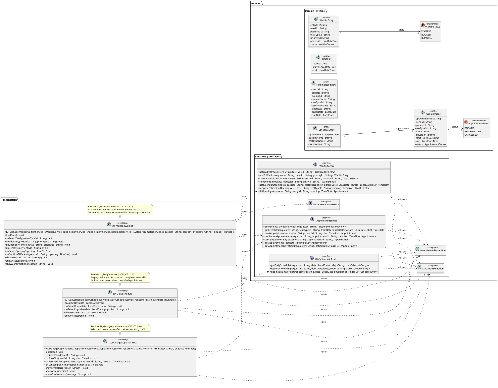

# Plan – C5 Appointment planning Design (#138)

> Plan for the Design discipline of Component C5 (*Appointment planning*: UC13, UC15, UC14), following
> [AGENTS.md](../../AGENTS.md) (D-025), [doc/plans/TEMPLATE.md](TEMPLATE.md), and the Visual Paradigm 18.1 XML
> round-trip precedent approved in [doc/plans/vpp-model-cleanup.md](vpp-model-cleanup.md) (#144).

| | |
|---|---|
| **Component issue** | #138 *C5. Appointment planning* (`Part of #138`; no separate design issue) · branch `feature/c5-design` |
| **Use cases & versions** | UC13 (#129, #130, #131; FR13, C5 `1.0.0`), UC15 (#132, #133, #134; FR15, C5 `1.1.0`), UC14 (#135, #136, #137; FR14, C5 `1.2.0`) · Product `v0.5.0` · Milestone 3 |
| **Specification & analysis** | #138 (§6), #129–#137, [doc/AN-C5-DECISIONS.md](../AN-C5-DECISIONS.md) (D35–D44), and C5 Analysis diagrams in `doc/ISO-Project.vpp` |
| **Design sources & precedent** | `doc/ISO-Project.vpp` (VP 18.1, D-017), [doc/design/README.md](../design/README.md), C1–C3 code in `common/`/`server/`/`client/`, C4 design (PR #168, #65), `DECISIONS.md` (D-008, D-015, D-016, D-017, D-022, D-023, D-024, D-025, D-027, D-029, D-030, D-032, D-035, D-036, D-040) |
| **Plan approved by** | Marcos Loro (20/11/2026) |

---

## Questions and design decisions

All open items from step 2, `doc/AN-C5-DECISIONS.md` (D37, D40–D44), and cross-component checks against the existing C1–C3 Java code and C4 VP design:

- **Q1 – Issue tracking, UC scope, and plan?**
  **A:** Link the design PR to `#138` (`Part of #138`, matching C4's PR #168 with `#65`); include all three use cases (`UC13`, `UC15`, `UC14`, per `AN-C5-DECISIONS.md` D35); write this plan (`doc/plans/C5-design.md`) first before editing `doc/xml_export/project.xml` (Marcos, 20/11/2026).
- **Q2 – Branch creation (`AGENTS.md` rule 7, D-001, D-015)?**
  **A:** The repository is currently on `develop` (`7490374`) and `feature/c5-design` does not exist yet. Marcos creates and checks out `feature/c5-design` (from `#138` / `develop`) and moves `#138` (or the C5 design task) to *In progress* on the project board (D-041) before Step 1 is committed. The agent never creates/switches branches or commits to `develop`.
- **Q3 – Fix needed design/contract gaps now vs defer?**
  **A:** Marcos instructed: fix real design gaps now rather than leaving "patch later" notes, and resolve open design choices for minimal friction during implementation (20/11/2026). Under D-036, fixes to **unimplemented C4** are applied directly in the VP design in this PR, whereas code patches to **already-released C1 and C2** (`v0.1.0`, `v0.2.0`) remain separate D-036 PATCH PRs approved by their component owners (listed explicitly below so implementation agents are not blocked).
- **Q4 – Service decomposition (1 monolithic service vs 3 cohesive services)?**
  **A:** **3 cohesive services**, 1-to-1 with Analysis `Control_*` and incremental component versions:
  - `IAppointmentService` / `AppointmentService` → `Control_ManageAppointments` (UC13, C5 `1.0.0`)
  - `IWaitlistService` / `WaitlistService` → `Control_ManageWaitlist` (UC15, C5 `1.1.0`), calling `IAppointmentService` (`«use»`) to realize the UC15 `<<include>>` UC13 booking flow without duplicating booking/slot rules (D42)
  - `IDailyScheduleService` / `DailyScheduleService` → `Control_DailySchedule` (UC14, C5 `1.2.0`)
  *Why less friction:* each UC implementation sub-issue (`UC13`, `UC15`, `UC14`) adds its own service cleanly without churning previously tested classes, keeping JaCoCo ≥ 80% line / 70% branch coverage (D-033) straightforward.
- **Q5 – Resolving D41 (cancelling an appointment returns `SchedulingNeed` to `PENDING`) and C4 contract gap?**
  **A:** Confirm **D41** and fix C4's VP design (`IClinicalOrderService` `dtPKn4WGAqBwARYk` & `ClinicalOrderService` `XBqWn4WGAqBwARom`) directly in this PR (C4 has zero Java code yet):
  1. Add `+markSchedulingNeedPending(requester: String, needId: String): void` (throws `AccessDeniedException, ValidationException`) backed by existing `ISchedulingNeedRepository`.
  2. Add `+getOrder(requester: String, orderId: String): ClinicalOrder` (throws `AccessDeniedException, ValidationException`) backed by existing `IClinicalOrderRepository.findById` — required by C5 because `SchedulingNeed` (`qoeKn4WGAqBwARXL`) only stores `orderId`, not `patientId`, `testTypeId`, `priorityId`, `creationDate`, or ordering `requester`.
  3. Keep C4's existing `+markSchedulingNeedBooked(requester: String, needId: String): void` (2 parameters) instead of adding `appointmentId` to `SchedulingNeed`: `Appointment.needId` already owns the link, preventing stale bidirectional IDs on cancel/rebook.
  4. Update C4's permission note on `IClinicalOrderService` so C5-facing operations (`getPendingSchedulingNeeds`, `getOrder`, `markSchedulingNeedBooked`, `markSchedulingNeedPending`) allow `MANAGE_APPOINTMENTS` in addition to `ORDER_PROCEDURES`.
  Re-export `C4-server-design.png` and `C4-client-design.png` alongside C5 PNGs so `.vpp` and `doc/design/*.png` stay in sync (D-017, D-025).
- **Q6 – Resolving D44 (UC14 worklists "per room or per physician")?**
  **A:** `#135`, `#136`, `#137`, and `#138` all require worklists per room **and** per physician. Copy `ClinicalOrder.requester` (the ordering physician already recorded by C4 per `AN-C4 D31` and PR #168) onto `Appointment.physician: String` at booking time. `IDailyScheduleService` exposes both `getRoomWorklist(requester, date, room)` and `getPhysicianWorklist(requester, date, physician)`. *Why less friction:* satisfies every UC14 AC with zero extra C4/UI inputs and zero extra runtime lookups per appointment.
- **Q7 – Resolving D40, D42, D43 (entities vs computed/derived value objects) and Pending Needs display in `IU_ManageAppointments`?**
  **A:** Confirm **D40, D42, D43**:
  - Persisted `«entity»` classes: `Appointment` (`AppointmentStatus`: `BOOKED`, `RESCHEDULED`, `CANCELLED`) and `WaitlistEntry` (`WaitlistStatus`: `WAITING`, `BOOKED`, `REMOVED`). No `Slot`, `Room`, `Worklist`, or `DailySchedule` persisted entity; no deletions (status transitions only, D-022).
  - Non-persisted value/view DTOs in `common/Domain (entities)` (explicitly annotated as derived/not persisted in VP):
    - `TimeSlot(room, start, end)` — computed free slot / calendar opening (D40, D42).
    - `ScheduleEntry(appointment, patientName, testTypeName, preparation)` — derived UC14 row (D43).
    - `PendingNeedView(needId, orderId, patientId, patientName, testTypeId, testTypeName, priorityId, orderDate, dueDate)` — derived UC13/UC15 view returned by `IAppointmentService.getPendingSchedulingNeeds(requester)`. *Justification:* `#130` requires showing patient, test type, priority, and order date for each pending need, whereas C4's `SchedulingNeed` only holds `needId`, `orderId`, `dueDate`, `status`. Resolving the join once on the server keeps `IU_ManageAppointments` dependent **only** on `IAppointmentService` (no N+1 calls across 4 services or `instanceof DiagnosticOrder` in Swing; `priorityId` comes from `DiagnosticOrder.priorityId` or `TestType.priority` default for `FollowUpOrder`).
- **Q8 – Listing appointments in `IU_ManageAppointments` + `getAppointmentsOfPatient`?**
  **A:** Include both `getAppointments(requester: String): List<Appointment>` (for `IU_ManageAppointments` to show existing appointments for reschedule/cancel without forcing a patient filter first) and `getAppointmentsOfPatient(requester: String, patientId: String): List<Appointment>` (explicitly required by `#138` §6 and future C3 discharge / C6 patient portal).
- **Q9 – Waitlist priority ordering without `Priority.level`?**
  **A:** Actual C2 `common/.../domain/Priority.java` only has `(id, name, description, active)` — there is **no** numeric `level` field (contrary to `AN-C4 D28`). `ConfigurationSeedData.java` seeds `URGENT`, `PREFERENTIAL`, `ROUTINE` in rank order inside `InMemoryConfigurationRepository` (insertion-ordered `LinkedHashMap`). `WaitlistService` therefore orders `WAITING` entries by the index of `entry.priorityId` in `ISystemParameterService.getPriorities(requester)` ascending, then `addedAt` ascending.
- **Q10 – C2 `TestType`/`Schedule`/`Priority` hierarchy & C3 `IPatientService` permission?**
  **A:** Match C4 PR #168: reuse C2's actual flat domain classes (`TestType`, `Schedule`, `Priority`) in `common/Domain (entities)` rather than making them subclasses of `SystemParameter`. For C3, `ADMISSIONS_STAFF` already holds `MANAGE_PATIENTS` (`InMemoryRoleRepository.java` L14–15), so C5 calling `IPatientService.getPatient(requester, patientId)` works out of the box and C3 already logs `PATIENT_ACCESSED` (`AN-C5 D39`).
- **Q11 – Required D-036 follow-up code patches to finished components (OUTSIDE this design PR)?**
  **A:** Per D-036, finished components are patched in their own issues/branches/PRs approved by their owners — **do not edit Java code on `feature/c5-design`**:
  1. **C1 PATCH (`server-c1-access` `1.2.3`, owner Ignacio):** Add `MANAGE_APPOINTMENTS` to `InMemoryPermissionRepository` and grant it to `ADMISSIONS_STAFF` in `InMemoryRoleRepository` (D37; alongside `ORDER_PROCEDURES` on `PHYSICIAN` for C4). *Zero C1 VP diagram impact:* `Permission` (`juO8CoWGAqACKYER`) is an entity class `(code, description)`, not an enum.
  2. **C2 PATCH (`server-c2-configuration` `1.1.2`, C2 owner):** Relax `SystemParameterService` read methods (`getTestTypes`, `getTestType`, `getSchedules`, `getPriorities`, `getAppointmentPolicies`) so authenticated active users with clinical/scheduling permissions (`ORDER_PROCEDURES`, `MANAGE_APPOINTMENTS`) are not rejected with `AccessDeniedException` (currently `SystemParameterService.java` L101–277 requires `CONFIGURE_SYSTEM`, Admin-only); also seed `Schedule` entries in `ConfigurationSeedData.java` for all 6 catalogue rooms (`Room RX-1`, `Room CT-1`, `Room MRI-1`, `Room US-1`, `Room MG-1`, `Room DX-1` — currently only `"Room CT-1"` at L59–64). *Zero C2 VP diagram impact:* `ISystemParameterService` (`Qb.D84WGAqAAZC7Z`) signatures do not change.
- **Q12 – Repository return conventions & Java package mapping?**
  **A:** Match C1–C3 exact conventions:
  - Nullable returns (`Appointment`, `WaitlistEntry`, or `null` — not `Optional<T>`) on `findById`/`findWaitingByNeed`, backed by `LinkedHashMap` in `InMemory*Repository` (matching `IPatientRepository` and `IConfigurationRepository`).
  - Packages (D-032): `es.uclm.esi.iso2.common.appointments.{domain,contracts}`, `es.uclm.esi.iso2.server.appointments.{service,persistence}` (`server/c5-appointments`), `es.uclm.esi.iso2.client.appointments.presentation` (`client/c5-appointments`).
  - Package-private `AppointmentSeedData` (`«auxiliary»`) + `loadSeedData()` on `AppointmentService` and `WaitlistService` (unauthenticated, no audit, matching `PatientService`/`PatientSeedData`).
  - Domain entities are immutable with state-transition helpers (`Appointment.rescheduled(...)`, `Appointment.cancelled()`, `WaitlistEntry.withPriority(...)`, `WaitlistEntry.booked()`, `WaitlistEntry.removed()`); per C1–C4 VP style, `«entity»` boxes display typed private attributes only.

---

## Files

| File | Action | What |
|---|---|---|
| `doc/plans/C5-design.md` | create | This plan, design decisions, full PlantUML proposals, and step-by-step log |
| `doc/xml_export/project.xml` *(local untracked only)* | modify, then remove outside repo | Add C5 design model elements, C4 contract fix (`getOrder`, `markSchedulingNeedPending`, updated permission note), and `C5 Design Class Diagram Server` / `C5 Design Class Diagram Client` (plus adjusted C4 box heights); **never committed** (`vpp-model-cleanup.md` Q5) |
| `doc/ISO-Project.vpp` | update *(Marcos via VP 18.1)* | Re-imported clean project saved in Visual Paradigm 18.1 |
| `doc/design/C5-server-design.png` | create *(Marcos via VP 18.1)* | Exported C5 Server Design Class Diagram |
| `doc/design/C5-client-design.png` | create *(Marcos via VP 18.1)* | Exported C5 Client Design Class Diagram |
| `doc/design/C4-server-design.png` | update *(Marcos via VP 18.1)* | Re-exported with C4 `IClinicalOrderService`/`ClinicalOrderService` fixes |
| `doc/design/C4-client-design.png` | update *(Marcos via VP 18.1)* | Re-exported with C4 `IClinicalOrderService` fixes |
| `doc/design/README.md` | update *(if needed)* | Document any omitted C5 Swing/helper details consistent with C1–C3 table |

---

## Target model and diagram specification

### Package & Model Explorer structure (`doc/ISO-Project.vpp` / `project.xml`)

All new C5 elements live inside the existing canonical Design packages established in `#144` (reusing all existing C1–C4 Design IDs, package IDs, stereotype IDs, and primitive `<DataType>` IDs — **never** Analysis root class IDs):

- **Canonical VP Package IDs:** `common` (`lpVKHoWGAqBwAQx3`), `Domain (entities)` (`qksGHoWGAqBwAQ9x`), `Contracts (interfaces)` (`KnRGHoWGAqBwAQ.i`), `server` (`G0EmHoWGAqBwAQ_O`), `Service (control)` (`muyOHoWGAqBwARKa`), `Persistence` (`vqDBHoWGAqBwARUP`), `Presentation` (`AsuT84WGAqAAZEIz`).
- **Reused existing VP Model IDs (read-only except C4 fix noted below):**
  - C1: `IRoleManagementService` (`WRIN7oWFS_lqMgzv`), `IAuditRecorder` (`wHH2HoWGAqBwARJT`), `AccessDeniedException` (`7Ywqi4WGAqBwARJ.`), `Permission` (`juO8CoWGAqACKYER`, untouched)
  - C2: `ISystemParameterService` (`Qb.D84WGAqAAZC7Z`), `TestType` (`vpab5b35b26ec800`), `Schedule` (`vpfc39f3bf426ace`), `Priority` (`vp16082e19d3fcdf`)
  - C3: `IPatientService` (`MwXSi4WGAqBwARBE`), `Patient` (`SKvii4WGAqBwAQ82`), `ValidationException` (`0KUyi4WGAqBwARB_`)
  - C4: `IClinicalOrderService` (`dtPKn4WGAqBwARYk` — **add** `getOrder`, `markSchedulingNeedPending`, update permission note `aIdun4WGAqBwARyh` / shape `aIdun4WGAqBwARyg`), `ClinicalOrderService` (`XBqWn4WGAqBwARom` — **add** `getOrder`, `markSchedulingNeedPending`), `ClinicalOrder` (`3jLyn4WGAqBwARPq`), `SchedulingNeed` (`qoeKn4WGAqBwARXL`), `SchedulingNeedStatus` (`qBtKn4WGAqBwARYH`)
- **Built-in `<DataType>` & Stereotype IDs:**
  - Primitive `<DataType>` IDs: `boolean` (`azUol4WGAqACjgkw`), `int` (`mzUol4WGAqACjgk1`), `long` (`mzUol4WGAqACjgk2`), `void` (`mzUol4WGAqACjgk4`).
  - Plain string Java types (`Type`/`ReturnType`/`BindedType`): `String`, `LocalDate`, `LocalTime`, `LocalDateTime`, `List`, `Map`, `Predicate`, `Runnable`.
  - Stereotype IDs: `entity` (`SJo8CoWGAqACKYB.`), `enumeration` (`6vJFEYWGAqBwAQu5`), `Interface` (`ZPt17oWFS_lqMgyl`), `Exception` (`hD4lEYWGAqBwAQwA`), `control` (`hGscCoWGAqACKX.Q`), `boundary` (`40NsCoWGAqACKX9G`), `auxiliary` (`uNV_Z4WGAqAAZBf6`), `throw` (`ztwVEYWGAqBwAQ07`), `use` (`p4I.HoWGAqBwARQx`).
- **VP diagram rendering conventions (C5 Server & Client):**
  - **Reused C1–C4 external interfaces:** In both C5 VP diagrams, reused interfaces (`IRoleManagementService`, `IAuditRecorder`, `ISystemParameterService`, `IPatientService`, `IClinicalOrderService`) render as **collapsed boxes** inside `common/Contracts (interfaces)` pointing to their existing shared VP model IDs (avoiding clutter from 30+ external operations). The PlantUML block below highlights the 4 C5-used methods on `IClinicalOrderService` solely to make the C4 additions (`getOrder`, `markSchedulingNeedPending`) and C5 call surface explicit for review, whereas VP's shared `dtPKn4WGAqBwARYk` holds all 7 operations (shown expanded on the C4 diagrams).
  - **Exception arrows (`«throw»`) & `<RaisedExceptions>`:** All `I*Service` and `*Service` operations declare `<RaisedExceptions>` in VP XML. To keep layouts readable (matching C3), `C5 Design Class Diagram Server` draws `Dependency «throw»` (`ztwVEYWGAqBwAQ07`) only from the 3 `*Service` classes (6 arrows instead of 12), while `C5 Design Class Diagram Client` draws `«throw»` from the 3 `I*Service` interfaces (and `«use»` from `IU_*`) to `AccessDeniedException` and `ValidationException`.
  - **Nested generic check (`Map<String, List<ScheduleEntry>>`):** `IDailyScheduleService.getDailySchedule` uses a 2-level nested `TemplateTypeBindInfo`, which has no prior precedent in `project.xml`. Step 2 and Step 3 verify that VP 18.1 renders the inner `<ScheduleEntry>` cleanly on import; if VP truncates the nested generic, fall back to plain string `ReturnType="Map<String, List<ScheduleEntry>>"` (or a `RoomSchedule` wrapper returning `List<RoomSchedule>` if needed).

### 1. `common` → `Domain (entities)` (`es.uclm.esi.iso2.common.appointments.domain`)

| Class / Enum | Stereotype | Attributes / Literals | Notes |
|---|---|---|---|
| `Appointment` | `«entity»` | `-appointmentId: String`, `-needId: String`, `-patientId: String`, `-testTypeId: String`, `-room: String`, `-physician: String`, `-start: LocalDateTime`, `-end: LocalDateTime`, `-status: AppointmentStatus` | Persisted (D40). `physician` copies `ClinicalOrder.requester` at booking time (D44). Never deleted; status transitions only (D-022). |
| `AppointmentStatus` | `«enumeration»` | `BOOKED`, `RESCHEDULED`, `CANCELLED` | D40, D-022 |
| `WaitlistEntry` | `«entity»` | `-entryId: String`, `-needId: String`, `-patientId: String`, `-testTypeId: String`, `-priorityId: String`, `-addedAt: LocalDateTime`, `-status: WaitlistStatus` | Persisted (D42). Ordered by priority index in C2 `getPriorities()` then `addedAt` asc. Never deleted (D-022). |
| `WaitlistStatus` | `«enumeration»` | `WAITING`, `BOOKED`, `REMOVED` | D42, D-022 |
| `TimeSlot` | `«entity»` | `-room: String`, `-start: LocalDateTime`, `-end: LocalDateTime` | **Derived value object, not persisted** (D40, D42). Represents computed free slots and calendar openings. |
| `PendingNeedView` | `«entity»` | `-needId: String`, `-orderId: String`, `-patientId: String`, `-patientName: String`, `-testTypeId: String`, `-testTypeName: String`, `-priorityId: String`, `-orderDate: LocalDate`, `-dueDate: LocalDate` | **Derived query view, not persisted.** Enriches C4 `SchedulingNeed` with `ClinicalOrder`, `Patient`, and `TestType` for UC13/UC15 UI. |
| `ScheduleEntry` | `«entity»` | `-appointment: Appointment`, `-patientName: String`, `-testTypeName: String`, `-preparation: String` | **Derived query view, not persisted** (D43). Row in UC14 daily schedule and worklists. |

### 2. `common` → `Contracts (interfaces)` (`es.uclm.esi.iso2.common.appointments.contracts`)

All service operations take `requester: String` first and declare `<RaisedExceptions>` in VP XML:

- **`IAppointmentService` (`«Interface»`, UC13 — C5 `1.0.0`):**
  - `+getPendingSchedulingNeeds(requester: String): List<PendingNeedView>` — throws `AccessDeniedException, ValidationException` *(propagates checked `ValidationException` from `getOrder`/`getPatient`/`getTestType` enrichment lookups so implementation stays 1:1 with the contract)*
  - `+getFreeSlots(requester: String, testTypeId: String, fromDate: LocalDate, toDate: LocalDate): List<TimeSlot>` — throws `AccessDeniedException, ValidationException`
  - `+bookAppointment(requester: String, needId: String, slot: TimeSlot): Appointment` — throws `AccessDeniedException, ValidationException`
  - `+rescheduleAppointment(requester: String, appointmentId: String, newSlot: TimeSlot): Appointment` — throws `AccessDeniedException, ValidationException`
  - `+cancelAppointment(requester: String, appointmentId: String): Appointment` — throws `AccessDeniedException, ValidationException`
  - `+getAppointments(requester: String): List<Appointment>` — throws `AccessDeniedException`
  - `+getAppointmentsOfPatient(requester: String, patientId: String): List<Appointment>` — throws `AccessDeniedException, ValidationException`
- **`IWaitlistService` (`«Interface»`, UC15 — C5 `1.1.0`):**
  - `+getWaitlist(requester: String, testTypeId: String): List<WaitlistEntry>` — throws `AccessDeniedException, ValidationException`
  - `+addToWaitlist(requester: String, needId: String, priorityId: String): WaitlistEntry` — throws `AccessDeniedException, ValidationException`
  - `+changeWaitlistPriority(requester: String, entryId: String, priorityId: String): WaitlistEntry` — throws `AccessDeniedException, ValidationException`
  - `+removeFromWaitlist(requester: String, entryId: String): WaitlistEntry` — throws `AccessDeniedException, ValidationException`
  - `+getCalendarOpenings(requester: String, testTypeId: String, fromDate: LocalDate, toDate: LocalDate): List<TimeSlot>` — throws `AccessDeniedException, ValidationException`
  - `+proposePatientForOpening(requester: String, testTypeId: String, opening: TimeSlot): WaitlistEntry` — throws `AccessDeniedException, ValidationException` *(returns `null` if no suitable active waiting patient exists, handling `#133` empty-waitlist flow consistently with C1–C3 nullable convention)*
  - `+fillOpening(requester: String, entryId: String, opening: TimeSlot): Appointment` — throws `AccessDeniedException, ValidationException`
- **`IDailyScheduleService` (`«Interface»`, UC14 — C5 `1.2.0`):**
  - `+getDailySchedule(requester: String, date: LocalDate): Map<String, List<ScheduleEntry>>` — throws `AccessDeniedException, ValidationException`
  - `+getRoomWorklist(requester: String, date: LocalDate, room: String): List<ScheduleEntry>` — throws `AccessDeniedException, ValidationException`
  - `+getPhysicianWorklist(requester: String, date: LocalDate, physician: String): List<ScheduleEntry>` — throws `AccessDeniedException, ValidationException`
- **C4 Fix on `IClinicalOrderService` (`dtPKn4WGAqBwARYk`):**
  - **Add** `+getOrder(requester: String, orderId: String): ClinicalOrder` — throws `AccessDeniedException, ValidationException`
  - **Add** `+markSchedulingNeedPending(requester: String, needId: String): void` — throws `AccessDeniedException, ValidationException`

### 3. `server` (`es.uclm.esi.iso2.server.appointments.{service,persistence}`)

- **`Service (control)`:**
  - `AppointmentService` (`«control»`, realizes `IAppointmentService` & `Control_ManageAppointments (UC13)`): implements all 7 `IAppointmentService` ops + `+loadSeedData(): void`. Uses `IAppointmentRepository`, `AppointmentSeedData`, `IClinicalOrderService`, `IPatientService`, `ISystemParameterService`, `IRoleManagementService`, `IAuditRecorder`. Throws `AccessDeniedException`, `ValidationException`.
  - `WaitlistService` (`«control»`, realizes `IWaitlistService` & `Control_ManageWaitlist (UC15)`): implements all 7 `IWaitlistService` ops + `+loadSeedData(): void`. Uses `IWaitlistRepository`, `AppointmentSeedData`, `IAppointmentService` (`<<include>>` UC13), `IClinicalOrderService`, `IPatientService`, `ISystemParameterService`, `IRoleManagementService`, `IAuditRecorder`. Throws `AccessDeniedException`, `ValidationException`.
  - `DailyScheduleService` (`«control»`, realizes `IDailyScheduleService` & `Control_DailySchedule (UC14)`): implements all 3 `IDailyScheduleService` ops. Uses `IAppointmentRepository`, `IPatientService`, `ISystemParameterService`, `IRoleManagementService`, `IAuditRecorder`. Throws `AccessDeniedException`, `ValidationException`.
  - `AppointmentSeedData` (`«auxiliary»`, package visibility): `~appointments(): List<Appointment>`, `~waitlistEntries(): List<WaitlistEntry>`.
  - *(Private helpers such as `checkPermission`, `validate`, `isSlotFree`, and DI constructors are omitted from VP boxes per [doc/design/README.md](../design/README.md) and shown via `«use»` arrows.)*
- **`Persistence`:**
  - `IAppointmentRepository` (`«Interface»`) & `InMemoryAppointmentRepository` (`-appointments: Map<String, Appointment>`):
    - `+findById(appointmentId: String): Appointment`
    - `+findAll(): List<Appointment>`
    - `+findByPatient(patientId: String): List<Appointment>`
    - `+findByRoomAndDateRange(room: String, fromDate: LocalDate, toDate: LocalDate): List<Appointment>`
    - `+findByDate(date: LocalDate): List<Appointment>`
    - `+findByDateAndRoom(date: LocalDate, room: String): List<Appointment>`
    - `+findByDateAndPhysician(date: LocalDate, physician: String): List<Appointment>`
    - `+save(appointment: Appointment): void`
  - `IWaitlistRepository` (`«Interface»`) & `InMemoryWaitlistRepository` (`-entries: Map<String, WaitlistEntry>`):
    - `+findById(entryId: String): WaitlistEntry`
    - `+findAll(): List<WaitlistEntry>`
    - `+findWaitingByTestType(testTypeId: String): List<WaitlistEntry>`
    - `+findWaitingByNeed(needId: String): WaitlistEntry`
    - `+save(entry: WaitlistEntry): void`

### 4. `Presentation` (`es.uclm.esi.iso2.client.appointments.presentation`)

Matches C3's `(service(s), requester, confirm: Predicate<String>, onBack: Runnable)` convention (`Main.java`) and Analysis callbacks (`showErrors`, `showAccessDenied`, `showConfirmation`):

- **`IU_ManageAppointments` (`«boundary»`, realizes `IU_ManageAppointments (UC13)`):**
  - `+IU_ManageAppointments(appointmentService: IAppointmentService, requester: String, confirm: Predicate<String>, onBack: Runnable)`
  - `+loadData(): void`
  - `+onSelectNeed(needId: String): void`
  - `+onBookSlot(needId: String, slot: TimeSlot): void`
  - `+onRescheduleAppointment(appointmentId: String, newSlot: TimeSlot): void`
  - `+onCancelAppointment(appointmentId: String): void`
  - `+showErrors(errors: List<String>): void`
  - `+showAccessDenied(): void`
  - `+showConfirmation(message: String): void`
- **`IU_ManageWaitlist` (`«boundary»`, realizes `IU_ManageWaitlist (UC15)`):**
  - `+IU_ManageWaitlist(waitlistService: IWaitlistService, appointmentService: IAppointmentService, parameterService: ISystemParameterService, requester: String, confirm: Predicate<String>, onBack: Runnable)`
  - `+loadData(): void` *(loads active test types, configured priorities, and pending scheduling needs on open)*
  - `+onSelectTestType(testTypeId: String): void`
  - `+onAddEntry(needId: String, priorityId: String): void`
  - `+onChangePriority(entryId: String, priorityId: String): void`
  - `+onRemoveEntry(entryId: String): void`
  - `+onSelectOpening(opening: TimeSlot): void`
  - `+onConfirmFillOpening(entryId: String, opening: TimeSlot): void`
  - `+showErrors(errors: List<String>): void`
  - `+showAccessDenied(): void`
  - `+showConfirmation(message: String): void`
- **`IU_DailySchedule` (`«boundary»`, realizes `IU_DailySchedule (UC14)`):**
  - `+IU_DailySchedule(dailyScheduleService: IDailyScheduleService, requester: String, onBack: Runnable)`
  - `+onSelectDay(date: LocalDate): void`
  - `+onSelectRoom(date: LocalDate, room: String): void`
  - `+onSelectPhysician(date: LocalDate, physician: String): void`
  - `+showErrors(errors: List<String>): void`
  - `+showAccessDenied(): void`

### 5. Permission & Audit Policy Summary

- **Permission (D37, D38):** Every C5 service operation calls `IRoleManagementService.hasPermission(requester, "MANAGE_APPOINTMENTS")`. On failure, it logs `APPOINTMENT_ACCESS_DENIED` / `WAITLIST_ACCESS_DENIED` / `SCHEDULE_ACCESS_DENIED` (generic `ACCESS_DENIED` flow of D38) via `IAuditRecorder` and throws `AccessDeniedException`.
- **Audit actions (UC19, D-029, `#138` §6–§7, `#131`/`#134`/`#137`):**
  - UC13: `APPOINTMENT_ACCESSED` (`getAppointments`, `getAppointmentsOfPatient`), `APPOINTMENT_BOOKED`, `APPOINTMENT_RESCHEDULED`, `APPOINTMENT_CANCELLED`
  - UC15: `WAITLIST_CHANGED` (add/tier change), `WAITLIST_ENTRY_REMOVED`, `OPENING_FILLED`
  - UC14: `SCHEDULE_ACCESSED` (daily schedule), `WORKLIST_ACCESSED` (room/physician worklist)
  - Patient data reads via `IPatientService.getPatient` are audited as `PATIENT_ACCESSED` by C3 (`AN-C5 D39`).

---

## PlantUML Design Proposals (for Marcos's review before VP 18.1 XML generation — D-008, D-017)

### `C5-server-design` (`C5 Design Class Diagram Server`)

```plantuml
@startuml C5-server-design
skinparam classAttributeIconSize 0
left to right direction

package "common" {
  package "Domain (entities)" {
    class Appointment <<entity>> {
      - appointmentId : String
      - needId : String
      - patientId : String
      - testTypeId : String
      - room : String
      - physician : String
      - start : LocalDateTime
      - end : LocalDateTime
      - status : AppointmentStatus
    }

    enum AppointmentStatus <<enumeration>> {
      BOOKED
      RESCHEDULED
      CANCELLED
    }

    class WaitlistEntry <<entity>> {
      - entryId : String
      - needId : String
      - patientId : String
      - testTypeId : String
      - priorityId : String
      - addedAt : LocalDateTime
      - status : WaitlistStatus
    }

    enum WaitlistStatus <<enumeration>> {
      WAITING
      BOOKED
      REMOVED
    }

    class TimeSlot <<entity>> {
      - room : String
      - start : LocalDateTime
      - end : LocalDateTime
    }
    note bottom of TimeSlot
      Computed value object, not persisted (D40, D42).
      Derived from room Schedule, TestType.durationMinutes
      and non-cancelled Appointments.
    end note

    class PendingNeedView <<entity>> {
      - needId : String
      - orderId : String
      - patientId : String
      - patientName : String
      - testTypeId : String
      - testTypeName : String
      - priorityId : String
      - orderDate : LocalDate
      - dueDate : LocalDate
    }
    note bottom of PendingNeedView
      Derived query view, not persisted.
      Enriches C4 SchedulingNeed with order,
      patient and test type data for UC13/UC15.
    end note

    class ScheduleEntry <<entity>> {
      - appointment : Appointment
      - patientName : String
      - testTypeName : String
      - preparation : String
    }
    note bottom of ScheduleEntry
      Derived query view for UC14, not persisted (D43).
      Excludes CANCELLED appointments.
    end note

    Appointment "*" --> "1" AppointmentStatus : status
    WaitlistEntry "*" --> "1" WaitlistStatus : status
    ScheduleEntry "0..*" --> "1" Appointment : appointment
  }

  package "Contracts (interfaces)" {
    interface IAppointmentService <<Interface>> {
      + getPendingSchedulingNeeds(requester : String) : List<PendingNeedView>
      + getFreeSlots(requester : String, testTypeId : String, fromDate : LocalDate, toDate : LocalDate) : List<TimeSlot>
      + bookAppointment(requester : String, needId : String, slot : TimeSlot) : Appointment
      + rescheduleAppointment(requester : String, appointmentId : String, newSlot : TimeSlot) : Appointment
      + cancelAppointment(requester : String, appointmentId : String) : Appointment
      + getAppointments(requester : String) : List<Appointment>
      + getAppointmentsOfPatient(requester : String, patientId : String) : List<Appointment>
    }

    interface IWaitlistService <<Interface>> {
      + getWaitlist(requester : String, testTypeId : String) : List<WaitlistEntry>
      + addToWaitlist(requester : String, needId : String, priorityId : String) : WaitlistEntry
      + changeWaitlistPriority(requester : String, entryId : String, priorityId : String) : WaitlistEntry
      + removeFromWaitlist(requester : String, entryId : String) : WaitlistEntry
      + getCalendarOpenings(requester : String, testTypeId : String, fromDate : LocalDate, toDate : LocalDate) : List<TimeSlot>
      + proposePatientForOpening(requester : String, testTypeId : String, opening : TimeSlot) : WaitlistEntry
      + fillOpening(requester : String, entryId : String, opening : TimeSlot) : Appointment
    }

    interface IDailyScheduleService <<Interface>> {
      + getDailySchedule(requester : String, date : LocalDate) : Map<String, List<ScheduleEntry>>
      + getRoomWorklist(requester : String, date : LocalDate, room : String) : List<ScheduleEntry>
      + getPhysicianWorklist(requester : String, date : LocalDate, physician : String) : List<ScheduleEntry>
    }

    ' Reused contracts & exceptions from C1, C2, C3, C4 (rendered collapsed in VP C5 diagrams;
    ' IClinicalOrderService shows the 4 C5-used ops here for review, while VP model dtPKn4WGAqBwARYk holds all 7 ops)
    interface IRoleManagementService <<Interface>>
    interface IAuditRecorder <<Interface>>
    interface ISystemParameterService <<Interface>>
    interface IPatientService <<Interface>>
    interface IClinicalOrderService <<Interface>> {
      + getOrder(requester : String, orderId : String) : ClinicalOrder
      + getPendingSchedulingNeeds(requester : String) : List<SchedulingNeed>
      + markSchedulingNeedBooked(requester : String, needId : String) : void
      + markSchedulingNeedPending(requester : String, needId : String) : void
    }
    class AccessDeniedException <<Exception>>
    class ValidationException <<Exception>>
    ' Note: <RaisedExceptions> is set on both I*Service and *Service ops in VP XML;
    ' Server diagram draws <<throw>> only from *Service (matching C3 Server) to avoid 12-arrow clutter.
  }
}

package "server" {
  package "Service (control)" {
    class AppointmentService <<control>> {
      + getPendingSchedulingNeeds(requester : String) : List<PendingNeedView>
      + getFreeSlots(requester : String, testTypeId : String, fromDate : LocalDate, toDate : LocalDate) : List<TimeSlot>
      + bookAppointment(requester : String, needId : String, slot : TimeSlot) : Appointment
      + rescheduleAppointment(requester : String, appointmentId : String, newSlot : TimeSlot) : Appointment
      + cancelAppointment(requester : String, appointmentId : String) : Appointment
      + getAppointments(requester : String) : List<Appointment>
      + getAppointmentsOfPatient(requester : String, patientId : String) : List<Appointment>
      + loadSeedData() : void
    }
    note bottom of AppointmentService
      Realizes Control_ManageAppointments (UC13, C5 1.0.0).
      Permission: MANAGE_APPOINTMENTS (D37, C1 patch D-036);
      denied checks audited (D38). Audit: APPOINTMENT_ACCESSED,
      APPOINTMENT_BOOKED, APPOINTMENT_RESCHEDULED, APPOINTMENT_CANCELLED.
      Cancel sets status=CANCELLED (D-022) and reverts
      SchedulingNeed to PENDING in C4 (D41).
      Copies ClinicalOrder.requester into Appointment.physician (D44).
    end note

    class WaitlistService <<control>> {
      + getWaitlist(requester : String, testTypeId : String) : List<WaitlistEntry>
      + addToWaitlist(requester : String, needId : String, priorityId : String) : WaitlistEntry
      + changeWaitlistPriority(requester : String, entryId : String, priorityId : String) : WaitlistEntry
      + removeFromWaitlist(requester : String, entryId : String) : WaitlistEntry
      + getCalendarOpenings(requester : String, testTypeId : String, fromDate : LocalDate, toDate : LocalDate) : List<TimeSlot>
      + proposePatientForOpening(requester : String, testTypeId : String, opening : TimeSlot) : WaitlistEntry
      + fillOpening(requester : String, entryId : String, opening : TimeSlot) : Appointment
      + loadSeedData() : void
    }
    note bottom of WaitlistService
      Realizes Control_ManageWaitlist (UC15, C5 1.1.0).
      Uses IAppointmentService (<<include>> UC13, D42).
      Orders WAITING entries by index in C2 getPriorities()
      then addedAt asc. Audit: WAITLIST_CHANGED,
      WAITLIST_ENTRY_REMOVED, OPENING_FILLED.
    end note

    class DailyScheduleService <<control>> {
      + getDailySchedule(requester : String, date : LocalDate) : Map<String, List<ScheduleEntry>>
      + getRoomWorklist(requester : String, date : LocalDate, room : String) : List<ScheduleEntry>
      + getPhysicianWorklist(requester : String, date : LocalDate, physician : String) : List<ScheduleEntry>
    }
    note bottom of DailyScheduleService
      Realizes Control_DailySchedule (UC14, C5 1.2.0).
      Read-only queries excluding CANCELLED (D43).
      Supports room and ordering-physician worklists (D44).
      Every access audited: SCHEDULE_ACCESSED, WORKLIST_ACCESSED.
    end note

    class AppointmentSeedData <<auxiliary>> {
      ~ appointments() : List<Appointment>
      ~ waitlistEntries() : List<WaitlistEntry>
    }
  }

  package "Persistence" {
    interface IAppointmentRepository <<Interface>> {
      + findById(appointmentId : String) : Appointment
      + findAll() : List<Appointment>
      + findByPatient(patientId : String) : List<Appointment>
      + findByRoomAndDateRange(room : String, fromDate : LocalDate, toDate : LocalDate) : List<Appointment>
      + findByDate(date : LocalDate) : List<Appointment>
      + findByDateAndRoom(date : LocalDate, room : String) : List<Appointment>
      + findByDateAndPhysician(date : LocalDate, physician : String) : List<Appointment>
      + save(appointment : Appointment) : void
    }

    class InMemoryAppointmentRepository {
      - appointments : Map<String, Appointment>
      + findById(appointmentId : String) : Appointment
      + findAll() : List<Appointment>
      + findByPatient(patientId : String) : List<Appointment>
      + findByRoomAndDateRange(room : String, fromDate : LocalDate, toDate : LocalDate) : List<Appointment>
      + findByDate(date : LocalDate) : List<Appointment>
      + findByDateAndRoom(date : LocalDate, room : String) : List<Appointment>
      + findByDateAndPhysician(date : LocalDate, physician : String) : List<Appointment>
      + save(appointment : Appointment) : void
    }

    interface IWaitlistRepository <<Interface>> {
      + findById(entryId : String) : WaitlistEntry
      + findAll() : List<WaitlistEntry>
      + findWaitingByTestType(testTypeId : String) : List<WaitlistEntry>
      + findWaitingByNeed(needId : String) : WaitlistEntry
      + save(entry : WaitlistEntry) : void
    }

    class InMemoryWaitlistRepository {
      - entries : Map<String, WaitlistEntry>
      + findById(entryId : String) : WaitlistEntry
      + findAll() : List<WaitlistEntry>
      + findWaitingByTestType(testTypeId : String) : List<WaitlistEntry>
      + findWaitingByNeed(needId : String) : WaitlistEntry
      + save(entry : WaitlistEntry) : void
    }
  }
}

' Realizations (VP XML: From = Interface, To = Implementation)
AppointmentService ..|> IAppointmentService
WaitlistService ..|> IWaitlistService
DailyScheduleService ..|> IDailyScheduleService
InMemoryAppointmentRepository ..|> IAppointmentRepository
InMemoryWaitlistRepository ..|> IWaitlistRepository

' Server dependencies (<<use>>)
AppointmentService ..> IAppointmentRepository : <<use>>
AppointmentService ..> AppointmentSeedData : <<use>>
AppointmentService ..> IClinicalOrderService : <<use>>
AppointmentService ..> IPatientService : <<use>>
AppointmentService ..> ISystemParameterService : <<use>>
AppointmentService ..> IRoleManagementService : <<use>>
AppointmentService ..> IAuditRecorder : <<use>>
AppointmentService ..> AccessDeniedException : <<throw>>
AppointmentService ..> ValidationException : <<throw>>

WaitlistService ..> IWaitlistRepository : <<use>>
WaitlistService ..> AppointmentSeedData : <<use>>
WaitlistService ..> IAppointmentService : <<use>>
WaitlistService ..> IClinicalOrderService : <<use>>
WaitlistService ..> IPatientService : <<use>>
WaitlistService ..> ISystemParameterService : <<use>>
WaitlistService ..> IRoleManagementService : <<use>>
WaitlistService ..> IAuditRecorder : <<use>>
WaitlistService ..> AccessDeniedException : <<throw>>
WaitlistService ..> ValidationException : <<throw>>

DailyScheduleService ..> IAppointmentRepository : <<use>>
DailyScheduleService ..> IPatientService : <<use>>
DailyScheduleService ..> ISystemParameterService : <<use>>
DailyScheduleService ..> IRoleManagementService : <<use>>
DailyScheduleService ..> IAuditRecorder : <<use>>
DailyScheduleService ..> AccessDeniedException : <<throw>>
DailyScheduleService ..> ValidationException : <<throw>>
@enduml
```

### `C5-client-design` (`C5 Design Class Diagram Client`)

---

## Steps

Tick each step with the commit hash after `mvn -B verify` is green, and clear *In progress* back to `nothing` (`AGENTS.md` step 5). All commits use Marcos's Git identity with **no** `Co-Authored-By` lines or AI tool signatures (`AGENTS.md` rule 13). **No `pom.xml` changes or version bumps** occur in this design-only PR (`AGENTS.md` rule 9; `common` bumps MINOR `1.5.0 → 1.6.0` during implementation per D-036).

- [x] 1. **Branch & plan approval (Marcos):** Marcos creates and switches to `feature/c5-design` (from `#138` / `develop`), moves the C5 design work to *In progress* on the project board (D-041), approves this plan, and commits `doc/plans/C5-design.md` (`docs(C5): add design plan for UC13, UC15 and UC14 (#138)`), ticking this step with the commit hash. (`7f12ae2`)
- [x] 2. **Patch local `doc/xml_export/project.xml` (untracked):** — *verified locally (`doc/xml_export/project.xml` patched & independently verified: 6239 unique IDs, 62 diagrams with all 58 non-C4 existing diagrams byte-identical, 0 dangling/Analysis IDs, 100% `Realization` `From = Interface, To = Impl`, 0 overlaps/containment/routing/text-fit issues across C4 & C5 diagrams, `data.zip` untouched).*
  - Add all C5 Design model elements under canonical packages (`qksGHoWGAqBwAQ9x`, `KnRGHoWGAqBwAQ.i`, `muyOHoWGAqBwARKa`, `vqDBHoWGAqBwARUP`, `AsuT84WGAqAAZEIz`), referencing only canonical Design IDs and built-in `<DataType>` IDs.
  - Apply the C4 contract fix (`getOrder`, `markSchedulingNeedPending`, updated permission note `aIdun4WGAqBwARyh`) and resize C4 diagram shapes so nothing clips or overlaps:
    - `C4 Design Class Diagram Server` (`DfnSn4WGAqBwAQuy`): grow `IClinicalOrderService` (`dtPKn4WGAqBwARYj`, `W=450, H=114`) and `ClinicalOrderService` (`XBqWn4WGAqBwARol`, `W=442, H=175`) by ~`+34px` H and ~`+20px` W; widen/resize C4 permission note `aIdun4WGAqBwARyg` (`Y=460..533, W=380, H=73`) and expand `Contracts (interfaces)` (`Y=72..559`, only 26px margin) + `common` height so the updated note does not overflow.
    - `C4 Design Class Diagram Client` (`Eu4yn4WGAqBwAQ6B`): grow `IClinicalOrderService` (`BRden4WGAqBwAR2J`, `Y=650..764, H=114`) and bump `Contracts (interfaces)` (`Y=598..816`) + `common` height by ~`+20px`.
    - Check pre-existing C4 member-pinned connectors (`Realization bHV2n4WGAqBwARtW`, `Dependency _ZqOn4WGAqBwARvY`): keep intact or cleanly re-target to class IDs (`XBqWn4WGAqBwARom`, `PKk2n4WGAqBwARrl`).
  - Create `C5 Design Class Diagram Server` and `C5 Design Class Diagram Client` with clean, non-overlapping layouts (reused C1–C4 interfaces rendered collapsed inside `Contracts (interfaces)`).
  - Run Python structural/reference integrity checks: 0 dangling IDs, 0 Analysis class ID references in C5/updated C4 signatures, valid 2-level nested `TemplateTypeBindInfo` on `getDailySchedule` (`Map<String, List<ScheduleEntry>>`), all `Realization` arrows `From = Interface, To = Impl`, 0 overlapping shapes, all existing diagrams preserved.
- [x] 3. **Manual Visual Paradigm 18.1 round-trip (Marcos):** — *verified locally (Marcos imported `doc/xml_export/project.xml` + `data.zip` into a new blank VP 18.1 project, saved `doc/ISO-Project.vpp`, exported `C5-server-design.png`, `C5-client-design.png`, `C4-server-design.png`, and `C4-client-design.png` to `doc/design/`, and removed `doc/xml_export/`; all 4 PNGs visually verified clean with zero clipping/overlap and full `Map<String, List<ScheduleEntry>>` rendering).*
- [x] 4. **Update `doc/design/README.md` (if needed), verify & commit:** Verified `doc/xml_export/` absent, no `pom.xml`/`DECISIONS.md`/Java files touched (`doc/design/README.md` needed no update since C5 has no Java code yet, matching `#168`), `mvn -B -ntp verify` green (`BUILD SUCCESS`, 830 tests, all JaCoCo coverage checks met), committed `doc/ISO-Project.vpp`, `doc/design/C5-*.png`, and `doc/design/C4-*.png` (`docs(C5): add client and server design class diagrams for UC13, UC15 and UC14, VP 18.1 (#138)`), ticked this step, and reset *In progress* to `none`. (`24a2c17`)
- [ ] 5. **Push, PR & post-merge bookkeeping (only upon Marcos's explicit request, `AGENTS.md` rules 8 & 20):** Push `feature/c5-design` and open a PR into `develop` referencing `Part of #138` using the **Annex A PR Review Checklist** (`.github/pull_request_template.md`, including stating AI assistance in `#138` per item **A. AI**). Flag the C4 VP contract update (`#65`) for **Denis** (Design co-owner) and the D41/D44 resolutions for **Requirements (Ignacio/David)** confirmation (item **D. Decision** — record in `DECISIONS.md` only after team approval per rules 1 & 9). After merge, propose the wiki *Requirements traceability matrix* update (D-044, rule 20) and apply it only after Marcos's explicit "yes".

---

## Verification

- [x] Python integrity check passes on `doc/xml_export/project.xml`: 0 dangling IDs, 0 Analysis class IDs in C5/updated C4 types/generics, 100% `Realization` arrows `From = Interface, To = Impl`, 0 overlapping boxes on C4 & C5 design diagrams, all existing diagrams preserved intact.
- [x] Every acceptance criterion and alternative flow of `#138` (§6–§7), `#129`–`#137` (UC13, UC15, UC14), and `doc/AN-C5-DECISIONS.md` (D35–D44) is covered by the C5 contracts, entities, services, repositories, and boundaries.
- [x] `doc/ISO-Project.vpp` opens cleanly in Visual Paradigm 18.1 with `C5-server-design.png`, `C5-client-design.png`, `C4-server-design.png`, and `C4-client-design.png` exported cleanly to `doc/design/`.
- [x] `doc/xml_export/` is removed/absent from Git and working tree, and no `pom.xml` or released C1–C3 Java code was modified.
- [x] `mvn -B verify` is green (`BUILD SUCCESS`) before every commit.

---

## Status

- **In progress:** none
- **Next step:** Step 5 – Push `feature/c5-design` and open PR to `develop` (`Part of #138`), then await review and post-merge wiki traceability update (D-044).
- **Open questions:** Follow-up items to coordinate during/after PR review: (1) C1 PATCH `1.2.3` for `MANAGE_APPOINTMENTS` (and `ORDER_PROCEDURES`), owner Ignacio (D-036); (2) C2 PATCH `1.1.2` to allow non-admin read access in `SystemParameterService` and seed schedules for all 6 catalogue rooms (D-036); (3) notify Denis (Design co-owner) of the C4 `#65` VP contract update (`getOrder`, `markSchedulingNeedPending`, updated permission note); (4) confirm D41 & D44 resolutions with Requirements (Ignacio/David) and log in `DECISIONS.md` only after team approval (`AGENTS.md` rules 1 & 9, PR checklist **D. Decision**); (5) state AI usage in `#138` (PR checklist **A. AI**), update `#138` §6 and `#129`–`#137` Analysis/Design checkboxes, and update the wiki *Requirements traceability matrix* post-merge upon Marcos's explicit "yes" (D-044, rules 8 & 20).
- **Last update:** 20/11/2026, Marcos Loro
