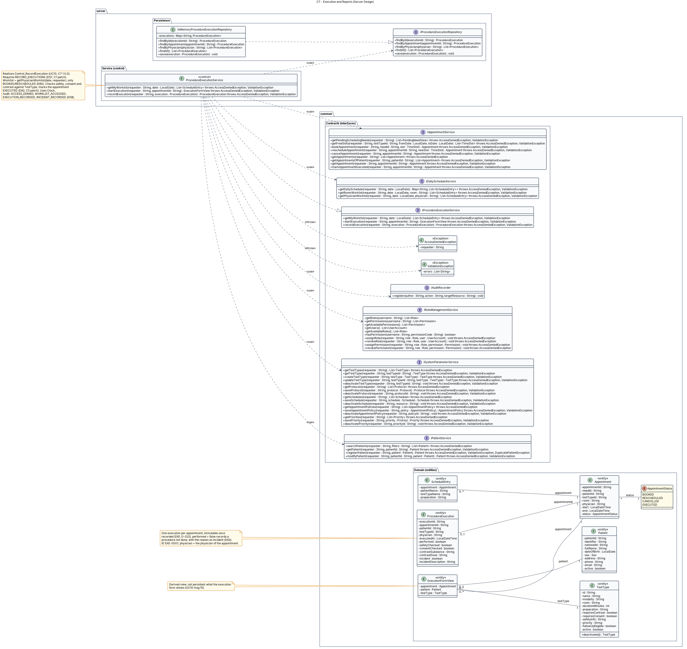
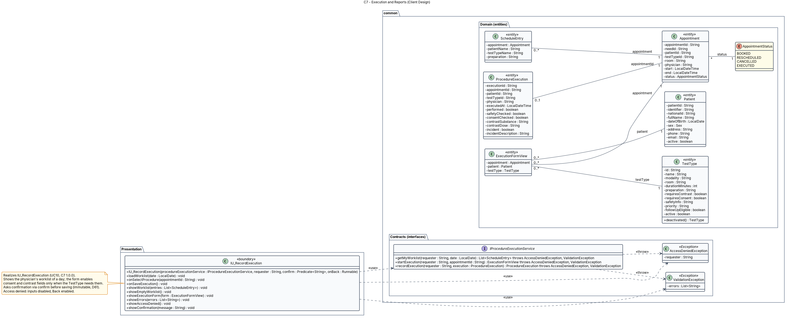

# Plan – C7 Execution and reports Design (#193)

> Plan for the Design discipline of Component C7 (*Execution and reports*: UC10 and UC09), following
> [AGENTS.md](../../AGENTS.md) (D-025, D-046, D-047, D-048) and [doc/plans/TEMPLATE.md](TEMPLATE.md).
> It fixes every domain rule, validation, limit, contract, DTO, screen flow and user-facing text owned by Design
> (*Decision ownership*, `AGENTS.md`), so that Implementation and Testing can work without ambiguity.

| | |
|---|---|
| **Component issue** | #193 *C7. Execution and reports* (`Refs #193`; no separate design issue) · branch `feature/c7-design` |
| **Use cases & versions** | UC10 (#194; FR10, C7 `1.0.0`), UC09 (#197; FR09, C7 `1.1.0`) · module `c7-reports` · Product `v0.7.0` · Milestone 4 |
| **Specification & analysis** | #193 (§6, §9, §10), #194–#199, [AN-C7-DECISIONS.md](../analysis/AN-C7-DECISIONS.md) (D56–D67), [UC10-record-execution-sequence.puml](../analysis/UC10-record-execution-sequence.puml), [UC09-diagnostic-reports-sequence.puml](../analysis/UC09-diagnostic-reports-sequence.puml) |
| **Design sources & precedent** | [doc/design/README.md](../design/README.md), [C5-design.md](C5-design.md), `doc/design/common/{_style,shared-contracts,C1-common,C2-common,C3-common,C5-common}.puml`, `DECISIONS.md` (D-011, D-016, D-022, D-023, D-025, D-027, D-030, D-032, D-036, D-046, D-047, D-048) |
| **Plan approved by** | Denis Ionescu (25/11/2026) |

---

## Questions and answers (Step 2)

Open items of #193 §10 and AN-C7 D57–D67, answered by Denis (owner of C7 Design) on 25/11/2026:

- **Q1 – Delivery order and files (D-046, D-047)?**
  **A:** One plan and one branch (`feature/c7-design`, `Refs #193`, D-048) delivering `doc/design/common/C7-common.puml`,
  `doc/design/C7-server-design.puml`, `doc/design/C7-client-design.puml` and `doc/plans/C7-context.md` in two steps:
  **Step 1 = UC10**, **Step 2 = UC09** (D56).
- **Q2 – Services (#193 §6)?**
  **A:** Two services, one per analysis control and component version, every operation with `requester : String` first:
  `IProcedureExecutionService` / `ProcedureExecutionService` → `Control_RecordExecution` (UC10, C7 `1.0.0`);
  `IDiagnosticReportService` / `DiagnosticReportService` → `Control_DiagnosticReports` (UC09, C7 `1.1.0`).
- **Q3 – "Assigned patients" of a physician (AN-C7 D59, D60)?**
  **A:** No new association on `Patient`. C5 already records the physician of every appointment
  (`Appointment.physician`, seeded with `mgarcia`) and its design already has
  `IDailyScheduleService.getPhysicianWorklist(requester, date, physician)` (UC14). So:
  - the worklist of UC10 is `getPhysicianWorklist(requester, date, requester)`, keeping only `BOOKED`/`RESCHEDULED`;
  - only the physician of the appointment records its execution, so `ProcedureExecution.physician` is that physician;
  - in UC09, a patient is assigned to a physician for a procedure when that physician recorded its execution
    (`execution.physician == requester`).
  This resolves D59 and D60 without a patch of C3 and without asking Requirements who assigns the physician.
  *Discrepancy with AN-C7 D59 (proposed `Patient * — 1 UserAccount`) is recorded in `C7-context.md`.*
- **Q4 – Procedure not performed (D62)?**
  **A:** It is recorded as a `ProcedureExecution` with `performed = false` and an incident that gives the reason; the
  appointment becomes `EXECUTED` (closed) anyway. Safety, consent and contrast are not required then. Only a performed
  execution can have a report. Whether the scheduling need goes back to `PENDING` is **not** done in It7 (D-011).
- **Q5 – Reviewer list (D65)?**
  **A:** The reviewer sees every `DRAFT` report whose author is not the reviewer, of any patient. No `READY` status.
- **Q6 – Images (D67)?**
  **A:** The `studyId` of a procedure is its `appointmentId` (accession number). C7 reads the study through C2:
  `IIntegrationManagementService.getStudy(requester, studyId) : ImagingStudy`, which delegates to
  `IRisPacsGateway.getStudy(studyId)` (simulated, D-016). The report stores only the references it links
  (`imageReferences : List<String>`), never images. No DICOM viewer (D-027).
- **Q7 – Screens?**
  **A:** `IU_RecordExecution` (UC10) and `IU_DiagnosticReports` (UC09), Swing `JPanel`s following C3/C5/C6
  (`requester`, `confirm : Predicate<String>`, `onBack : Runnable`).
- **Q8 – Permissions (D57)?**
  **A:** `RECORD_EXECUTIONS` (UC10) and `WRITE_REPORTS` (UC09, also for the reviewer), both granted to `PHYSICIAN`.
  Seed data only: no change to C1 interfaces or diagrams.

---

## Required D-036 follow-up patches on finished components (code PRs outside this PR)

| Component | Owner | Patch (code) | Diagram change in this PR |
|---|---|---|---|
| **C1** (`server-c1-access`) | Ignacio | Add `RECORD_EXECUTIONS` and `WRITE_REPORTS` to `InMemoryPermissionRepository` and grant both to `PHYSICIAN` in `InMemoryRoleRepository` (D57). | None (seed data) |
| **C2** (`server-c2-configuration`, `common`) | C2 owner | 1) `SystemParameterService.getTestType` also accepts `RECORD_EXECUTIONS` and `WRITE_REPORTS`. 2) *(UC09)* New `ImagingStudy` in `common`, `getStudy(studyId)` on `IRisPacsGateway`/`RisPacsGatewaySimulator`, and `getStudy(requester, studyId)` on `IIntegrationManagementService`/`IntegrationManagementService`, requiring `WRITE_REPORTS` (D67). | Step 2: `C2-common.puml`, `C2-server-design.puml` |
| **C3** (`server-c3-patients`) | Denis | `PatientService.getPatient` also accepts `RECORD_EXECUTIONS` and `WRITE_REPORTS` (still audits `PATIENT_ACCESSED`, AN-C2-C3 D26). | None |
| **C5** (`server-c5-appointments`, `common`) | C5 owner | 1) `EXECUTED` in `AppointmentStatus` (D62). 2) `getAppointment(requester, appointmentId)` and `markAppointmentExecuted(requester, appointmentId)` on `IAppointmentService`/`AppointmentService`; `markAppointmentExecuted` rejects cancelled or already executed appointments. 3) `RECORD_EXECUTIONS` accepted by `getAppointment`, `markAppointmentExecuted` and, only when `physician == requester`, `DailyScheduleService.getPhysicianWorklist`. 4) `EXECUTED` appointments do not block free slots differently from `BOOKED` (no change). | Step 1: `C5-common.puml`, `C5-server-design.puml` |

> **Dependency:** UC10 implementation needs UC14 (`DailyScheduleService`) implemented (agents/components.md: UC10
> depends on UC13, UC14, UC17).
> **Coordination:** `feature/c6-design` (#186) also edits `C5-common.puml` (`Appointment`, `IAppointmentService`).
> The branch merged second resolves the conflict by keeping both changes.

---

## Files

| File | Action | What |
|---|---|---|
| `doc/plans/C7-design.md` | create | This plan |
| `doc/plans/C7-context.md` | create | Context file of C7 from `CONTEXT-TEMPLATE.md` (D-047) |
| `doc/design/common/C7-common.puml` | create | `!startsub` definitions of the C7 domain types and contracts |
| `doc/design/C7-server-design.puml` | create | C7 Server Design Class Diagram |
| `doc/design/C7-client-design.puml` | create | C7 Client Design Class Diagram |
| `doc/design/common/C5-common.puml` | update | `EXECUTED` in `AppointmentStatus`; `getAppointment`, `markAppointmentExecuted` in `IAppointmentService` |
| `doc/design/C5-server-design.puml` | update | Same two operations in `AppointmentService` |
| `doc/design/common/C2-common.puml` | update (Step 2) | `ImagingStudy`; `getStudy` in `IIntegrationManagementService` |
| `doc/design/C2-server-design.puml` | update (Step 2) | `getStudy` in `IntegrationManagementService`, `IRisPacsGateway`, `RisPacsGatewaySimulator` |
| `doc/design/C7-server-design.png`, `doc/design/C7-client-design.png` | create | Previews rendered with `plantuml -tpng` (D-046), shown in *Design diagrams* below |
| Patched C2/C5 PNGs | update (Step 3) | Re-rendered previews of the patched diagrams |

*(Rule 23 / D-048: `AGENTS.md`, `DECISIONS.md`, `agents/*.md` and `.github/` are not modified in this branch.)*

---

## Target design specification

### Packages & Maven modules (D-032)
- `common`: `es.uclm.esi.iso2.common.reports.domain`, `es.uclm.esi.iso2.common.reports.contracts`
- `server/c7-reports` (`server-c7-reports`): `es.uclm.esi.iso2.server.reports.service`, `es.uclm.esi.iso2.server.reports.persistence`
- `client/c7-reports` (`client-c7-reports`): `es.uclm.esi.iso2.client.reports.presentation`

### 1. Domain (`common.reports.domain`)

| Class | UC | Attributes | Notes |
|---|---|---|---|
| `ProcedureExecution` «entity» | UC10 | `-executionId : String`, `-appointmentId : String`, `-patientId : String`, `-testTypeId : String`, `-physician : String`, `-executedAt : LocalDateTime`, `-performed : boolean`, `-safetyChecked : boolean`, `-consentChecked : boolean`, `-contrastSubstance : String`, `-contrastDose : String`, `-incident : boolean`, `-incidentDescription : String` | Persisted, ID `EXE-0001`. One per appointment, immutable once recorded (D61, D-022). The client sends it with `executionId`, `patientId`, `testTypeId`, `physician` and `executedAt` empty; the server fills them. |
| `ExecutionFormView` «entity» | UC10 | `-appointment : Appointment`, `-patient : Patient`, `-testType : TestType` | Derived view, not persisted: what the form shows (msg 15). |
| `ReportStatus` «enumeration» | UC09 | `DRAFT`, `VALIDATED` | D64 |
| `DiagnosticReport` «entity» | UC09 | `-reportId : String`, `-executionId : String`, `-patientId : String`, `-author : String`, `-createdAt : LocalDateTime`, `-findings : String`, `-impression : String`, `-imageReferences : List<String>`, `-status : ReportStatus`, `-validator : String`, `-validatedAt : LocalDateTime` | Persisted, ID `REP-0001`. One per performed execution. `validated(validator, at)` returns the VALIDATED copy; a VALIDATED report never changes (D64). |
| `Addendum` «entity» | UC09 | `-addendumId : String`, `-reportId : String`, `-author : String`, `-addedAt : LocalDateTime`, `-text : String` | Persisted, ID `ADD-0001`. Only on VALIDATED reports, never edited (D66). |
| `ReportableExecutionView` «entity» | UC09 | `-execution : ProcedureExecution`, `-patientName : String`, `-testTypeName : String`, `-report : DiagnosticReport` | Derived view (msg 8); `report` is `null` when there is none yet. |
| `ReportWorkspaceView` «entity» | UC09 | `-execution : ProcedureExecution`, `-study : ImagingStudy`, `-report : DiagnosticReport`, `-addenda : List<Addendum>` | Derived view (msg 16); `report` may be `null`. |
| `ImagingStudy` «entity» *(C2 `common`)* | UC09 | `-studyId : String`, `-patientId : String`, `-modality : String`, `-studyDate : LocalDate`, `-imageReferences : List<String>` | Returned by the simulated RIS/PACS (D67). |

Existing types used: `Appointment`, `AppointmentStatus`, `ScheduleEntry` (C5), `Patient` (C3), `TestType` (C2).

### 2. Contracts (`common.reports.contracts`)

- **`IProcedureExecutionService` (UC10, C7 `1.0.0`):**
  - `+getMyWorklist(requester : String, date : LocalDate) : List<ScheduleEntry> throws AccessDeniedException, ValidationException`
  - `+startExecution(requester : String, appointmentId : String) : ExecutionFormView throws AccessDeniedException, ValidationException`
  - `+recordExecution(requester : String, execution : ProcedureExecution) : ProcedureExecution throws AccessDeniedException, ValidationException`
- **`IDiagnosticReportService` (UC09, C7 `1.1.0`):**
  - `+getMyReportableExecutions(requester : String) : List<ReportableExecutionView> throws AccessDeniedException`
  - `+openReport(requester : String, executionId : String) : ReportWorkspaceView throws AccessDeniedException, ValidationException`
  - `+saveDraft(requester : String, executionId : String, findings : String, impression : String, imageReferences : List<String>) : DiagnosticReport throws AccessDeniedException, ValidationException`
  - `+getReportsToValidate(requester : String) : List<DiagnosticReport> throws AccessDeniedException`
  - `+validateReport(requester : String, reportId : String) : DiagnosticReport throws AccessDeniedException, ValidationException`
  - `+addAddendum(requester : String, reportId : String, text : String) : Addendum throws AccessDeniedException, ValidationException`

### 3. Server (`server.reports.{service,persistence}`)
- `ProcedureExecutionService` «control» realizes `IProcedureExecutionService`; uses `IProcedureExecutionRepository`,
  `IDailyScheduleService`, `IAppointmentService`, `IPatientService`, `ISystemParameterService`,
  `IRoleManagementService`, `IAuditRecorder`, `Clock` (injected constructor + default constructor with the in-memory
  repository and `Clock.systemDefaultZone()`, like `AppointmentService`).
- `DiagnosticReportService` «control» realizes `IDiagnosticReportService`; uses `IDiagnosticReportRepository`,
  `IAddendumRepository`, `IProcedureExecutionRepository`, `IPatientService`, `ISystemParameterService`,
  `IIntegrationManagementService`, `IRoleManagementService`, `IAuditRecorder`, `Clock`.
- Repositories (`Map` + `LinkedHashMap`, nullable `findById`, D-030):
  - `IProcedureExecutionRepository` / `InMemoryProcedureExecutionRepository`: `findById(executionId)`, `findByAppointment(appointmentId)`, `findByPhysician(physician) : List`, `findAll() : List`, `save(execution)`
  - `IDiagnosticReportRepository` / `InMemoryDiagnosticReportRepository`: `findById(reportId)`, `findByExecution(executionId)`, `findByStatus(status) : List`, `findAll() : List`, `save(report)`
  - `IAddendumRepository` / `InMemoryAddendumRepository`: `findById(addendumId)`, `findByReport(reportId) : List`, `findAll() : List`, `save(addendum)`

### 4. Presentation (`client.reports.presentation`)
- **`IU_RecordExecution` «boundary» (UC10):** `+IU_RecordExecution(procedureExecutionService : IProcedureExecutionService, requester : String, confirm : Predicate<String>, onBack : Runnable)`, `+loadWorklist(date : LocalDate)`, `+onSelectProcedure(appointmentId : String)`, `+onSaveExecution()`, `+showWorklist(entries : List<ScheduleEntry>)`, `+showEmptyWorklist()`, `+showExecutionForm(form : ExecutionFormView)`, `+showErrors(errors : List<String>)`, `+showAccessDenied()`, `+showConfirmation(message : String)`
- **`IU_DiagnosticReports` «boundary» (UC09):** `+IU_DiagnosticReports(diagnosticReportService : IDiagnosticReportService, requester : String, confirm : Predicate<String>, onBack : Runnable)`, `+loadData()`, `+onOpenReport(executionId : String)`, `+onSaveDraft(executionId : String, findings : String, impression : String, imageReferences : List<String>)`, `+onValidateReport(reportId : String)`, `+onAddAddendum(reportId : String, text : String)`, `+showExecutions(executions : List<ReportableExecutionView>)`, `+showReportsToValidate(reports : List<DiagnosticReport>)`, `+showWorkspace(workspace : ReportWorkspaceView)`, `+showErrors(errors : List<String>)`, `+showAccessDenied()`, `+showConfirmation(message : String)`

---

## Domain rules, validations, limits, audit policy & user-facing texts (Design-owned)

All validation errors of one call are collected into one `ValidationException`; nothing is stored when it is thrown.

### UC10 – `ProcedureExecutionService`
1. **Permission (D57, D58):** every operation requires `RECORD_EXECUTIONS`. On failure: `register(requester, "ACCESS_DENIED", "RECORD_EXECUTIONS")`, then `throw new AccessDeniedException(requester)`.
2. **`getMyWorklist`:** `date` required (`"The date is required"`). Calls `dailyScheduleService.getPhysicianWorklist(requester, date, requester)`, keeps entries whose appointment is `BOOKED` or `RESCHEDULED`, sorted by `start` ascending. Audit `WORKLIST_ACCESSED` with target `"WORKLIST:" + date`.
3. **Appointment checks (used by `startExecution` and `recordExecution`):**
   - `appointmentId` blank → `"The appointment is required"`.
   - `appointmentService.getAppointment(...)` is `null` → `"There is no appointment with the id " + appointmentId`.
   - `appointment.physician` ≠ `requester` → `"The appointment " + appointmentId + " is not in your worklist"`.
   - status `CANCELLED` → `"The appointment " + appointmentId + " is cancelled"`.
   - status `EXECUTED` or `executionRepository.findByAppointment(appointmentId) != null` → `"The appointment " + appointmentId + " has already been executed"`.
4. **`startExecution`:** after the checks, returns `ExecutionFormView(appointment, patientService.getPatient(requester, patientId), systemParameterService.getTestType(requester, testTypeId))`. No own audit event (C3 audits `PATIENT_ACCESSED`).
5. **`recordExecution`:** `execution` `null` → `"The execution data is required"`. Appointment checks on `execution.appointmentId`, then with the `TestType` of the appointment:
   - **Performed** (`performed == true`):
     - `testType.safetyInfo` not blank and `!safetyChecked` → `"The safety checks must be confirmed"`
     - `testType.requiresConsent` and `!consentChecked` → `"The patient's consent must be confirmed"`
     - `testType.requiresContrast`: `contrastSubstance` blank → `"The contrast substance is required"`; `contrastDose` blank → `"The contrast dose is required"`; each at most 100 characters (`"The contrast substance must be at most 100 characters"`, `"The contrast dose must be at most 100 characters"`). If the test type does not use contrast, both are stored as `""`.
   - **Not performed** (`performed == false`): `incident` must be `true` (`"A procedure that was not performed needs an incident with the reason"`); checks are stored as `false` and contrast as `""`.
   - **Incident** (`incident == true`): `incidentDescription` not blank (`"The incident description is required"`) and at most 1000 characters (`"The incident description must be at most 1000 characters"`). Without incident, the description is stored as `""`.
   - If valid: `appointmentService.markAppointmentExecuted(requester, appointmentId)` first, then save the execution with `executionId` (`EXE-0001`…), `patientId`/`testTypeId` from the appointment, `physician = requester`, `executedAt = now(clock)`. Audit `EXECUTION_RECORDED` (`"EXECUTION:" + executionId`) and, with incident, `INCIDENT_RECORDED` (same target). Returns the saved execution.

### UC09 – `DiagnosticReportService`
1. **Permission (D57, D58):** every operation requires `WRITE_REPORTS`; on failure `register(requester, "ACCESS_DENIED", "WRITE_REPORTS")` and `AccessDeniedException`.
2. **`getMyReportableExecutions`:** executions with `physician == requester` and `performed == true`, newest first, each with patient full name, test type name and its report (or `null`). Audit `REPORTS_ACCESSED` (`"REPORTS:" + requester`).
3. **Execution checks (`openReport`, `saveDraft`):** blank id → `"The procedure is required"`; not found → `"There is no procedure execution with the id " + executionId`; `!performed` → `"The procedure " + executionId + " was not performed, so it cannot have a report"`; `physician ≠ requester` → `"The patient of procedure " + executionId + " is not assigned to you"`.
4. **`openReport`:** returns the workspace with `integrationManagementService.getStudy(requester, appointmentId)`, the report (or `null`) and its addenda, oldest first. If RIS/PACS fails, `study` is `null` and the screen shows the message below.
5. **`saveDraft`:** report of the execution already `VALIDATED` → `"The report is validated and cannot be edited; add an addendum instead"`. `findings` and `impression` required (`"The findings are required"`, `"The impression is required"`), at most 4000 characters each (`"The findings must be at most 4000 characters"`, `"The impression must be at most 4000 characters"`). `imageReferences` may be empty (`null` → empty); every reference must belong to the study (`"The image " + ref + " does not belong to the study of this procedure"`). Creates the DRAFT (`REP-0001`…, `author = requester`, `createdAt = now`) or updates the existing draft. Audit `REPORT_SAVED` (`"REPORT:" + reportId`).
6. **`getReportsToValidate`:** reports with status `DRAFT` and `author ≠ requester`, oldest first. No own audit event.
7. **`validateReport`:** blank id → `"The report is required"`; not found → `"There is no report with the id " + reportId`; `VALIDATED` → `"The report " + reportId + " is already validated"`; `author == requester` → `"You cannot validate your own report; another physician must review it"`. Saves `validated(requester, now)`. Audit `REPORT_VALIDATED`.
8. **`addAddendum`:** report checks as above; `DRAFT` → `"The report is still a draft; edit the draft instead"`; the physician of its execution ≠ requester → `"The patient of report " + reportId + " is not assigned to you"`; `text` required (`"The addendum text is required"`), at most 2000 characters (`"The addendum must be at most 2000 characters"`). Saves (`ADD-0001`…). Audit `ADDENDUM_ADDED` (`"ADDENDUM:" + addendumId`). The report text never changes.

### User-facing texts & UI flows

| Screen | Element | Exact text / behaviour |
|---|---|---|
| `IU_RecordExecution` | Title, date, empty | Title `"Procedure Execution"`; field `Date` (today by default) and button `Load worklist`; empty list `"You have no pending procedures for this day."` |
| `IU_RecordExecution` | Worklist columns | `Time`, `Appointment`, `Patient`, `Test type`, `Room` |
| `IU_RecordExecution` | Form | Read-only `Patient`, `Test type`, `Safety information`; check boxes `Procedure performed` (checked by default), `Safety checks completed`, `Patient consent confirmed` (enabled only if the test type requires consent); fields `Contrast substance`, `Contrast dose` (enabled only if it uses contrast); check box `Incident` and field `Incident description` (enabled with `Incident`); buttons `Save execution`, `Back` |
| `IU_RecordExecution` | Confirmation question | `"Record the execution of appointment " + appointmentId + "? It cannot be changed afterwards."` — declined: nothing is sent |
| `IU_RecordExecution` | Success | `"Execution " + executionId + " recorded for appointment " + appointmentId + "."` plus `" The incident has been registered."` when there is one; the worklist is reloaded |
| `IU_RecordExecution` | Reload failure / access denied | `"Execution recorded, but the worklist could not be refreshed."` · `"Access denied: you do not have permission to record procedure executions."` (inputs disabled, `Back` enabled) |
| `IU_DiagnosticReports` | Title, tabs, empty | Title `"Diagnostic Reports"`; tabs `My procedures` and `Reports to validate`; empty `"You have no performed procedures to report."` / `"There are no reports waiting for validation."` |
| `IU_DiagnosticReports` | Columns | `My procedures`: `Date`, `Execution`, `Patient`, `Test type`, `Report` (`"—"`, `"Draft"`, `"Validated"`). `Reports to validate`: `Report`, `Patient`, `Author`, `Created` |
| `IU_DiagnosticReports` | Workspace | List `Study images` (check the ones to link); fields `Findings`, `Impression`; read-only list `Addenda`; field `New addendum`; buttons `Save draft`, `Validate report`, `Add addendum`, `Back`. `Save draft` is disabled for a validated report, `Add addendum` for a draft |
| `IU_DiagnosticReports` | Confirmation question | Validate: `"Validate report " + reportId + "? A validated report cannot be edited."` — declined: nothing is sent |
| `IU_DiagnosticReports` | Success | `"Report " + reportId + " saved as draft."` · `"Report " + reportId + " validated."` · `"Addendum " + addendumId + " added to report " + reportId + "."` |
| `IU_DiagnosticReports` | Study / access denied | `"The images of this study could not be loaded from RIS/PACS."` · `"Access denied: you do not have permission to write diagnostic reports."` |

---

## Design diagrams (Step 1 – UC10)

Rendered previews of the `.puml` files (D-046). The `.puml` files are the source of truth; the PNGs are regenerated
with `plantuml -tpng` whenever they change.

### `C7-server-design` (C7 Design Class Diagram Server)
Source: [`C7-server-design.puml`](../design/C7-server-design.puml) · shared types: [`common/C7-common.puml`](../design/common/C7-common.puml)

### `C7-client-design` (C7 Design Class Diagram Client)
Source: [`C7-client-design.puml`](../design/C7-client-design.puml)

---

## Steps
Tick each step with the hash of its commit.
- [ ] 1. **UC10 (C7 `1.0.0`):** this plan (with the *Design diagrams* previews); `C7-common.puml`, `C7-server-design.puml`, `C7-client-design.puml` (UC10 scope); `C5-common.puml`, `C5-server-design.puml` (EXECUTED, `getAppointment`, `markAppointmentExecuted`); `C7-context.md`; `C7-server-design.png`, `C7-client-design.png`.
- [ ] 2. **UC09 (C7 `1.1.0`):** extend the C7 files with `DiagnosticReport`, `ReportStatus`, `Addendum`, the views, `IDiagnosticReportService`, `DiagnosticReportService`, repositories and `IU_DiagnosticReports`; `C2-common.puml`, `C2-server-design.puml` (`ImagingStudy`, `getStudy`).
- [ ] 3. **Previews:** re-render `C7-server-design.png`, `C7-client-design.png` with UC09 and the patched C2/C5 PNGs with `plantuml -tpng`, and update *Design diagrams*.

## Verification
- [ ] Every flow and alternative of UC10 and UC09 in AN-C7 (msgs and 3a…48c) maps to an operation, a rule or a text of this plan.
- [ ] All `!includesub` references resolve; the four diagrams render without errors.
- [ ] `C7-context.md` follows `CONTEXT-TEMPLATE.md` and cites its sources.
- [ ] No shared process files changed (rule 23, D-048).

## Status
- **In progress:** Step 1
- **Next step:** review of this plan and the UC10 diagrams by Denis
- **Open questions:** none
- **Last update:** 25/11/2026, Denis Ionescu
