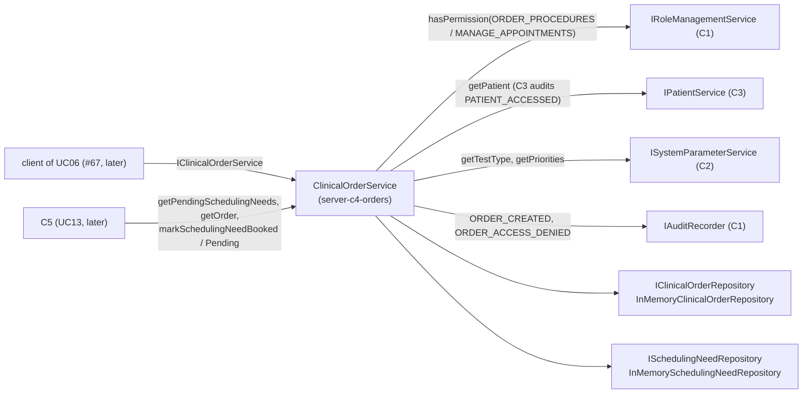
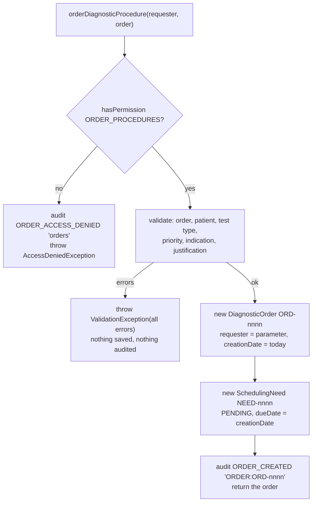

# Plan – UC06 – Server (#68)

| | |
|---|---|
| **Sub-issue** | #68 *UC06 – Server (C4 v1.0.0)* · branch `feature/UC06-server` (created by Javier from `develop` `2a4bbc4`; brought up to date with `develop` `b8a8983`, which includes the merged pull request #201, before step 1) |
| **Use case** | #66 *UC06 – Order a diagnostic procedure (C4 v1.0.0)* · FR06 · component C4 1.0.0 (`server-c4-orders`, `agents/components.md:36`) |
| **Specification** | #68, #66; flow of UC06 in `doc/AN-C4-DECISIONS.md:28-42`; D29, D30, D31, D33, D34 of `doc/AN-C4-DECISIONS.md`; D-022, D-023, D-033, D-036, D-037, D-039, D-040 |
| **Design** | `doc/design/C4-server-design.puml` and `doc/design/common/C4-common.puml` as merged in pull request #201 (`develop` `b8a8983`; D-046) · contracts: section 6 of #65 *C4. Clinical orders* (it matches the design; section 1 still says "1.6.0 → 1.7.0", the old numbering, see **Status**) |
| **Plan approved by** | Javier Villanueva Crespo, 22/11/2026 (including the yes of rule 9 for the poms of step 1, the new module and `common` 1.6.0, and `agents/` of step 6) |

## Decisions already taken
- **Contract (Marcos, Design, 22/11/2026):** the approved design of pull request #168, with the `throws` of pull request #201 (merged in `develop` `b8a8983` on 22/11/2026), is what is implemented. Marcos updates the rest of the design afterwards if needed.
- **Permissions already exist** in C1 1.2.4 (#173): `ORDER_PROCEDURES` for `PHYSICIAN` and `MANAGE_APPOINTMENTS` for `ADMISSIONS_STAFF` (`server/c1-access/.../persistence/InMemoryRoleRepository.java:14-18`). The reads of C2 (`getTestType`, `getPriorities`) and of C3 (`getPatient`) already accept `ORDER_PROCEDURES` (#174, #175).
- **Criterion of David (Meeting 9):** touch as little as possible.
- **Tests are Adam's** (rule 17, D-034): **nobody in this plan writes, edits or deletes a test**. The plan lists what to cover in *State for Adam* and *Cases to cover*, without inventing expected results.
- **Not in this plan:** the client of UC06 (#67), including `Main.java` and the poms of `client/`; UC07 (#71: `FollowUpOrder`, `orderFollowUp`, the needs of the next 12 months of D-040); UC08 (Iteration 9, D-013); editing or cancelling an order (D-039).
- C2 and C3 return inactive records too: `getTestType` returns a deactivated test type (`SystemParameterService.java:111-114`), `getPriorities` returns the deactivated priorities (`:238-241`), and `getPatient` returns an inactive patient (`PatientService.java:101-106`). So C4 checks `isActive()` itself.
- Every `getPatient` call is registered by C3 as `PATIENT_ACCESSED` (`PatientService.java:104`); C4 does not repeat it (D34 of `doc/AN-C4-DECISIONS.md:95-97`).

## Questions and answers
All answered by Javier on 22/11/2026.
- **Q0 – Contract.** **A:** exactly the signatures and `throws` of `doc/design/common/C4-common.puml` in `develop` `b8a8983` (pull request #201, merged). The branch is brought up to date with `develop` **before step 1**; the orchestrator does it, not the implementing agent (see *How to work*).
- **Q1 – `common` (rule 9).** **A:** new packages `es.uclm.esi.iso2.common.orders.domain` (`ClinicalOrder` abstract, `DiagnosticOrder`, `SchedulingNeed`, `SchedulingNeedStatus`) and `es.uclm.esi.iso2.common.orders.contracts` (`IClinicalOrderService`), plus `common/.../common/orders/package-info.java`, as C3 did (`common/.../common/patients/package-info.java`). The data classes have no logic: only a constructor and getters (immutable, as `Patient.java`), so that no branch is added to `common`. `common` goes from `1.5.0-SNAPSHOT` to `1.6.0-SNAPSHOT` (D-036: contracts added → MINOR; `1.5.0` was released in `v0.3.0`, commit `27c2cd8`).
- **Q2 – Module (rule 9).** **A:** `server/c4-orders`, `artifactId` `server-c4-orders`, version `1.0.0-SNAPSHOT`, depends only on `common` and JUnit (as `server/c3-patients/pom.xml`); packages `es.uclm.esi.iso2.server.orders.persistence` and `es.uclm.esi.iso2.server.orders.service`; the module is added to `server/pom.xml` and its version to the `<dependencyManagement>` of `pom.xml`.
- **Q3 – `Main.java`.** **A:** the wiring of the service in `client/c1-access/.../Main.java` and its pom go in the plan of the client (#67), as in UC12 (`doc/plans/UC12-client.md:19,31`). This plan does not touch `client/`.
- **Q4 – Validation of `orderDiagnosticProcedure`.** **A:** first the permission `ORDER_PROCEDURES` (no call to C2 or C3 when it is denied); then every error together in one `ValidationException`, in this order: order (`null` stops here), patient, test type, priority, clinical indication, justification. The patient, the test type and the priority must exist **and be active**. The `orderId`, `requester` and `creationDate` sent by the client are ignored: the server sets them. Messages:
  - `"The order is required"`
  - `"The patient is required"` · the message of C3 when it does not exist (`"There is no patient with the id X"`, `PatientService.java:201`) · `"The patient X is not active"`
  - `"The test type is required"` · the message of C2 when it does not exist (`"There is no test type with the id X"`, `SystemParameterService.java:339`) · `"The test type X is not active"`
  - `"The priority is required"` · `"The priority X is not one of the configured priorities"` · `"The priority X is not active"`
  - `"The clinical indication is required"` · `"The justification is required"`
- **Q5 – Indication and justification.** **A:** both required (not empty after removing the spaces at the ends: `isBlank()`), no maximum length. Pending confirmation of Requirements (David and Ignacio): see **Status**.
- **Q6 – Ids, dates and clock.** **A:** the server numbers the orders `ORD-0001`, `ORD-0002`… and the needs `NEED-0001`, `NEED-0002`… with a counter in the service (pattern of `P-0001`, D-037); the counter skips an id that the repository already has (repositories given to the constructor). `creationDate` is today's date of the server; the `dueDate` of the need of a diagnostic order is its `creationDate` (pending confirmation of Requirements). The service gets a `java.time.Clock` (JDK, not a new dependency, rule 6) in one constructor, and another constructor uses the system clock, so that Adam can fix the date.
- **Q7 – Audit.** **A:** a created order is `ORDER_CREATED` with the resource `ORDER:<orderId>`; a denied attempt is `ORDER_ACCESS_DENIED` with the resource `ORDER:<orderId>` (`getOrder`), `SCHEDULING_NEED:<needId>` (`markSchedulingNeedBooked`, `markSchedulingNeedPending`) or `orders` (`orderDiagnosticProcedure`, `getOrdersOfPatient`, `getPendingSchedulingNeeds`). The reads and the changes of state of the needs are not audited (note N2 of the design only names the creations). Design must confirm `ORDER_ACCESS_DENIED` against the `ACCESS_DENIED` of note N2 (`C4-server-design.puml`, note N2): see **Status**.
- **Q8 – Seed data.** **A:** **not decided** (Javier will ask Adam whether they are needed). This plan has no step for seed data and does **not** create `loadSeedData()`, although the design shows it. If it is decided, a step is added. See **Status**.
- **Q9 – `agents/` (rule 9).** **A:** only versions, in their own step: the line of `c4-orders` in `agents/architecture.md` after line 11, and `common` `1.6.0-SNAPSHOT` in `agents/components.md:56`. The out-of-date sentence of `agents/architecture.md:20` ("for now `common` only has … (C1)") is not changed: open question.
- **Q10 – Steps and tests.** **A:** 1 poms; 2 domain and contract in `common`; 3 in-memory repositories; 4 service: permission, `orderDiagnosticProcedure`, `validate`, `createSchedulingNeeds`, audit; 5 reads and operations for C5; 6 `agents/`; 7 hand over to Adam (no push). Code commits carry the body "Tests pending Adam (#68).". Step 1 confirms with the full build that a module without tests does not fail JaCoCo; if `common` falls below 80 % of lines or 70 % of branches, stop.
- **Q11 – Methods now.** **A:** `orderDiagnosticProcedure`, `getOrdersOfPatient`, `getOrder`, `getPendingSchedulingNeeds`, `markSchedulingNeedBooked` and `markSchedulingNeedPending`. `FollowUpOrder` and `orderFollowUp` come with UC07 (#71), with no stub now. So the interface of this version has 6 of the 7 operations of the design.
- **Q12 – Permission of each operation (note N2).** **A:** `orderDiagnosticProcedure` and `getOrdersOfPatient`: only `ORDER_PROCEDURES`. `getPendingSchedulingNeeds`, `getOrder`, `markSchedulingNeedBooked` and `markSchedulingNeedPending`: `ORDER_PROCEDURES` **or** `MANAGE_APPOINTMENTS`.
- **Q13 – Edge cases.** **A:** `getOrdersOfPatient` with a `null` or blank id → `ValidationException("The patient is required")`; an unknown patient → empty list, without calling C3; the orders in the order in which they were saved. `getOrder` with an unknown or `null` id → `"There is no order with the id X"`. An unknown or `null` `needId` → `"There is no scheduling need with the id X"`. Booking a need already booked → `"The scheduling need X is already booked"`; making pending a need already pending → `"The scheduling need X is already pending"`. `getPendingSchedulingNeeds` in the order in which they were saved.
- **Q14 – State of a need.** **A:** no setters: the service saves a new `SchedulingNeed` (same `needId`, `orderId` and `dueDate`, the other status) that replaces the old one in the repository.
- **Q15 – Plan.** **A:** `doc/plans/UC06-server.md`.

## Files
| File | Action | What | Step |
|---|---|---|---|
| `server/c4-orders/pom.xml` | create | `server-c4-orders` `1.0.0-SNAPSHOT`, depends on `common` and JUnit (Q2) — **rule 9** | 1 |
| `server/pom.xml` | change | module `c4-orders` (Q2) — **rule 9** | 1 |
| `pom.xml` | change | managed version of `server-c4-orders`; `common` `1.6.0-SNAPSHOT` (Q1, Q2) — **rule 9** | 1 |
| `common/pom.xml` | change | `1.6.0-SNAPSHOT` (Q1) — **rule 9** | 1 |
| `common/src/main/java/es/uclm/esi/iso2/common/orders/package-info.java` | create | package of C4 — **rule 9 (new package)** | 2 |
| `common/.../common/orders/domain/` `SchedulingNeedStatus`, `ClinicalOrder`, `DiagnosticOrder`, `SchedulingNeed` | create | data classes without logic (Q1) | 2 |
| `common/.../common/orders/contracts/IClinicalOrderService.java` | create (2), change (5) | the contract: `orderDiagnosticProcedure` in step 2, the other five operations in step 5 (Q0, Q11) | 2, 5 |
| `server/c4-orders/src/main/java/es/uclm/esi/iso2/server/orders/persistence/` `IClinicalOrderRepository`, `ISchedulingNeedRepository`, `InMemoryClinicalOrderRepository`, `InMemorySchedulingNeedRepository` | create | as the design (D-030) | 3 |
| `server/c4-orders/.../server/orders/service/ClinicalOrderService.java` | create (4), change (5) | control of UC06 (Q4-Q7, Q12-Q14) | 4, 5 |
| `agents/architecture.md`, `agents/components.md` | change | versions only (Q9) — **rule 9** | 6 |
| `doc/plans/UC06-server.md` | create/update | this plan | 7 |

No other file changes: no test, no file of `client/`, of C1, C2 or C3, no `DECISIONS.md`, no `doc/`. `server-c4-orders` depends only on `common`: it reaches C1, C2 and C3 only through the contracts of `common` (`IRoleManagementService`, `IAuditRecorder`, `ISystemParameterService`, `IPatientService`), as D-032 asks. Every class and public method has its Javadoc in English (rule 18); methods with `@Override` have none (they inherit it from the interface, as in C2 and C3).

## How the pieces fit




## How to work (read before step 1)
- **Before step 1 (done by the orchestrator, not by the implementing agent):** the branch is brought up to date with `develop` (`git fetch origin` and `git merge origin/develop`, no rebase), which already includes pull request #201 (`b8a8983`). That merge only changes files of `doc/design/` (`git diff 2a4bbc4 b8a8983 --stat`: 5 files), so no line number of this plan moves. If **Status** does not say that this was done, stop and ask Javier.
- Run every command from the root of the repository in **Git Bash** (Windows). One step = one commit. Before a step, write it as *In progress* in **Status**; after the commit, tick it here with the short hash and set *In progress* back to nothing.
- Line numbers are those of the files **before** the step (as on `develop` `b8a8983`); after an edit above, find the line by its content.
- Code, comments and Javadoc in English. Keep lines under 120 characters and the existing 4-space indentation. Write the code of each step **exactly** as it is given here.
- Never edit, create or delete a file under `src/test`. Never run `git push`, never create a branch, never use `--no-verify`, `reset --hard`, `clean` or `rebase`. Commits use the Git identity already configured, with no co-author line and no tool signature (rule 13).
- **Do not build before writing the code of the step.** The checks, after the code:
  - **Check A (main code of every module compiles, ~5 s):**
    `mvn -B -ntp -Dmaven.test.skip=true -Djacoco.skip=true verify 2>&1 | grep -E "ERROR|BUILD|SKIPPED"; echo "Exit code: ${PIPESTATUS[0]}"`
    It must print `BUILD SUCCESS` and `Exit code: 0`.
  - **Check B (tests, without coverage, ~45 s):**
    `mvn -B -ntp -fae -Djacoco.skip=true -Dmaven.test.failure.ignore=true verify 2>&1 | grep -E "Tests run:|FAIL|ERROR|BUILD|SKIPPED" | grep -v " -- in "; echo "Exit code: ${PIPESTATUS[0]}"`
  - **Full build (~45 s):**
    `mvn -B -ntp verify 2>&1 | grep -E "Tests run:|FAIL|ERROR|WARN|BUILD|coverage checks|Skipping JaCoCo|SUCCESS \[" | grep -v " -- in "; echo "Exit code: ${PIPESTATUS[0]}"`
  - **Coverage of `common`** (after a full build):
    `awk -F, 'NR>1{lm+=$8;lc+=$9;bm+=$6;bc+=$7} END{print "lines",lc"/"lc+lm, "branches",bc"/"bc+bm}' common/target/site/jacoco/jacoco.csv`
- **Baseline** (full build run on this branch on 22/11/2026, `2a4bbc4`, before any change): `BUILD SUCCESS`, `Exit code: 0`, 10 reactor modules, every module `Failures: 0, Errors: 0` and "All coverage checks have been met" 7 times — `common` 52 tests, `server-c1-access` 182, `server-c2-configuration` 171, `server-c3-patients` 151, `client-c2-configuration` 124, `client-c3-patients` 112, `client-c1-access` 98. Coverage of `common`: lines 200/202, branches 14/14.
- **JaCoCo without tests** (checked on 22/11/2026 in `jacoco-maven-plugin-0.8.14.jar`, class `CheckMojo`): the check is skipped, with the message `Skipping JaCoCo execution due to missing execution data file` (or `… missing classes directory`), when a module has no tests. So `server-c4-orders` passes the full build without tests, but its coverage is **not** measured until Adam's tests exist. (`doc/plans/UC12-server.md:62` said the opposite; the plugin and the full build of step 1 decide.)
- **Allowed files:** before each commit run `git status --short` and `git diff --stat`; they must list only the files of the step (and this plan only in step 7). Anything else: stop and tell Javier.
- If a check gives a result different from the one written in the step, **stop**, do not commit, and write in **Status** what happened. If `common` falls below 80 % of lines or 70 % of branches, stop.

## Steps
- [x] **1. Module `server/c4-orders` (empty), its managed version, and `common` `1.6.0-SNAPSHOT`** (Q1, Q2). **Ask Javier for the yes of rule 9 before changing the poms.** Done: `69f588c`.
  - Create `server/c4-orders/pom.xml`:
    ```xml
    <?xml version="1.0" encoding="UTF-8"?>
    <project xmlns="http://maven.apache.org/POM/4.0.0"
             xmlns:xsi="http://www.w3.org/2001/XMLSchema-instance"
             xsi:schemaLocation="http://maven.apache.org/POM/4.0.0 https://maven.apache.org/xsd/maven-4.0.0.xsd">
      <modelVersion>4.0.0</modelVersion>

      <parent>
        <groupId>es.uclm.esi.iso2</groupId>
        <artifactId>radiodiagnostics</artifactId>
        <version>0.4.0-SNAPSHOT</version>
        <relativePath>../../pom.xml</relativePath>
      </parent>

      <artifactId>server-c4-orders</artifactId>
      <version>1.0.0-SNAPSHOT</version>

      <dependencies>
        <dependency>
          <groupId>es.uclm.esi.iso2</groupId>
          <artifactId>common</artifactId>
        </dependency>
        <dependency>
          <groupId>org.junit.jupiter</groupId>
          <artifactId>junit-jupiter</artifactId>
          <scope>test</scope>
        </dependency>
      </dependencies>
    </project>
    ```
  - `server/pom.xml`: after line 19 (`    <module>c3-patients</module>`) add `    <module>c4-orders</module>`.
  - `pom.xml` line 29 (inside the `<dependency>` of `common`, lines 26-30): `<version>1.5.0-SNAPSHOT</version>` → `<version>1.6.0-SNAPSHOT</version>`.
  - `pom.xml`: after line 45 (the `</dependency>` that closes `server-c3-patients`, lines 41-45) add:
    ```xml
          <dependency>
            <groupId>es.uclm.esi.iso2</groupId>
            <artifactId>server-c4-orders</artifactId>
            <version>1.0.0-SNAPSHOT</version>
          </dependency>
    ```
  - `common/pom.xml` line 14: `<version>1.5.0-SNAPSHOT</version>` → `<version>1.6.0-SNAPSHOT</version>`.
  - Nothing else: not the parent version `0.4.0-SNAPSHOT`, not any pom of `client/`.
  - Checks: A, then the full build. **Expected:** `BUILD SUCCESS`, `Exit code: 0`; 11 reactor modules, with `common 1.6.0-SNAPSHOT` and `server-c4-orders 1.0.0-SNAPSHOT` (after `server-c3-patients`) `SUCCESS`; the test counts of the baseline with `Failures: 0, Errors: 0`; "All coverage checks have been met" 7 times; for `server-c4-orders` no `Tests run:` line and a `Skipping JaCoCo` line; a `WARN` "JAR will be empty" for `server-c4-orders` is expected. Write in **Status** what the build printed for `server-c4-orders`.
  - Commit: `git add server/c4-orders/pom.xml server/pom.xml pom.xml common/pom.xml`, then
    `git commit -m "build(UC06): module server-c4-orders and common 1.6.0-SNAPSHOT (#68)"`
- [x] **2. Domain and contract of C4 in `common`** (Q0, Q1, Q11). Module `common`. The packages are new (rule 9: covered by the approval of this plan). Done: `7b949bb`.
  - Create `common/src/main/java/es/uclm/esi/iso2/common/orders/package-info.java`:
    ```java
    /**
     * C4. Clinical orders: the contracts (interfaces) and data classes shared by the server and the client (D-016).
     */
    package es.uclm.esi.iso2.common.orders;
    ```
  - Create `common/src/main/java/es/uclm/esi/iso2/common/orders/domain/SchedulingNeedStatus.java`:
    ```java
    package es.uclm.esi.iso2.common.orders.domain;

    /** The state of a scheduling need (UC06, D33): waiting to be booked in C5, or already booked. */
    public enum SchedulingNeedStatus {
        /** Waiting for the admissions staff to book an appointment for it (UC13). */
        PENDING,
        /** An appointment was booked for it in C5 (UC13). */
        BOOKED
    }
    ```
  - Create `common/src/main/java/es/uclm/esi/iso2/common/orders/domain/ClinicalOrder.java`:
    ```java
    package es.uclm.esi.iso2.common.orders.domain;

    import java.time.LocalDate;

    /**
     * What every clinical order has (UC06, D31): the patient, the test type, the physician who asked for it, the
     * clinical indication, the justification and the date when it was created. The server gives the {@code orderId},
     * the {@code requester} and the {@code creationDate}. An order is never edited, cancelled or deleted (D-039,
     * D-022).
     */
    public abstract class ClinicalOrder {
        private final String orderId;
        private final String patientId;
        private final String testTypeId;
        private final String requester;
        private final String indication;
        private final String justification;
        private final LocalDate creationDate;

        /**
         * Creates the data that every order has.
         *
         * @param orderId the id given by the server ({@code ORD-0001}); {@code null} before the order is created
         * @param patientId the internal id of the patient (C3)
         * @param testTypeId the id of the test type of the catalogue (C2)
         * @param requester the username of the physician who asked for the order; the server sets it
         * @param indication the clinical indication
         * @param justification the justification of the order
         * @param creationDate the date when the order was created; the server sets it
         */
        protected ClinicalOrder(String orderId, String patientId, String testTypeId, String requester,
                String indication, String justification, LocalDate creationDate) {
            this.orderId = orderId;
            this.patientId = patientId;
            this.testTypeId = testTypeId;
            this.requester = requester;
            this.indication = indication;
            this.justification = justification;
            this.creationDate = creationDate;
        }

        /** Returns the id given by the server. */
        public String getOrderId() {
            return orderId;
        }

        /** Returns the internal id of the patient. */
        public String getPatientId() {
            return patientId;
        }

        /** Returns the id of the test type. */
        public String getTestTypeId() {
            return testTypeId;
        }

        /** Returns the username of the physician who asked for the order. */
        public String getRequester() {
            return requester;
        }

        /** Returns the clinical indication. */
        public String getIndication() {
            return indication;
        }

        /** Returns the justification. */
        public String getJustification() {
            return justification;
        }

        /** Returns the date when the order was created. */
        public LocalDate getCreationDate() {
            return creationDate;
        }
    }
    ```
  - Create `common/src/main/java/es/uclm/esi/iso2/common/orders/domain/DiagnosticOrder.java`:
    ```java
    package es.uclm.esi.iso2.common.orders.domain;

    import java.time.LocalDate;

    /**
     * An order of a diagnostic procedure (UC06): a clinical order with one of the priorities configured in C2
     * (urgent, preferential or routine). When it is created it generates one pending scheduling need for C5.
     */
    public class DiagnosticOrder extends ClinicalOrder {
        private final String priorityId;

        /**
         * Creates the order.
         *
         * @param orderId the id given by the server ({@code ORD-0001}); {@code null} before the order is created
         * @param patientId the internal id of the patient (C3)
         * @param testTypeId the id of the test type of the catalogue (C2)
         * @param requester the username of the physician who asked for the order; the server sets it
         * @param indication the clinical indication
         * @param justification the justification of the order
         * @param creationDate the date when the order was created; the server sets it
         * @param priorityId the id of the priority (C2)
         */
        public DiagnosticOrder(String orderId, String patientId, String testTypeId, String requester,
                String indication, String justification, LocalDate creationDate, String priorityId) {
            super(orderId, patientId, testTypeId, requester, indication, justification, creationDate);
            this.priorityId = priorityId;
        }

        /** Returns the id of the priority. */
        public String getPriorityId() {
            return priorityId;
        }
    }
    ```
  - Create `common/src/main/java/es/uclm/esi/iso2/common/orders/domain/SchedulingNeed.java`:
    ```java
    package es.uclm.esi.iso2.common.orders.domain;

    import java.time.LocalDate;

    /**
     * Something that has to be booked in C5 because of an order (UC06, D33): C4 creates it as pending, and C5 marks it
     * as booked when it books the appointment, or as pending again when the appointment is cancelled. It is never
     * deleted (D-022).
     */
    public class SchedulingNeed {
        private final String needId;
        private final String orderId;
        private final LocalDate dueDate;
        private final SchedulingNeedStatus status;

        /**
         * Creates the scheduling need.
         *
         * @param needId the id given by the server ({@code NEED-0001})
         * @param orderId the id of the order that generated it
         * @param dueDate the date from which it has to be booked
         * @param status whether it is pending or booked
         */
        public SchedulingNeed(String needId, String orderId, LocalDate dueDate, SchedulingNeedStatus status) {
            this.needId = needId;
            this.orderId = orderId;
            this.dueDate = dueDate;
            this.status = status;
        }

        /** Returns the id given by the server. */
        public String getNeedId() {
            return needId;
        }

        /** Returns the id of the order that generated it. */
        public String getOrderId() {
            return orderId;
        }

        /** Returns the date from which it has to be booked. */
        public LocalDate getDueDate() {
            return dueDate;
        }

        /** Returns whether it is pending or booked. */
        public SchedulingNeedStatus getStatus() {
            return status;
        }
    }
    ```
  - Create `common/src/main/java/es/uclm/esi/iso2/common/orders/contracts/IClinicalOrderService.java` (only the operation of this step; step 5 adds the other five):
    ```java
    package es.uclm.esi.iso2.common.orders.contracts;

    import es.uclm.esi.iso2.common.access.contracts.AccessDeniedException;
    import es.uclm.esi.iso2.common.orders.domain.DiagnosticOrder;
    import es.uclm.esi.iso2.common.shared.ValidationException;

    /**
     * Orders diagnostic procedures and keeps their scheduling needs for C5 (UC06). Ordering needs the permission
     * {@code ORDER_PROCEDURES} of the requester; the operations that C5 uses also accept {@code MANAGE_APPOINTMENTS}.
     * Every denied attempt and every created order is registered in the audit log. An order is never edited, cancelled
     * or deleted (D-039).
     */
    public interface IClinicalOrderService {
        /**
         * Creates a diagnostic order for an active patient and an active test type, with one of the active configured
         * priorities, and one pending scheduling need for it. The server gives the {@code orderId}, takes the requester
         * as the physician who asked for it and today as the creation date.
         *
         * @param requester the username of the physician who orders
         * @param order the data of the order; its {@code orderId}, {@code requester} and {@code creationDate} are
         *        ignored
         * @return the created order, with its {@code orderId}, {@code requester} and {@code creationDate}
         * @throws AccessDeniedException if the requester does not have {@code ORDER_PROCEDURES}
         * @throws ValidationException with every reason if the order is not valid; nothing is saved
         */
        DiagnosticOrder orderDiagnosticProcedure(String requester, DiagnosticOrder order)
                throws AccessDeniedException, ValidationException;
    }
    ```
  - Checks: A, then the full build. **Expected:** as in step 1 (same tests, 7 coverage checks met, `server-c4-orders` skipped by JaCoCo). Then run the coverage of `common`: about 233-237 lines with 200 covered (≈ 85 %) and branches 14/14. If lines < 80 % or branches < 70 %, stop.
  - Commit: `git add common/src/main/java/es/uclm/esi/iso2/common/orders`, then
    `git commit -m "feat(UC06): clinical order domain and IClinicalOrderService in common (#68)" -m "Tests pending Adam (#68)."`
- [x] **3. In-memory repositories of orders and scheduling needs** (D-030). Module `server/c4-orders`. Done: `2d85d02`.
  - Create `server/c4-orders/src/main/java/es/uclm/esi/iso2/server/orders/persistence/IClinicalOrderRepository.java`:
    ```java
    package es.uclm.esi.iso2.server.orders.persistence;

    import es.uclm.esi.iso2.common.orders.domain.ClinicalOrder;
    import java.util.List;

    /** Where the clinical orders are kept (UC06). C4 is the only component that writes them (D-023). */
    public interface IClinicalOrderRepository {
        /**
         * Finds an order by its id.
         *
         * @param orderId the id, for example {@code ORD-0001}
         * @return the order, or {@code null} if there is none
         */
        ClinicalOrder findById(String orderId);

        /**
         * Finds the orders of a patient.
         *
         * @param patientId the internal id of the patient
         * @return the orders of that patient, in the order in which they were saved; empty if there are none
         */
        List<ClinicalOrder> findByPatient(String patientId);

        /**
         * Saves an order: it is added, or it replaces the one with the same {@code orderId}.
         *
         * @param order the order to save
         */
        void save(ClinicalOrder order);
    }
    ```
  - Create `.../persistence/ISchedulingNeedRepository.java`:
    ```java
    package es.uclm.esi.iso2.server.orders.persistence;

    import es.uclm.esi.iso2.common.orders.domain.SchedulingNeed;
    import java.util.List;

    /** Where the scheduling needs of the orders are kept (UC06). C4 is the only component that writes them (D-023). */
    public interface ISchedulingNeedRepository {
        /**
         * Finds a scheduling need by its id.
         *
         * @param needId the id, for example {@code NEED-0001}
         * @return the scheduling need, or {@code null} if there is none
         */
        SchedulingNeed findById(String needId);

        /**
         * Finds the scheduling needs that are still pending.
         *
         * @return the pending needs, in the order in which they were first saved; empty if there are none
         */
        List<SchedulingNeed> findPending();

        /**
         * Saves a scheduling need: it is added, or it replaces the one with the same {@code needId}.
         *
         * @param need the scheduling need to save
         */
        void save(SchedulingNeed need);
    }
    ```
  - Create `.../persistence/InMemoryClinicalOrderRepository.java`:
    ```java
    package es.uclm.esi.iso2.server.orders.persistence;

    import es.uclm.esi.iso2.common.orders.domain.ClinicalOrder;
    import java.util.LinkedHashMap;
    import java.util.List;
    import java.util.Map;
    import java.util.Objects;

    /** Keeps the clinical orders in memory (D-030), so they are lost when the program closes. */
    public class InMemoryClinicalOrderRepository implements IClinicalOrderRepository {
        private final Map<String, ClinicalOrder> orders = new LinkedHashMap<>();

        @Override
        public ClinicalOrder findById(String orderId) {
            return orders.get(orderId);
        }

        @Override
        public List<ClinicalOrder> findByPatient(String patientId) {
            return orders.values().stream()
                    .filter(order -> Objects.equals(order.getPatientId(), patientId))
                    .toList();
        }

        @Override
        public void save(ClinicalOrder order) {
            orders.put(order.getOrderId(), order);
        }
    }
    ```
  - Create `.../persistence/InMemorySchedulingNeedRepository.java`:
    ```java
    package es.uclm.esi.iso2.server.orders.persistence;

    import es.uclm.esi.iso2.common.orders.domain.SchedulingNeed;
    import es.uclm.esi.iso2.common.orders.domain.SchedulingNeedStatus;
    import java.util.LinkedHashMap;
    import java.util.List;
    import java.util.Map;

    /** Keeps the scheduling needs in memory (D-030), so they are lost when the program closes. */
    public class InMemorySchedulingNeedRepository implements ISchedulingNeedRepository {
        private final Map<String, SchedulingNeed> needs = new LinkedHashMap<>();

        @Override
        public SchedulingNeed findById(String needId) {
            return needs.get(needId);
        }

        @Override
        public List<SchedulingNeed> findPending() {
            return needs.values().stream()
                    .filter(need -> need.getStatus() == SchedulingNeedStatus.PENDING)
                    .toList();
        }

        @Override
        public void save(SchedulingNeed need) {
            needs.put(need.getNeedId(), need);
        }
    }
    ```
    (A `LinkedHashMap` keeps the position of a key when it is replaced, so a need marked as pending again keeps its first place.)
  - Checks: A, then the full build. **Expected:** as in step 2; `server-c4-orders` still has no `Tests run:` line and JaCoCo is skipped (`missing execution data file`).
  - Commit: `git add server/c4-orders/src/main/java/es/uclm/esi/iso2/server/orders/persistence`, then
    `git commit -m "feat(UC06): in-memory repositories of orders and scheduling needs (#68)" -m "Tests pending Adam (#68)."`
- [x] **4. `ClinicalOrderService`: permission, `orderDiagnosticProcedure`, `validate`, `createSchedulingNeeds` and audit** (Q4-Q7, Q12). Module `server/c4-orders`. Done: `ef85719`.
  - Create `server/c4-orders/src/main/java/es/uclm/esi/iso2/server/orders/service/ClinicalOrderService.java`:
    ```java
    package es.uclm.esi.iso2.server.orders.service;

    import es.uclm.esi.iso2.common.access.contracts.AccessDeniedException;
    import es.uclm.esi.iso2.common.access.contracts.IAuditRecorder;
    import es.uclm.esi.iso2.common.access.contracts.IRoleManagementService;
    import es.uclm.esi.iso2.common.configuration.contracts.ISystemParameterService;
    import es.uclm.esi.iso2.common.configuration.domain.Priority;
    import es.uclm.esi.iso2.common.configuration.domain.TestType;
    import es.uclm.esi.iso2.common.orders.contracts.IClinicalOrderService;
    import es.uclm.esi.iso2.common.orders.domain.ClinicalOrder;
    import es.uclm.esi.iso2.common.orders.domain.DiagnosticOrder;
    import es.uclm.esi.iso2.common.orders.domain.SchedulingNeed;
    import es.uclm.esi.iso2.common.orders.domain.SchedulingNeedStatus;
    import es.uclm.esi.iso2.common.patients.contracts.IPatientService;
    import es.uclm.esi.iso2.common.patients.domain.Patient;
    import es.uclm.esi.iso2.common.shared.ValidationException;
    import es.uclm.esi.iso2.server.orders.persistence.IClinicalOrderRepository;
    import es.uclm.esi.iso2.server.orders.persistence.ISchedulingNeedRepository;
    import es.uclm.esi.iso2.server.orders.persistence.InMemoryClinicalOrderRepository;
    import es.uclm.esi.iso2.server.orders.persistence.InMemorySchedulingNeedRepository;
    import java.time.Clock;
    import java.time.LocalDate;
    import java.util.ArrayList;
    import java.util.List;

    /**
     * Orders diagnostic procedures and keeps their scheduling needs for C5 (UC06, Control_OrderProcedure). Ordering
     * needs an active user with the permission {@code ORDER_PROCEDURES} (D29). The order is only created for an active
     * patient (C3) and an active test type (C2), with one of the active priorities configured in C2, and with its
     * clinical indication and justification; every error is returned together. Each created order gets one pending
     * scheduling need, due on the day the order is created. A denied attempt is registered as
     * {@code ORDER_ACCESS_DENIED} (D30) and a created order as {@code ORDER_CREATED}. The server gives the ids
     * ({@code ORD-0001}, {@code NEED-0001}...). Orders are never edited, cancelled or deleted (D-039, D-022).
     */
    public class ClinicalOrderService implements IClinicalOrderService {
        private static final String ORDER_PROCEDURES = "ORDER_PROCEDURES";
        private static final String CREATED = "ORDER_CREATED";
        private static final String ACCESS_DENIED = "ORDER_ACCESS_DENIED";
        private static final String ORDERS = "orders";
        private static final String ORDER = "ORDER:";

        private final IClinicalOrderRepository orders;
        private final ISchedulingNeedRepository needs;
        private final IRoleManagementService roleManagementService;
        private final IAuditRecorder auditRecorder;
        private final ISystemParameterService systemParameterService;
        private final IPatientService patientService;
        private final Clock clock;
        private int lastOrderNumber;
        private int lastNeedNumber;

        /**
         * Creates the service with the given repositories and clock.
         *
         * @param orders where the orders are kept
         * @param needs where the scheduling needs are kept
         * @param roleManagementService used to know the permissions of the requester (contract of C1)
         * @param auditRecorder where the created orders and the denied attempts are registered (contract of C1)
         * @param systemParameterService used to read the test types and the priorities (contract of C2)
         * @param patientService used to read the patient (contract of C3)
         * @param clock gives today's date, the creation date of the orders
         */
        public ClinicalOrderService(IClinicalOrderRepository orders, ISchedulingNeedRepository needs,
                IRoleManagementService roleManagementService, IAuditRecorder auditRecorder,
                ISystemParameterService systemParameterService, IPatientService patientService, Clock clock) {
            this.orders = orders;
            this.needs = needs;
            this.roleManagementService = roleManagementService;
            this.auditRecorder = auditRecorder;
            this.systemParameterService = systemParameterService;
            this.patientService = patientService;
            this.clock = clock;
        }

        /**
         * Creates the service with empty in-memory repositories (D-030) and the clock of the system.
         *
         * @param roleManagementService used to know the permissions of the requester (contract of C1)
         * @param auditRecorder where the created orders and the denied attempts are registered (contract of C1)
         * @param systemParameterService used to read the test types and the priorities (contract of C2)
         * @param patientService used to read the patient (contract of C3)
         */
        public ClinicalOrderService(IRoleManagementService roleManagementService, IAuditRecorder auditRecorder,
                ISystemParameterService systemParameterService, IPatientService patientService) {
            this(new InMemoryClinicalOrderRepository(), new InMemorySchedulingNeedRepository(), roleManagementService,
                    auditRecorder, systemParameterService, patientService, Clock.systemDefaultZone());
        }

        @Override
        public DiagnosticOrder orderDiagnosticProcedure(String requester, DiagnosticOrder order)
                throws AccessDeniedException, ValidationException {
            checkPermission(requester, ORDERS);
            List<String> errors = validate(requester, order);
            if (!errors.isEmpty()) {
                throw new ValidationException(errors);
            }
            DiagnosticOrder created = new DiagnosticOrder(nextOrderId(), order.getPatientId(), order.getTestTypeId(),
                    requester, order.getIndication(), order.getJustification(), LocalDate.now(clock),
                    order.getPriorityId());
            orders.save(created);
            createSchedulingNeeds(created);
            auditRecorder.register(requester, CREATED, ORDER + created.getOrderId());
            return created;
        }

        /** The requester must be an active user with ORDER_PROCEDURES; if not, it is registered and denied. */
        private void checkPermission(String requester, String resource) throws AccessDeniedException {
            if (!roleManagementService.hasPermission(requester, ORDER_PROCEDURES)) {
                deny(requester, resource);
            }
        }

        /** Registers the denied attempt on the resource and denies the access. */
        private void deny(String requester, String resource) throws AccessDeniedException {
            auditRecorder.register(requester, ACCESS_DENIED, resource);
            throw new AccessDeniedException(requester);
        }

        /**
         * Every reason why the order cannot be created, in this order: order, patient, test type, priority, clinical
         * indication and justification. The requester is needed to read the patient (C3) and the parameters (C2).
         */
        private List<String> validate(String requester, DiagnosticOrder order) throws AccessDeniedException {
            List<String> errors = new ArrayList<>();
            if (order == null) {
                errors.add("The order is required");
                return errors;
            }
            checkPatient(requester, order.getPatientId(), errors);
            checkTestType(requester, order.getTestTypeId(), errors);
            checkPriority(requester, order.getPriorityId(), errors);
            if (blank(order.getIndication())) {
                errors.add("The clinical indication is required");
            }
            if (blank(order.getJustification())) {
                errors.add("The justification is required");
            }
            return errors;
        }

        /** The patient must be given, exist in C3 and be active. */
        private void checkPatient(String requester, String patientId, List<String> errors)
                throws AccessDeniedException {
            if (blank(patientId)) {
                errors.add("The patient is required");
                return;
            }
            try {
                Patient patient = patientService.getPatient(requester, patientId);
                if (!patient.isActive()) {
                    errors.add("The patient " + patientId + " is not active");
                }
            } catch (ValidationException unknown) {
                errors.addAll(unknown.getErrors());
            }
        }

        /** The test type must be given, exist in the catalogue of C2 and be active. */
        private void checkTestType(String requester, String testTypeId, List<String> errors)
                throws AccessDeniedException {
            if (blank(testTypeId)) {
                errors.add("The test type is required");
                return;
            }
            try {
                TestType testType = systemParameterService.getTestType(requester, testTypeId);
                if (!testType.isActive()) {
                    errors.add("The test type " + testTypeId + " is not active");
                }
            } catch (ValidationException unknown) {
                errors.addAll(unknown.getErrors());
            }
        }

        /** The priority must be given, be one of the priorities configured in C2 and be active. */
        private void checkPriority(String requester, String priorityId, List<String> errors)
                throws AccessDeniedException {
            if (blank(priorityId)) {
                errors.add("The priority is required");
                return;
            }
            Priority priority = systemParameterService.getPriorities(requester).stream()
                    .filter(configured -> priorityId.equals(configured.getId()))
                    .findFirst()
                    .orElse(null);
            if (priority == null) {
                errors.add("The priority " + priorityId + " is not one of the configured priorities");
            } else if (!priority.isActive()) {
                errors.add("The priority " + priorityId + " is not active");
            }
        }

        /** A diagnostic order generates one pending scheduling need, due on the day the order is created (D33). */
        private List<SchedulingNeed> createSchedulingNeeds(ClinicalOrder order) {
            SchedulingNeed need = new SchedulingNeed(nextNeedId(), order.getOrderId(), order.getCreationDate(),
                    SchedulingNeedStatus.PENDING);
            needs.save(need);
            return List.of(need);
        }

        /** The next free id {@code ORD-0001}, {@code ORD-0002}...; it skips the ids that the repository already has. */
        private String nextOrderId() {
            String id;
            do {
                lastOrderNumber++;
                id = String.format("ORD-%04d", lastOrderNumber);
            } while (orders.findById(id) != null);
            return id;
        }

        /** The next free id {@code NEED-0001}, {@code NEED-0002}...; it skips the ids that the repository already has. */
        private String nextNeedId() {
            String id;
            do {
                lastNeedNumber++;
                id = String.format("NEED-%04d", lastNeedNumber);
            } while (needs.findById(id) != null);
            return id;
        }

        private static boolean blank(String text) {
            return text == null || text.isBlank();
        }
    }
    ```
  - Notes: `ClinicalOrderService implements IClinicalOrderService` compiles in this step because the interface has only `orderDiagnosticProcedure` until step 5. The `AccessDeniedException` that C2 or C3 might throw is not caught (it cannot happen with `ORDER_PROCEDURES`, #174, #175). The private methods differ from the diagram (`checkPermission(requester)`, `validate(order)`), because C2 and C3 need the requester and the audit needs the resource: see **Status**.
  - Checks: A, then the full build. **Expected:** as in step 3 (same tests of the other modules; `server-c4-orders` with no `Tests run:` line and JaCoCo skipped).
  - Commit: `git add server/c4-orders/src/main/java/es/uclm/esi/iso2/server/orders/service/ClinicalOrderService.java`, then
    `git commit -m "feat(UC06): order a diagnostic procedure with validation and audit (#68)" -m "Tests pending Adam (#68)."`
- [x] **5. Reads and operations for C5** (Q7, Q11-Q14). Modules `common` and `server/c4-orders`. Done: `488c9ef`.
  - `IClinicalOrderService.java`:
    - imports: add, in alphabetical order with the others, `import es.uclm.esi.iso2.common.orders.domain.ClinicalOrder;`, `import es.uclm.esi.iso2.common.orders.domain.SchedulingNeed;` and `import java.util.List;` (after the `shared` import).
    - after `orderDiagnosticProcedure`, add, in this order (the order of the design without `orderFollowUp`), with one empty line before each Javadoc:
      ```java
          /**
           * Returns the orders of a patient, diagnostic and follow-up ones, in the order in which they were created.
           *
           * @param requester the username of the physician who asks
           * @param patientId the internal id of the patient
           * @return the orders of the patient; empty if there are none or the patient is unknown
           * @throws AccessDeniedException if the requester does not have {@code ORDER_PROCEDURES}
           * @throws ValidationException if the patient id is not given
           */
          List<ClinicalOrder> getOrdersOfPatient(String requester, String patientId)
                  throws AccessDeniedException, ValidationException;

          /**
           * Returns the scheduling needs that are still pending, for C5 to book them (UC13).
           *
           * @param requester the username of the user who asks
           * @return the pending needs, in the order in which they were created
           * @throws AccessDeniedException if the requester has neither {@code ORDER_PROCEDURES} nor
           *         {@code MANAGE_APPOINTMENTS}
           */
          List<SchedulingNeed> getPendingSchedulingNeeds(String requester) throws AccessDeniedException;

          /**
           * Marks a pending scheduling need as booked, when C5 books its appointment (UC13).
           *
           * @param requester the username of the user who books
           * @param needId the id of the scheduling need
           * @throws AccessDeniedException if the requester has neither {@code ORDER_PROCEDURES} nor
           *         {@code MANAGE_APPOINTMENTS}
           * @throws ValidationException if there is no such need or it is already booked
           */
          void markSchedulingNeedBooked(String requester, String needId)
                  throws AccessDeniedException, ValidationException;

          /**
           * Returns one order, diagnostic or follow-up, for example the one of a scheduling need.
           *
           * @param requester the username of the user who asks
           * @param orderId the id of the order
           * @return the order
           * @throws AccessDeniedException if the requester has neither {@code ORDER_PROCEDURES} nor
           *         {@code MANAGE_APPOINTMENTS}
           * @throws ValidationException if there is no order with that id
           */
          ClinicalOrder getOrder(String requester, String orderId) throws AccessDeniedException, ValidationException;

          /**
           * Marks a booked scheduling need as pending again, when C5 cancels its appointment (D41).
           *
           * @param requester the username of the user who cancels
           * @param needId the id of the scheduling need
           * @throws AccessDeniedException if the requester has neither {@code ORDER_PROCEDURES} nor
           *         {@code MANAGE_APPOINTMENTS}
           * @throws ValidationException if there is no such need or it is already pending
           */
          void markSchedulingNeedPending(String requester, String needId)
                  throws AccessDeniedException, ValidationException;
      ```
  - `ClinicalOrderService.java`:
    - imports: add `import java.util.Locale;` after `import java.util.List;`.
    - class Javadoc: after the sentence that ends "…with its clinical indication and justification; every error is returned together." add the sentence ` Reading the orders of a patient also needs {@code ORDER_PROCEDURES}; the operations that C5 uses (the pending needs, one order, and marking a need as booked or pending again) accept {@code ORDER_PROCEDURES} or {@code MANAGE_APPOINTMENTS} (D37, D41), and they are not audited.` (wrap at 120 characters).
    - constants: after `ORDER_PROCEDURES` add `private static final String MANAGE_APPOINTMENTS = "MANAGE_APPOINTMENTS";`; after `ORDER` add `private static final String SCHEDULING_NEED = "SCHEDULING_NEED:";`.
    - after the method `orderDiagnosticProcedure` add:
      ```java
          @Override
          public List<ClinicalOrder> getOrdersOfPatient(String requester, String patientId)
                  throws AccessDeniedException, ValidationException {
              checkPermission(requester, ORDERS);
              if (blank(patientId)) {
                  throw new ValidationException(List.of("The patient is required"));
              }
              return orders.findByPatient(patientId);
          }

          @Override
          public List<SchedulingNeed> getPendingSchedulingNeeds(String requester) throws AccessDeniedException {
              checkSchedulingPermission(requester, ORDERS);
              return needs.findPending();
          }

          @Override
          public void markSchedulingNeedBooked(String requester, String needId)
                  throws AccessDeniedException, ValidationException {
              checkSchedulingPermission(requester, SCHEDULING_NEED + needId);
              changeStatus(needId, SchedulingNeedStatus.BOOKED);
          }

          @Override
          public ClinicalOrder getOrder(String requester, String orderId)
                  throws AccessDeniedException, ValidationException {
              checkSchedulingPermission(requester, ORDER + orderId);
              ClinicalOrder order = orders.findById(orderId);
              if (order == null) {
                  throw new ValidationException(List.of("There is no order with the id " + orderId));
              }
              return order;
          }

          @Override
          public void markSchedulingNeedPending(String requester, String needId)
                  throws AccessDeniedException, ValidationException {
              checkSchedulingPermission(requester, SCHEDULING_NEED + needId);
              changeStatus(needId, SchedulingNeedStatus.PENDING);
          }
      ```
    - after the method `checkPermission` add:
      ```java
          /**
           * Checks an operation that C5 uses: the requester must be an active user with ORDER_PROCEDURES or
           * MANAGE_APPOINTMENTS; if not, it is registered and denied.
           */
          private void checkSchedulingPermission(String requester, String resource) throws AccessDeniedException {
              if (!roleManagementService.hasPermission(requester, ORDER_PROCEDURES)
                      && !roleManagementService.hasPermission(requester, MANAGE_APPOINTMENTS)) {
                  deny(requester, resource);
              }
          }
      ```
    - after the method `createSchedulingNeeds` add:
      ```java
          /**
           * Saves the need with the new status, replacing the old one (the need has no setters). The need must exist
           * and not have that status already.
           */
          private void changeStatus(String needId, SchedulingNeedStatus status) throws ValidationException {
              SchedulingNeed need = needs.findById(needId);
              if (need == null) {
                  throw new ValidationException(List.of("There is no scheduling need with the id " + needId));
              }
              if (need.getStatus() == status) {
                  throw new ValidationException(List.of("The scheduling need " + needId + " is already "
                          + status.name().toLowerCase(Locale.ROOT)));
              }
              needs.save(new SchedulingNeed(need.getNeedId(), need.getOrderId(), need.getDueDate(), status));
          }
      ```
  - Checks: A, then the full build. **Expected:** as in step 4; coverage of `common` unchanged from step 2 (an interface adds no lines).
  - Commit: `git add common/src/main/java/es/uclm/esi/iso2/common/orders/contracts/IClinicalOrderService.java server/c4-orders/src/main/java/es/uclm/esi/iso2/server/orders/service/ClinicalOrderService.java`, then
    `git commit -m "feat(UC06): orders of a patient, one order and scheduling needs for C5 (#68)" -m "Tests pending Adam (#68)."`
- [x] **6. Versions in `agents/`** (Q9). **Ask Javier for the yes of rule 9 before changing `agents/`.** Only versions: Done: `92d38bb`.
  - `agents/architecture.md` line 11: the start `│   └── c3-patients/` becomes `│   ├── c3-patients/` (the rest of the line does not change), and after it add the line
    `│   └── c4-orders/       server of C4 (artifactId \`server-c4-orders\`, version 1.0.0-SNAPSHOT), depends only on common`
  - `agents/components.md` line 56: `` `common` is at 1.5.0-SNAPSHOT. `` → `` `common` is at 1.6.0-SNAPSHOT. `` The rest of the line does not change.
  - Not changed: `agents/architecture.md:20` (open question).
  - No build (documents only).
  - Commit: `git add agents/architecture.md agents/components.md`, then `git commit -m "docs(UC06): versions of server-c4-orders and common in agents (#68)"`
- [x] **7. Hand over to Adam.** Tick steps 1-6 with their hashes, fill in *State for Adam* (date, hashes, what the full build printed) and **Status**, then `git add doc/plans/UC06-server.md` and `git commit -m "docs(UC06): state of UC06-server for Adam (#68)"`. **No push**: Javier pushes and tells Adam.

## State for Adam
**Ready on 23/11/2026**, branch `feature/UC06-server`, steps 1 to 6 committed: `69f588c` (module and poms), `7b949bb` (domain and contract in `common`), `2d85d02` (in-memory repositories), `ef85719` (`orderDiagnosticProcedure`), `488c9ef` (reads and operations for C5), `92d38bb` (`agents/`). `mvn -B verify` is green for `common` and `server/c4-orders` (coverage of `common` 200/235 lines, 14/14 branches); the full build has to be repeated on a machine with a desktop because the Swing tests need fonts. What is already known:
- `server-c4-orders` has no tests: JaCoCo skips its check (`Skipping JaCoCo execution …`), so its coverage (80 % lines, 70 % branches, D-033) is only measured when your tests exist. The pull request (`Closes #68`) is opened only with your tests green and that check met.
- **No inactive patient with the real C3:** there is no discharge in `IPatientService` (D-024, iteration 8), and the three seed patients are active (`PatientSeedData.java:20-25`). To test "patient not active", use your own `IPatientService` for the test, or `new PatientService(repository, …)` with an `InMemoryPatientRepository` that already has an inactive `Patient`.
- A deactivated test type or priority can be made with the real C2 (`deactivateTestType`, `deactivatePriority`, they need `CONFIGURE_SYSTEM`: `admin`), or with your own `ISystemParameterService`.
- **Clock:** the 7-argument constructor takes a `java.time.Clock`; with `Clock.fixed(...)` the `creationDate` of the order and the `dueDate` of its need are known.
- Seed users (`InMemoryUserAccountRepository.java:21-30`): `mgarcia` is the active physician (`ORDER_PROCEDURES`), `lmartin` the admissions staff (`MANAGE_APPOINTMENTS`), `pnavarro` an inactive physician, `admin` and `jfernandez` have neither permission.
- **Seed data are not decided** (Q8): there is no `loadSeedData()`; the service starts empty.

## Cases to cover
Adam designs the table (rule 17); the agent does not invent expected results. Cases that the decisions of this plan define:
1. **Permission of `orderDiagnosticProcedure` and `getOrdersOfPatient` (only `ORDER_PROCEDURES`):** `mgarcia` accepted; `lmartin`, `admin`, `jfernandez`, `pnavarro`, an unknown user and a `null` requester denied with `AccessDeniedException`, `ORDER_ACCESS_DENIED` and the resource `orders`; when denied, C2 and C3 are not called and nothing is saved.
2. **Permission of the operations for C5 (`ORDER_PROCEDURES` or `MANAGE_APPOINTMENTS`):** `mgarcia` and `lmartin` accepted; the others of case 1 denied, with the resource `orders` (`getPendingSchedulingNeeds`), `ORDER:<orderId>` (`getOrder`) or `SCHEDULING_NEED:<needId>` (`markSchedulingNeedBooked`, `markSchedulingNeedPending`).
3. **`orderDiagnosticProcedure` valid:** the returned order has the id `ORD-0001` (then `ORD-0002`…), the requester of the parameter and the date of the clock, whatever `orderId`, `requester` and `creationDate` were sent; the other fields as sent; it is saved; one need `NEED-0001` (then `NEED-0002`…) with its `orderId`, `PENDING` and `dueDate` = `creationDate`; `ORDER_CREATED` with `ORDER:<orderId>`; C3 registers `PATIENT_ACCESSED`.
4. **`orderDiagnosticProcedure` invalid (Q4, Q5):** `null` order (only "The order is required"); `null`, empty and blank patient, test type, priority, indication and justification; unknown patient (message of C3); inactive patient; unknown test type (message of C2); deactivated test type; unknown priority; deactivated priority; several errors together and their order; in every case nothing is saved, no need is created, `ORDER_CREATED` is not registered and the next valid order still gets the next free id.
5. **`getOrdersOfPatient`:** the orders of the patient in the order of creation, not those of another patient; unknown patient → empty list and C3 not called; `null`, empty and blank id → "The patient is required"; nothing audited when accepted.
6. **`getOrder`:** an existing id returns the order (a `DiagnosticOrder` with its `priorityId`); unknown and `null` id → "There is no order with the id X".
7. **`getPendingSchedulingNeeds`:** only the pending needs, in the order of creation; a booked need disappears; a need made pending again comes back in its first place; empty at the start.
8. **`markSchedulingNeedBooked` / `markSchedulingNeedPending`:** pending → booked and booked → pending (same `needId`, `orderId` and `dueDate`); "The scheduling need X is already booked" / "… already pending"; unknown and `null` id → "There is no scheduling need with the id X"; nothing audited when accepted.
9. **Ids:** with repositories given to the constructor that already have `ORD-0001` or `NEED-0001`, the next ids skip them.
10. **Classes:** `ClinicalOrder` (through `DiagnosticOrder`), `DiagnosticOrder`, `SchedulingNeed` and `SchedulingNeedStatus` (getters, values); `InMemoryClinicalOrderRepository` and `InMemorySchedulingNeedRepository` (`findById` unknown → `null`, `findByPatient`, `findPending`, `save` replaces).

## Verification
- [ ] Every acceptance criterion of #68 is checked with Adam's tests (the tests are in the pull request #203, not in
      this branch): an order is only created for an active patient and an active test type, with one of the configured priorities; every created order appears as a pending scheduling need for C5 and its creation is registered in the audit log; a denied attempt is rejected and registered; the interfaces match the contract of #65 and of `C4-common.puml` (`b8a8983`), except `orderFollowUp`, which comes with UC07 (Q11).
- [x] `server-c4-orders` depends only on `common`; no file of `client/`, of C1, C2 or C3 changed (`git diff --stat develop...HEAD`).
- [ ] `mvn -B verify` (full build) is green with Adam's tests (pull request #203), the coverage check of
      `server-c4-orders` and of `common` included.
- [x] The CI of the pull request (`Closes #68`) is green.

## Status
- **In progress:** nothing; steps 1 to 7 are done.
- **Next step:** Testing (Adam) runs his tests of `feature/UC06-server-tests` against this branch and confirms the
  coverage of `server-c4-orders`; the pull request #202 (`Closes #68`) is then merged.
- **Tests branch:** `feature/UC06-server-tests` forks from `92d38bb`, with the test design in
  `doc/testing/test-cases/UC06-server-test-design.md`; steps 2 to 6 were done by Ignacio on 23/11/2026.
- **Build of the branch (24/11/2026):** `mvn -B -ntp clean verify` gives `BUILD SUCCESS` with the eight modules of
  this branch, every one `Failures: 0, Errors: 0` (52, 182, 171, 151, 124, 112 and 98 tests) and "All coverage checks
  have been met" 7 times; `common` covers 200/235 lines (85 %) and 14/14 branches. `server-c4-orders` still has no
  tests, so JaCoCo skips its check until Adam's tests exist.
- **Open questions:**
  1. Javier (with Adam): seed data of C4 (`loadSeedData()`, in the design): needed or not, and which. If they are, a step is added (Q8).
  2. Requirements (David and Ignacio): are the clinical indication and the justification required, and with a maximum length (Q5)? Which `dueDate` has the need of a diagnostic order: the date of the order, or one that depends on the priority (Q6)? Does a deactivated priority count as a "configured tier" (Q4)?
  3. Design (Marcos and Denis): `ORDER_ACCESS_DENIED` instead of the `ACCESS_DENIED` of note N2 (Q7); the constructor with `Clock` (Q6); `FollowUpOrder` and `orderFollowUp` enter `common` with UC07 (Q11); the `requester` sent inside the order is ignored (Q4); the private methods of `ClinicalOrderService` differ from the diagram (`checkPermission(requester, resource)` and `checkSchedulingPermission`, `validate(requester, order)`); D29 and D31 of `doc/AN-C4-DECISIONS.md` (lines 70 and 81) still say *To confirm*.
  4. Ignacio (versions): section 1 of #65 still says "server and client 1.6.0 → 1.7.0" (old numbering; `agents/components.md:36` says UC06 → 1.0.0); `common` 1.6.0-SNAPSHOT for the contracts of C4 — if C5 also adds contracts to `common`, who raises the version.
  5. `agents/architecture.md:20` says that `common` only has the package of C1; it is out of date and not changed here (rule 2).
  6. The texts of the order are saved as they are sent (C3 removes the spaces at the ends, `PatientService.java:249`); not decided, kept as the smallest change.
  7. #68 is assigned to the seven members of the team; D-041 asks that only the member who works on it is assigned.
- **Last update:** 24/11/2026, Ignacio — step 7 done: steps 1 to 6 ticked with their hashes, the final checkboxes
  checked and the build of the branch green.
