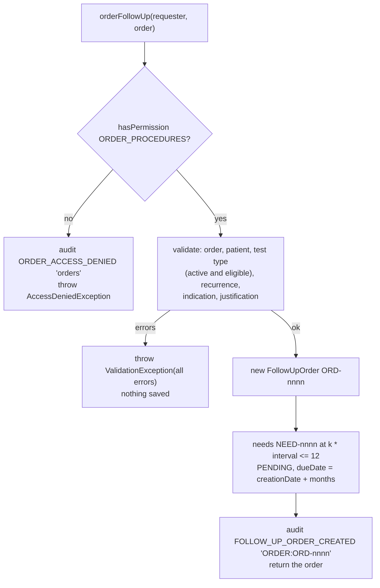

# Plan – UC07 – Server (#71)

| | |
|---|---|
| **Sub-issue** | #71 *UC07 – Server (C4 v1.1.0)* · branch `feature/UC07-server`, created from `feature/UC06-server` (`b156b9a`) because UC06 is still in review (#202) |
| **Use case** | #69 *UC07 – Order periodic follow-up procedures (C4 v1.1.0)* · FR07 · component C4 1.1.0 (`server-c4-orders`, `agents/components.md:36`) |
| **Specification** | #71, #69; flow of UC07 in `doc/AN-C4-DECISIONS.md:44-60`; D-036, D-037, D-039, D-040 of `DECISIONS.md`; D31 and D33 of `doc/AN-C4-DECISIONS.md` |
| **Design** | `doc/design/common/C4-common.puml` (`FollowUpOrder`, `orderFollowUp`) and `doc/design/C4-server-design.puml` (`Control_OrderFollowUp`, notes N2 and N3), merged in pull request #201 |
| **Plan approved by** | Ignacio Romero Torres, 23/11/2026 (he asked for the plan and delegated the review to the members: Javier for Implementation and Adam for Testing) |

## Decisions already taken
- **Contract:** exactly the design of #201: `FollowUpOrder extends ClinicalOrder` with `recurrenceIntervalMonths` (`int`), and
  `FollowUpOrder orderFollowUp(String requester, FollowUpOrder order) throws AccessDeniedException, ValidationException` in
  `IClinicalOrderService`. No other operation changes.
- **D-040:** a follow-up order generates, when it is created and without a timer, the scheduling needs of the next 12
  months; with an interval of six months there are two. They stay `PENDING` in `getPendingSchedulingNeeds()` for C5, and
  if the follow-up continues the physician creates another order.
- **D-039:** orders are never edited or cancelled; the follow-up order is a new order.
- **Permissions:** `ORDER_PROCEDURES` for `PHYSICIAN` already exists in C1 1.2.4 (#173); `getPatient` (C3) and
  `getTestType` (C2) already accept it (#174, #175). C2 returns the test type even when it is deactivated or not
  eligible, so C4 checks `isActive()` and `isFollowUpEligible()` itself.
- **Tests are Adam's** (rule 17, D-034): nobody in this plan writes, edits or deletes a test. The plan lists what has to be
  covered in *State for Adam*; the tests go in `feature/UC07-server-tests`, which forks from this branch, as UC06 did.
- **Not in this plan:** the client of UC07 (#70), UC08 (Iteration 9, D-013), seed data and any change in C1, C2, C3 or C5.

## Questions and answers
Answered by the approval of this plan; the proposals are accepted as written.
- **Q1 – Versions (rule 9).** **A:** `common` goes from `1.6.0-SNAPSHOT` to `1.7.0-SNAPSHOT` (a class and an operation
  are added: MINOR, D-036) and `server-c4-orders` from `1.0.0-SNAPSHOT` to `1.1.0-SNAPSHOT` (one use case: MINOR, D-014).
  Both versions are changed in the module pom and in the `<dependencyManagement>` of the parent.
  **Superseded:** `common` is now `1.8.0-SNAPSHOT`, changed in UC13-server (#208, `b040e99`); the `1.7.0-SNAPSHOT` of
  this step is the base of that change, not the current version of the branch.
- **Q2 – `FollowUpOrder`.** **A:** a data class with no logic, like `DiagnosticOrder`: it adds `recurrenceIntervalMonths`
  and its getter, and inherits everything else from `ClinicalOrder`. The server gives the `orderId`, the `requester` and
  the `creationDate`; the interval is the number of months between one procedure and the next.
- **Q3 – Validation of `orderFollowUp`.** **A:** first the permission `ORDER_PROCEDURES` (no call to C2 or C3 when it is
  denied); then every error together in one `ValidationException`, in this order: order, patient, test type, recurrence
  interval, clinical indication, justification. Messages:
  - `"The order is required"`
  - `"The patient is required"` · the message of C3 when it does not exist (`"There is no patient with the id X"`) ·
    `"The patient X is not active"`
  - `"The test type is required"` · the message of C2 when it does not exist (`"There is no test type with the id X"`) ·
    `"The test type X is not active"` · `"The test type X is not eligible for follow-up"`
  - `"The recurrence interval must be a positive number of months"`
  - `"The clinical indication is required"` · `"The justification is required"`
- **Q4 – Scheduling needs (D-040).** **A:** for an interval of `n` months the service creates one pending need with
  `dueDate = creationDate.plusMonths(k * n)` for every `k >= 1` with `k * n <= 12`; so 6 gives two needs (month 6 and
  month 12), 1 gives twelve and 12 gives one. The ids are `NEED-0001`, `NEED-0002`… of the same counter that UC06 uses.
- **Q5 – Ids and date.** **A:** the follow-up orders take the same counter as the diagnostic ones (`ORD-0001`, `ORD-0002`…),
  and `creationDate` is today's date of the `Clock` of the service, as in UC06.
- **Q6 – Audit.** **A:** a created order is `FOLLOW_UP_ORDER_CREATED` with the resource `ORDER:<orderId>` (note N2 names
  it); a denied attempt is `ORDER_ACCESS_DENIED` with the resource `orders`. The needs are not audited: N2 only names the
  creations of orders, as in UC06.
- **Q7 – Reads.** **A:** no change: `getOrdersOfPatient` already returns diagnostic and follow-up orders; a follow-up order
  is a `ClinicalOrder` and the client reads the interval with an `instanceof FollowUpOrder`, as it does with the priority.
- **Q8 – Steps and commits.** **A:** 1 poms and `common` (`FollowUpOrder` and `orderFollowUp`); 2 the service
  (`orderFollowUp`, `validateFollowUp`, `createFollowUpSchedulingNeeds`); 3 `agents/` and this plan; 4 hand over to
  Testing. One step = one commit, and code commits carry the body "Tests pending Adam (#71).". Then the branch
  `feature/UC07-server-tests` with the design and the tests, as with UC06.

## Review of the Testing (23/11/2026)
- **Line over 120 characters.** The Javadoc of `orderFollowUp` (`IClinicalOrderService.java:34`) had a line of 121
  characters; step 5 wraps it, with no change of behaviour.
- **Interval of 13 months or more — open question for the team.** With `n > 12` there is no `k >= 1` with `k * n <= 12`,
  so the order is accepted and creates **no** scheduling needs; the spinner of the client allows up to 120 months, so a
  physician can reach it. Should the order be rejected, or accepted with zero needs? D-040 only says "the needs of the
  next 12 months". Nothing is implemented until the team decides (rules 1 and 2).

## Files
| File | Action | What | Step |
|---|---|---|---|
| `common/pom.xml`, `pom.xml` | change | `common` `1.7.0-SNAPSHOT` (superseded by `1.8.0-SNAPSHOT`, #208) and `server-c4-orders` `1.1.0-SNAPSHOT` (Q1) — **rule 9** | 1 |
| `server/c4-orders/pom.xml` | change | `1.1.0-SNAPSHOT` (Q1) — **rule 9** | 1 |
| `common/.../common/orders/domain/FollowUpOrder.java` | create | the entity of the design (Q2) | 1 |
| `common/.../common/orders/contracts/IClinicalOrderService.java` | change | `orderFollowUp` (Q1, Q3) | 1 |
| `server/c4-orders/.../server/orders/service/ClinicalOrderService.java` | change | `orderFollowUp`, `validateFollowUp`, `createFollowUpSchedulingNeeds` (Q3-Q6) | 2 |
| `agents/architecture.md`, `agents/components.md` | change | versions only (Q1) — **rule 9** | 3 |
| `doc/plans/UC07-server.md` | create/update | this plan | 3 |
| `common/.../common/orders/contracts/IClinicalOrderService.java` | change | wrap the signature of `orderDiagnosticProcedure` (review) | 5 |

No other file changes: nothing under `src/test` (rule 17), nothing of `client/`, of C1, C2, C3 or C5, no `DECISIONS.md`.
Every class and public method has its Javadoc in English (rule 18); the methods with `@Override` have none.

## How the pieces fit

## Verification
- [x] Every acceptance criterion of #71: a follow-up order is created only for a test type eligible for follow-up and an
      active patient; it generates its needs from the recurrence interval without any action of a person; every
      operation checks the permission and is audited (checked with Adam's tests TC07S-01 to 36, `OrderFollowUpTest`,
      in `develop` since #205; reviewed by Implementation on 25/11/2026).
- [x] `mvn -B verify` green (`common` keeps at least 80 % of lines and 70 % of branches). On 25/11/2026, `develop`
      (`4f0dbab`): `BUILD SUCCESS` in the 14 modules, all coverage checks met, with the tests of Adam in
      `server-c4-orders`.
- [x] The 44 cases of UC06 still pass: with the tests of UC06 in `develop` (#203 and #222) the same build is green.
- [x] The CI of the pull request is green (#205, job `build`: success).

## Status
- **In progress:** nothing; steps 1 to 6 are done and the pull request #205 was merged on 24/11/2026.
- **Done:** `3891ee9` step 1 (`common` `1.7.0-SNAPSHOT`, raised to `1.8.0-SNAPSHOT` in #208, `server-c4-orders`
  `1.1.0-SNAPSHOT`, `FollowUpOrder` and
  `orderFollowUp`), `b6d1e74` step 2 (`orderFollowUp`, `validateFollowUp`, `checkFollowUpTestType` and
  `createFollowUpSchedulingNeeds`); `6c85236` step 5 (the Javadoc of `orderFollowUp` under 120 characters).
- **State for Adam (Testing):** the tests of `server-c4-orders` are in `develop` (#203, #222 and #206; `OrderFollowUpTest` has 28 tests). At the time of this plan the module had no tests, so JaCoCo skipped it, and the coverage of `common` was 200/239 lines and 14/14 branches. The cases to cover were: permission denied (with `ORDER_ACCESS_DENIED`), the ten messages of Q3, the order created with `ORD-nnnn` and `FOLLOW_UP_ORDER_CREATED`, the needs of D-040 for an interval of 12, 6, 5 and 1 months (one, two, two and twelve needs, `dueDate = creationDate.plusMonths(k * interval)`, all `PENDING`), that the diagnostic counter and the follow-up counter are shared, and that the follow-up orders appear in `getOrdersOfPatient`.
- **Next step:** none. Step 6, the rejection of the interval of 13 months or more, is done (`6e8dd58`); the client
  (#70) was merged on 24/11/2026.
- **Interval of 13 months or more: decided by David on 24/11/2026.** `validateFollowUp` rejects it with `The
  recurrence interval cannot be more than 12 months`, in the same format as the message of 0 months, and the screen
  keeps its spinner from 0 to 12 (TC07C-17 and 18), so the client adds no check of its own: it would be unreachable
  from the spinner and untested (rule 5). Testing covers the rejection in the service (TC07S-35 and 36) and Adam
  fixed that text, proposed by Implementation and confirmed by him; the final wording is Design's (#219).
- **Last update:** 25/11/2026, Javier — Verification boxes ticked with the build of `develop` and the CI of #205, and
  the status brought up to date (no code changes). Before: 24/11/2026, Ignacio — step 6: the service rejects an
  interval of more than 12 months.
